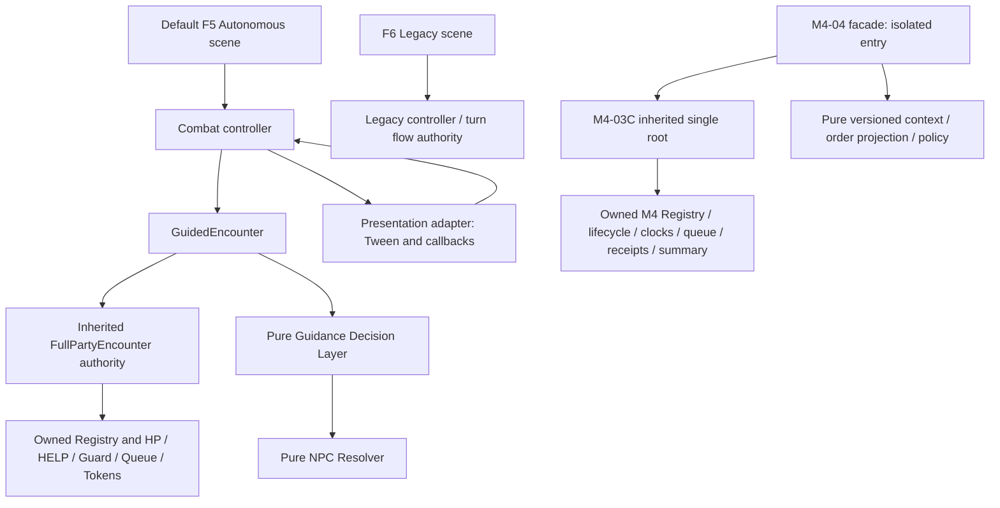
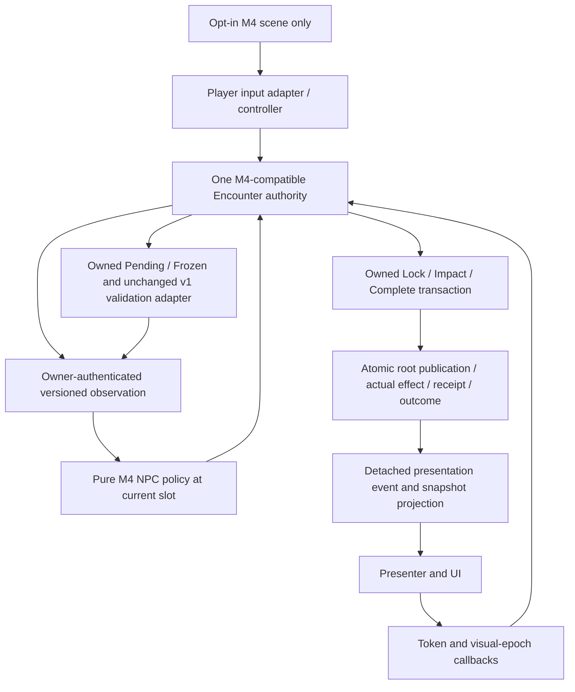

# M4-05A — Playable Integration Contract & Owner Decision Gate

**DESIGN ONLY — G05 directions and T05-01–06 Option A OWNER APPROVED.** [Current Owner selection/preflight](#22-t05-owner-selections-and-current-task-preflight), [delegated E1–E3 package](#23-e1e3-technical-resolution-and-compatibility), [benchmarks/recovery](#24-e4-benchmarks-and-e5-failed-close-recovery) and [E6 schema corrections](#25-e6-recursive-schema-audit-and-explicit-corrections) govern this gate. Expanded technical details are **DELEGATED TECHNICAL CHOICE / INDEPENDENT REVIEW PENDING**, not personal Owner selections. §§17–21 preserve the PR #57 approval/proposal checkpoint; their T05-pending wording is historical. No runtime implementation authorization is granted.

[Milestone authority](README.md#current-status-and-next-roadmap) remains the documentation index. [M4 architecture](M4_Down_Help_Death_Retreat_Architecture.md) and its historical A01–A39 matrix remain unchanged. [M4-04 §2.1](M4_04_Autonomous_Decision_Contract.md#21-owner-subdecision-approval--current-authority) retains approved isolated O1-A/O2-A/O3-A/O5-A; this proposal does not widen those approvals. Old Draft/NOT STARTED labels in historical records are not current milestone status.

## 1. Canonical preflight and evidence boundary

**Historical PR #56 preflight; current task preflight is in §22.**

| Check | Observed result on 9 November 2026 |
|---|---|
| Repository / canonical | `shanwinder/wanderer` / `visual-combat-test-1` |
| Required, initial local, fetched, live canonical and merge-base | All `7ce51cd0695d844ca8e7c085ab592bd9108b1e01` |
| Prerequisite | [PR #55](https://github.com/shanwinder/wanderer/pull/55) MERGED; merge SHA exactly matches required canonical; merged 10:15:27 Asia/Bangkok; former delivery HEAD `4babe132b84e9412a27391d11a1d98ea4779962d` |
| Squash ancestry | Canonical commit has PR #54 canonical as its single parent; PR #55 metadata records seven feature commits and the one canonical merge commit |
| Cleanliness / duplicate check | Initial working tree clean; fetched branches and open PR search found no M4-05A work; unrelated #2/#17 remain open Drafts, untouched |
| Task branch | `codex/m4-05a-playable-integration-design`, created from exact required SHA |
| Commands / source | `git status --short --branch`, `git fetch origin`, `git rev-parse HEAD origin/visual-combat-test-1`, `git merge-base HEAD origin/visual-combat-test-1`, `git branch -a`, `git ls-remote origin refs/heads/visual-combat-test-1`; live GitHub PR metadata/open-PR search |
| Access retry | Initial sandbox fetch could not write Git metadata and initial live lookup lacked DNS; approved elevated retries succeeded before branch creation |

**Inherited verification, not a new M4-05A run:** [PR #55 post-rebase record](../tests/actors/evidence/m4-04/post-r54-rebase.json) names Godot `4.7.2.stable.official.ed1daf0bf`, executable `/Applications/Godot.app/Contents/MacOS/Godot`, tested source `abb0727a892127d4b43f880af5890d68859d7f86`, original focused source `6187a4ff6dea0a5a983c21171e92db53eff6cd63`, exact full verification commands, expected/actual, exits and archive references. Recorded expected and actual: canonical 88/88 and candidate 94/94 stages; focused 128 cases / 458 assertions; 0 unexpected errors/timeouts, five expected negative errors separately; Legacy 6 cases / 5,892 identical frames. These results are attributed to those tested sources, **not** a fresh execution on squash SHA or this design HEAD.

The 128-case record separates 121 pure-policy cases, five owned-transaction cases, one diagnostic and one blocked-dependency case. Real ATTACK/RESCUE/RETREAT examples are M404-124/125/126. M404-128 is a real serial Enemy second-hit SKIPPED case, not arbitrary external mutation during an action. See [coverage](../tests/actors/evidence/m4-04/coverage.json), [case index](../tests/actors/evidence/m4-04/case-index.json) and [post-rebase scenarios](../tests/actors/evidence/m4-04/post-r54/m4-04-scenarios.json). Partial/blocked design rows are not promoted to PASS. No Godot, import, parse, headless startup, gameplay, GUI, keyboard or visual acceptance was run for M4-05A.

## 2. Current architecture — inspected facts



Arrows to pure modules are computations, not additional mutable owners. M4-02 is the earlier standalone RESCUE/Clock proof; C integrates its approved semantics in C's own root and pure transition rules, **not** by wrapping a live M4-02 Encounter. Likewise M4-04 extends C directly, not production FullPartyEncounter.

| Domain / inspected sources | Implemented now | Playable integration gap |
|---|---|---|
| [Autonomous scene](../scenes/combat/combat_autonomous_optin.tscn), [Legacy scene](../scenes/combat/combat_prototype.tscn), [controller](../scripts/combat/combat_prototype.gd) | F5 inherited scene selects autonomous session; controller instantiates GuidedEncounter, owns UI drafts and visual views; Legacy uses its own original combat flow | Existing controller expects production dictionaries, token phases, command-ready and binary result UI; it is not an M4 adapter |
| [GuidedEncounter](../scripts/combat/guided_encounter.gd), [FullPartyEncounter](../scripts/combat/full_party_encounter.gd) | One inherited Registry, HP, HELP/Guard ledger, pending queue, action token, command, Pending/Frozen Guidance and fixed profiles; Guided override locks per-slot decision report | No M4 LifeState/episode/clock/terminal summary; underscore-field coupling prevents blind substitution |
| [Resolver](../scripts/npc/npc_decision_resolver.gd), [Layer](../scripts/npc/guidance_decision_layer.gd), [Guidance data](../scripts/npc/guidance_data_contract.gd) | Exact validated shapes; first still-valid declared self-hit Safety; living Player HELP≤30%; causal FOLLOWED/MATCHED_INDEPENDENTLY/REFUSED | Resolver returns PLAYER_DEFEATED at Player HP0; v1 has no RESCUE/RETREAT guidance type; cannot fake positive HP to reuse it |
| Production commands and actions | Player ATTACK/DEFEND; NPC independent decisions at their slots; Player→NPC1/2/3→Enemy order; fallback before Player ATTACK lock; resolve then complete exactly once | No Player RESCUE/RETREAT input contract; no player-less round admission; M4 queue API and token schemas differ |
| Production HELP/Guard/terminal | NPC HELP heals living Player up to +4/maxHP, consumes own one use only on positive heal; DEFEND reduces Enemy hit by 2, minimum1; Player Guard covers round, NPC Guard next hit; round-end clears guards. Player HP0→DEFEAT before checking no enemies; else no living Enemy→VICTORY | No DOWN continuation; cannot retain production terminal evaluation in an M4 authority |
| [M4-01 actor](../scripts/m4/isolated_actor_state.gd), [M4-02 owner](../scripts/m4/isolated_rescue_clock_encounter.gd) | Party ALIVE/DOWN/DEAD and PRESENT/RETREATED valid pairs; RESCUE HP1 with episode/resource binding; B2 entry grace, subsequent round-close ticks/death | Earlier standalone proof APIs are not production controller hooks; no UI or conscious consent |
| [M4-03C owner](../scripts/m4/m403_terminal_encounter.gd), [rules](../scripts/m4/m403_terminal_rules.gd), [queue](../scripts/m4/m403_queue_adapter.gd) | One root/publication; seed/journal replay validation; finite plan admission; ATTACK/RESCUE/RETREAT Lock/Impact/Complete, real receipts/dispositions; witnessed seal/close; atomic terminal freeze; Abort/Restart | Capability is fixture authority; not production input authorization. HELP/Guard absent; no dynamic unlimited round generator; Restart rejects SEALED |
| [M4-04 facade](../scripts/m4/m404_decision_facade.gd), [context](../scripts/m4/m404_decision_context.gd), [policy](../scripts/m4/m404_autonomous_decision_policy.gd), [episode projection](../scripts/m4/m404_episode_order_projection.gd) | Exact12/exact8 isolated context/output, owner-equality binding, generation-wide replay-derived episode ranking; O1/O2/O3 priorities; supported decisions delegate to C transactions | Live context publishes null HELP uses and null Frozen/Profile. Unknown HELP is not zero: relevant priority blocks. DEFEND/HELP effects blocked. Production D09 is absent |
| [Presenter](../scripts/combat/combat_presentation_adapter.gd) | Visual epoch; time/phase/identity checks; impact callback returns effect feedback; return-home before completion; no owned HP | Current generic HELP/SKIP branch does not define RESCUE/RETREAT/DOWN/DEAD visuals; outcome and lifecycle UI need reviewed mapping |

**Critical compatibility differences:** production damage Player/NPC/Enemy = **5/1/3**. M4-04 facade locks NPC ATTACK with **5**, and blocks target maxHP<5. C accepts fixture-bound attack amounts; it is not production damage policy. Preserve both existing implementations; G05-01 must select a versioned playable damage provider (recommended 5/1/3 to preserve accepted playable balance) before B. Do not silently change M4-04's isolated tests/constants or claim identical balance. C also declares each Enemy's target as first active Party at admission; production can supply scenario declarations. Target fallback/declaration mapping, finite-plan exhaustion and full-history replay cost require bounded review.

## 3. Proposed playable architecture and single authority



**PROPOSED invariant:** an opt-in session has exactly one mutable combat authority. HP, LifeState, participation, episodes, resources, Guard, queue, declarations, tokens, receipts, clock and terminal summary belong to that authority. Guidance and command admission live within its validated lifecycle domain. Pure replay scratch data, UI text caches and snapshots do not become writers. No live FullPartyEncounter inside an M4 Encounter, no two Registries synchronized by signals, no mirrored queue in the controller. Default F5 and Legacy sessions remain separate existing paths, never concurrent owners of the opt-in battle.

Preferred implementation shape: an M4-compatible authority extension with reviewed versioned rules and adapters, preserving isolated modules/tests. Whether a subclass can satisfy new ledger/journal schema without compromising replay is a **dependency**, not a promise. B must demonstrate a single publication seam and full reconstruction of new operations. If this requires changes to core C validators, provide a reviewed versioned extension rather than bypassing them or passing new fields to old exact validators.

**PROPOSED flow:** Player selects own ATTACK/DEFEND and independent Guidance draft → input adapter validates identity/readiness → Encounter accepts Guidance and admits actual Player command at proper boundary → owner advances queue → current NPC observes one revision → pure policy returns candidate/reasons → owner revalidates and locks supported choice → presenter shows locked intent → impact callback requests actual transaction → owner publishes effect/outcome atomically → view maps actual result → return animation → completion requests one owned receipt → owner advances or closes. For Player DOWN, admission uses an explicitly approved autonomous continuation operation, not a proxy command. Animation timing never authorizes an otherwise invalid effect.

**PROPOSED single-owner / no-fake-receipt proof plan:** inspect the opt-in object graph and instrument its publication seam: one active root/Registry owns each battle; controller/presenter retain no writable HP/queue/ledger. Mutating detached nested snapshots must leave the complete owner root unchanged. For ATTACK/RESCUE/RETREAT and approved HELP/DEFEND, record pre-lock, post-lock, post-impact and post-completion roots, authorization identity, journal operation and receipt set. Policy/read/lock alone produces no receipt; impact changes only the authorized effect/resources; accepted completion adds exactly one authentic receipt and one disposition. Rejection must preserve the entire root; cancel/Restart must not fabricate progress. Inject failure before publication to prove atomicity, and prove summary/receipt imports are rejected. These are B proof requirements, not results from inspecting this design.

## 4. Proposed versioned input/output adapter contract

Names below are design names, not implemented APIs or approved wire schemas. Exact recursive schemas, rejection precedence and replay journal additions must be reviewed before B implementation. Use a separate `M4PlayableAdapter v1` namespace; do not widen Guidance v1 or pretend that `owner_kind=M403_ISOLATED` authenticates a production owner.

| Boundary | Proposed inputs / provenance | Output / rejection contract |
|---|---|---|
| Session/bootstrap | Validated bounded fixture, stable retained IDs, separately held authority capability; explicit selected mode/version | One session/generation and owner-issued read view; malformed fixture leaves whole old session unchanged |
| Player command | Version, current session/generation/round/queue/expected state revision, request ID, actual Player ID, ATTACK/DEFEND and target | Admission status and accepted Player command identity; reject NPC actor IDs, unavailable Player, stale/duplicate request, busy/terminal state; no writes on rejection |
| Guidance | Unchanged exact8 v1 request via separate adapter; issuer bound to owner Player and command-ready state | Existing accepted/rejected semantics and Guidance revision; accept alone remains Pending if command admission fails; no M4 fields injected |
| NPC observation/decision | Single owned revision, real eligible slot/opportunity, episode order from authenticated history, HELP/RESCUE ledgers, immutable owner-bound Frozen/profile | Versioned candidate, exclusions and causal relation; recompute/equality validate before lock. No caller-selected NPC action or injected resource/binding |
| Transaction | Owner-built lock request; complete unmodified owned token for impact/complete/cancel; no caller result/amount override | Actual APPLIED/SKIPPED/rejected state and authoritative effect data; receipt only from accepted completion; token schema distinct from Main's token |
| Presentation view | Version, session/generation/round, state revision, action identity/phase, actor/target IDs, locked decision/relation, actual effect, lifecycle/resource snapshot, frozen outcome identity | Detached data; UI may display intent before effect but positive feedback only after APPLIED. Rejected callbacks produce no hit/heal/guard/receipt |
| Round/terminal | Owner admission, dispositions, genuine completed receipts, witness/event identities; immutable outcome ID | Natural close once or terminal/administrative stop; retained Party lifecycle and separate Enemy availability summary; not a controller-derived win/loss |

Request IDs are deduplication identities, not capabilities. UI is not allowed to invoke fixture mutations, import receipts/witnesses, alter state snapshots, choose an NPC target, or set command-ready. Proposed private adapter bookkeeping may retain token/visual correlation only; it cannot manufacture gameplay authorization. Legacy APIs remain unchanged. Test malformed versions/types/extra keys/mixed identities/caller-modified snapshots before accepting any new adapter.

## 5. Proposed lifecycle, token ownership and round admission

| Phase | Owner responsibility | Controller/presenter responsibility |
|---|---|---|
| Before lock | Validate real slot, actor/target eligibility, current revision, capability and policy; fallback only at approved pre-lock selection point | Display available commands/draft; never pop a second queue |
| Locked | Issue immutable token with session/G/R/Q/slot/action/actor/target/episode/authorization and lock revision; reserve one active action | Retain exact token and visual epoch; show intent/reason without claiming effect |
| Impact | Revalidate live actor/target/episode/use and exact token; atomic effect + resource + outcome if required; otherwise actual SKIPPED, or protocol rejection with no mutation | Forward token; show real delta and LifeState; preserve original decision reason separately |
| Completion | Only APPLIED/SKIPPED action completes; exactly one receipt/disposition/cursor handoff; causal terminal token alone may settle frozen outcome | Return to saved home; forward completion once; do not write a receipt or advance independently |
| Cancel / abort | Pre-impact cancel and its disposition are not effect/receipt; administrative abort uses genuine owned authority and freezes without tick | Kill corresponding visual callbacks; no success animation or invented completion |
| Natural close | DRAINED, no outstanding work, real progress, active sides, authenticated seal witness; close batch once, then admit a reviewed next round | UI timer/animation-end cannot tick clocks; display close results from owner |

**PROPOSED finite playable boundary:** retain a finite reviewed round plan for the first proof, with initial/next-round command admission distinct from preparation. If plan exhausts or no real progress prevents seal, display the owner's diagnostic as a bounded-proof stop; do not call it victory/defeat, invent a receipt, spin or synthesize rounds. Review exact proof duration, continuation admission and controlled recovery under G05-01/G05-03. An unbounded production scheduler is deferred. No disposed Player/NPC slot is reinserted after RESCUE; an actor may use an existing not-yet-disposed slot only under its legitimate command/policy rules.

## 6. G05-02 — proposed HELP / DEFEND effect bridge (O6)

**Option A direction OWNER APPROVED in §17; exact ledger/journal/cleanup details remain PROPOSED under T05-03/06.** Extend the single authority with the smallest replay-validated HELP ledger and Guard ledger; do not execute these through FullPartyEncounter as a second engine. Bootstrap grants one HELP use per eligible NPC identity for the encounter and records provenance in the owner seed. Reads, copies, candidates and UI badges grant nothing; caller-provided `help_uses` rejects. HELP and RESCUE have separate ledgers and transaction kinds.

| Contract point | Proposed owner-controlled behavior |
|---|---|
| HELP selection / lock | Existing rule: NPC helps **living ALIVE/PRESENT Player** at HP≤30%, own use1; no NPC-to-NPC ordinary HELP or Player HELP command added. +4 capped at maxHP; never heal DOWN/DEAD or RETREATED actor |
| HELP impact | Validate same eligible helper, living/present Player, retained target and available use. Preserve production locked-effect rule: threshold chooses the action at slot; impact checks target availability/non-full HP and use, not a new threshold-based cancellation. Atomic positive HP delta + use1→0 + journal effect; no use on rejection/SKIPPED |
| RESCUE separation | Existing distinct DOWN episode, eligible Party helper/use and HP1 effect; HELP cannot retire a DOWN episode, spend rescue use or be relabelled RESCUE |
| DEFEND lock / impact | Self-target Player or NPC only through its rightful command/decision slot. Atomic owned Guard grant; zero HP delta is valid **Guard effect**, not fake damage/heal. No consumable HELP/RESCUE charge |
| Guard damage | Enemy damage reduction2/min1. Player Guard persists for Enemy hits that round; NPC Guard consumed by next qualifying Enemy hit. Normal round end clears Guard; repeated grants do not stack. Damage + guard consumption + DOWN/terminal consequences publish together |
| New lifecycle cleanup requiring approval | PROPOSED clear an actor's Guard when DOWN/DEAD/RETREATED, and clear remaining Guard on terminal/Restart; RESCUE does not restore a removed Guard. This is an M4 extension, not a claim that isolated C already owns Guard |
| Completion / rollback | Impact commits effect once; accepted Complete creates real receipt. Duplicate completion adds none. Pre-impact cancellation uses real disposition and spends nothing. Failure before atomic publish leaves HP/ledgers/journal/revision unchanged; never refund an already committed effect merely because animation is cancelled. Restart resets a new generation, not historical rollback |

Required O6 dependencies: versioned root/seed/journal/replay validation for both ledgers, lock/token/impact/complete operations, actual effect projection, Guard expiry/consumption and failure-injection proof. A token or pure `selected=HELP/DEFEND` is not an effect receipt. Any unsupported transition must remain blocked, not bypass replay validation.

**Historical alternative B — not selected by the Owner:** keep O6 blocked and demonstrate only supported ATTACK/RESCUE/RETREAT in explicitly labelled fixtures. Safety can select DEFEND and stop on missing effect bridge; unknown live HELP can block before nonurgent RESCUE. Never set HELP uses to zero to force fallback or silently turn DEFEND into ATTACK. Show “blocked dependency” and allow approved stop/Restart. Such a delivery cannot claim complete D08 priority execution or full playable acceptance; paired pure-policy examples remain separate. Owner must accept this reduced scope explicitly.

## 7. G05-03 — proposed Player DOWN and terminal migration

All rules in this section apply only to the proposed opt-in path after approval. Default Main retains Player HP0→DEFEAT. Preserve M4 Party valid pairs and Enemy HP-only availability.

- Player HP0 becomes DOWN/PRESENT, creates the authentic episode, loses command/Guidance eligibility; NPC/Enemy queue continues while outcome ACTIVE. DOWN does not itself mean DEFEAT if another ALIVE/PRESENT Party actor remains.
- NPC RESCUE Player or another NPC commits HP1/ALIVE, retires the exact episode, consumes helper rescue use once. DEAD and RETREATED cannot act or receive RESCUE; re-DOWN is a new episode/order. DOWN has no conscious active consent/refusal in this scope.
- RESCUE restores eligibility, not a consumed opportunity or old Player command. Player input resumes only at next valid command-ready boundary with new round/generation identity and fresh accepted input. Running-round Player slot without a legitimate accepted command must not be auto-filled; its disposition/admission rule is a G05-04 dependency.
- Natural round-close clock uses B2 entry-round grace; next valid close B1; following close B0→DEAD. No animation-time ticks, terminal ticks, Abort ticks or duplicate-close ticks. Strict seal requires active sides; clock-caused terminal is unreachable in the current strict model and remains a consistency check, not a required fabricated demonstration.

Carry forward [C classifier](../scripts/m4/m403_outcome_classifier.gd) precedence for opt-in review, without changing it silently. P = ALIVE/PRESENT Party count, E = HP-positive Enemy count, R = ALIVE/RETREATED Party count; N = initial Party size:

| Condition, in precedence order | Outcome / display |
|---|---|
| P>0, E>0 | ACTIVE; continue legal slots |
| P>0, E=0 | VICTORY; may include DOWN Party members in summary |
| P=0, R=N | PARTY_RETREAT |
| P=0, 0<R<N | MIXED_WITHDRAWAL; display those left DOWN/DEAD separately |
| P=0, R=0, E=0 | DEFEAT / MUTUAL_INCAPACITATION |
| P=0, R=0, E>0 | DEFEAT / NO_ACTIVE_PARTY |

Last-Party exit and last-Enemy hit freeze actual outcome plus summary atomically at effect; terminal causal token may finish once, later slots stop, no natural close is fabricated. No active helper means no post-terminal rescue window. Summary lists each initial Party ID exactly once with LifeState/participation/final episode relation, and each Enemy once with HP/availability; Enemy HP0 is not labelled DEAD. No permanent save/aftercare fate is inferred. Administrative ABORTED and plan-exhaustion diagnostics stay distinct from combat outcome.

## 8. G05-04 — proposed Guidance and Player command integration (D09)

Preserve Guidance v1 exact8: `schema_version`, `guidance_type`, `issuer_player_id`, `preferred_target_id`, `encounter_id`, `generation`, `round_id`, `expected_guidance_revision`. Types stay NONE/ATTACK/DEFEND/HELP/FOCUS_TARGET. FOCUS names an Enemy preference; HELP does not mean RESCUE. No NPC command input, fake Player HP, proxy Player, new Compassion effect or trait weighting.

Preserve [R1 Option A](../tests/npc/README.md#r1-option-a--current-m3a-04-contract): accepted submit (including identical content)+1; successful existing preferred-Enemy removal invalidating Pending FOCUS+1; reads/rejects/HP0/unrelated removal/freeze/round completion/terminal do not increment; Restart new generation/revision0. Retained DEAD/RETREATED IDs are not unregister events. State revision and Guidance revision remain distinct. No new lifecycle revision counter is smuggled into v1.

**PROPOSED production integration adapter:** owner binds session↔encounter identity explicitly, obtains Frozen/profile from its own store at a coherent current state revision, and supplies a separate versioned M4 observation. Existing exact isolated context validators cannot accept a new owner kind without a separately reviewed version. Delegate to unchanged v1 Layer only for genuinely compatible state (including supported roster, eligible Party and known authoritative HELP uses); otherwise use the reviewed M4 policy/relation mapping. Frozen data is an advisory historical record, never an execution grant. FOLLOWED requires a changed baseline/selected decision caused by compatible Guidance; identical independent choice is MATCHED_INDEPENDENTLY; priority refusal is distinct from request rejection or effect skip. Unsupported Guidance must be honestly NOT_APPLICABLE, never treated as consent.

| Player lifecycle / timing | Proposed command / Pending / Frozen behavior | Approval dependency |
|---|---|---|
| ALIVE/PRESENT before round | Fresh v1 submit accepted → Pending; actual successful admission alone freezes it. Failed command leaves accepted Pending visible; no pretend round start | G05-04 normal adapter/API mapping |
| Already DOWN at bootstrap or next boundary | No Player command or new Guidance; explicit autonomous admission with NONE for that round; still real NPC/Enemy opportunities | G05-03 continuation and G05-04 mapping of round preparation to admission |
| DOWN during running round after freeze | Disable commands; preserve Frozen and locked reason history for that round. NPC decides at own slot from real current state; DOWN alone no Guidance revision bump | G05-04 Frozen provenance and unsupported-state relation mapping |
| Rescued during running round | No command-ready reopening, Pending re-arm or reinsertion; preserve legitimate history, wait for next boundary | G05-04 disposition for any uncommanded Player slot; no proxy SKIP receipt |
| Next natural boundary, Player alive | Clear prior Active; new round identity and Pending NONE, then fresh request using current identity/revision | G05-04 exact round increment location: Main increments on finish; C advances on next open. Must increment once, not twice |
| Accepted Pending then external DOWN before begin | Recommended strict boundary: reject that producer atomically before life/Pending change; no same-identity invalidation. Forced diagnostic fixture stays outside command-ready flow even after HP1 | G05-04 exception gate; only valid new-generation Restart recovery for initial isolated exception, no fake round advance |
| DEAD or RETREATED Player | No new command/Guidance; other eligible actors may continue; no automatic return/revival | G05-03/G05-04; voluntary Player retreat UI remains deferred |
| Terminal / Restart | Clear Pending/Active under lifecycle contract; retain detached frozen summary until valid Restart; new G invalidates callbacks and input | G05-03/G05-06 Restart boundary review |

**Exceptional decisions still required:** legal pre-round external life producer; same-identity Pending invalidation/recovery (not approved, and any R1 extension needs its own task); accepted Player command losing eligibility before lock; Player rescued before a previously uncommanded undisposed slot; round admission when Player absent; exact compatibility/relation rules for non-v1 Party states; owner-bound Frozen/profile schema; FOCUS invalidation for future actual roster removal. Recommended bounded scope rejects unsupported producers and retains IDs. If Owner wants same-round re-entry or new Guidance types, defer them to a separately reviewed extension instead of implementing full D09 here.

## 9. G05-05 — proposed visual / user experience contract

Presentation is a data-only consumer of actual owner events. Visual choreography may anticipate **intent**, but success, HP changes, LifeState changes and resource use appear only from accepted effects. Never route RESCUE/RETREAT through an unknown-action generic branch and call it accepted animation.

| Owned state/event | Proposed visible feedback | Forbidden inference |
|---|---|---|
| ALIVE/PRESENT | Current HP, eligible state, selected/locked target cues; normal pose | HP-positive alone must not override participation/input gates |
| DOWN/PRESENT | Distinct down pose + text DOWN + actual budget/episode indicator; commands disabled for Player | Do not show DEAD, hide retained identity, or run a local countdown |
| DEAD/PRESENT | Distinct inactive/death presentation and DEAD text; no selectable rescue target | No ordinary heal/revival feedback or implied save-level permadeath implementation |
| ALIVE/RETREATED | Exit/retreat feedback then retained roster badge; absent from active target choices | Do not unregister, lose summary row or play death feedback |
| RESCUE locked / APPLIED | Intent names helper and DOWN recipient; success restores HP1/standing only on actual event, shows spent rescue use | No “+4 HELP” label or success before impact |
| RESCUE unavailable / rejected / SKIPPED | Explicit unavailable reason before lock; request rejection distinct from actual post-lock SKIPPED. Show original intent beside actual result | No fake heal, hit, resource debit or recipient-refusal wording |
| NPC RETREAT | Self-preservation reason and self action; exit only after actual effect; retained summary | No UI command forcing companion exit |
| NPC reasons / Guidance | Short Thai reason, baseline vs selected and FOLLOWED/MATCHED_INDEPENDENTLY/REFUSED/NOT_APPLICABLE from actual report; detail via keyboard-accessible log | Matching action is not proof of causal compliance; safety choice is not unconscious recipient refusal |
| HELP / Guard | Real heal amount or Guard grant/consumption/expiry; distinguish Guard effect from HP0 delta | A zero delta is not fabricated damage or a receipt |
| Terminal | Exact outcome + Party lifecycle and Enemy availability panels; causal action may finish, inputs stay locked | Do not collapse MIXED_WITHDRAWAL into victory or DOWN into DEAD |
| Restart | Clear old logs/intents/tokens/selection/summary as appropriate, reset transforms/labels from new owner snapshot, restore keyboard focus | No late old-generation visual/effect callback touching new state |

Preserve speed **0.70**, lunge **44px**, Compact Formation: NPC1 `(320,480)`, NPC2 `(405,435)`, NPC3 `(475,509)`, Player `(570,465)`, Enemy A `(970,506)`, B `(1100,424)`; actions return to saved home transforms. Any deliberate RETREAT hide/exit presentation must not shift the baseline homes. Timing/poses for new states require visual approval, not new gameplay timers. At 1280×720 provide visible keyboard focus, Tab/Shift-Tab navigation, normal activation keys, readable short Thai labels and keyboard-accessible full reasons; tooltips alone are insufficient. DOWN and terminal screens must leave Restart reachable.

## 10. G05-06 — proposed O7 interleaving and Restart safety

| Situation | Current legal basis / proposed boundary | Proof obligation |
|---|---|---|
| Mutation before Lock | Prior completed serial actions can change later slot state. Rebuild observation at slot, reject stale observed revision | Real sequence, compare selected target/episode and exact root; no cached round-start policy |
| After Lock, before Impact | C is serial; arbitrary external damage/heal/retreat producer is **unsupported**, not authorized by an animation delay | Reject unsupported producer/no mutation. If later approved, specify issuer/capability, journal/replay accounting, phase legality, impact revalidation and tests separately |
| Actual SKIPPED | Real serial first Enemy hit can make declared target unavailable before second Enemy action; C can lock that second declared hit and settle SKIPPED | Real token→SKIPPED→Complete receipt; do not describe it as external mid-action mutation |
| Pre-impact cancel | Owned cancel disposes opportunity; no impact/receipt | No resource/HP delta, no close based on fake progress |
| Callback cancelled by Restart | Valid owner reset advances generation; visual epoch changes and Tween/callables are cancelled | Inject old callback at windup/impact/return; no new-session mutation or feedback |
| Stale-generation callback | Token identity is rejected regardless of reused action number or visual state | Whole-root equality, no receipt/cursor/tick/UI effect |
| Duplicate impact/completion | Exact token phase/consumption permits once only | Two calls cannot double effect/use/receipt/advance |
| Frozen outcome | Only actual causal settled token may complete once; other work rejected/stopped; summary immutable | Terminal during effect plus late callbacks; no extra round close/tick or rewrite of summary |

**Restart nuance — PROPOSED:** validate reset before replacing the owner; after successful reset invalidate presentation epoch and render the new snapshot synchronously before any subsequent callback. Invalid reset preserves old state; do not cancel a real committed effect and invent its rollback. Current C rejects Restart in SEALED. Recommended B has synchronous owner-controlled seal→close with no await/UI callback between them; Restart requests are serviced after a legal close boundary. If that cannot be guaranteed, Owner must approve a genuine pre-issued Abort route or a separately reviewed reset extension. Do not bypass C's phase check, fabricate Abort authority or silently open a SEALED reset loophole. Test valid LOCKED/APPLIED/terminal reset and invalid SEALED reset separately; an always-responsive GUI promise remains unverified until B/C.

O7 closure requires a named **legal producer** and real history, not direct test writes to `_root`, a mocked receipt or pure altered snapshot. Pure diagnostics remain useful but cannot close a playable acceptance row. Unsupported producers remain dependency X7 below.

## 11. Owner decision register — approved directions

The authoritative exact approval record is [§17](#17-owner-approval-record--current-authority-9-november-2026). G05-01 Option A and G05-02 Option A are OWNER APPROVED; G05-03–06 are OWNER APPROVED DIRECTIONS. Earlier alternatives remain design history, not selected options. T05-01–06 Option A selections are now OWNER APPROVED in §22; §18 preserves earlier alternatives. Delegated material schema corrections require independent review; no runtime authorization is granted.

## 12. Dependencies, risks and rollback design

| Dependency | Unresolved work / risk | Proposed resolution boundary |
|---|---|---|
| X1 API / authority | C's fixture capability, strict seed/journal schemas and full replay are not reviewed production APIs; performance under GUI unknown | G05-01: versioned single-root extension and bounded performance evidence; no live wrapped Encounter |
| X2 balance / scheduling | NPC5 vs Main1, declared-target semantics, finite plan and Main-finish vs C-open round identity differ | G05-01/03/04: explicit playable provider recommendation5/1/3; preserve isolated5; stable order/pre-lock fallback and fixed per-round declarations; approve finite stop and admission. Dynamic scheduler deferred |
| X3 O6 | HELP provenance, Guard effect/consumption/expiry absent in C; new operations must pass replay | G05-02 A approved direction; T05-03/06 exact schema/transactions pending |
| X4 production D09 | Frozen/Profile live binding and command/Guidance APIs absent; exceptions could resurrect stale input | G05-04 adapter and strict exception rejection, no changed v1/R1 |
| X5 visuals | Current controller couples Legacy/Guided; generic presenter lacks explicit M4 choreography | G05-05 opt-in adapters/views and GUI/keyboard evidence |
| X6 Restart / round close | SEALED reset restriction; delayed callbacks; zero-progress/exhaustion cannot be forced through close | G05-03/06 legal synchronous close boundary or separately approved Abort/reset route |
| X7 O7 | No arbitrary mid-action external mutation producer in current serial model | Defer producer extension; prove supported serial/restart/duplicate cases honestly |
| X8 O4 / scope | Conscious consent/recipient refusal, new Player RESCUE/RETREAT commands, new traits, inventory/persistence/aftercare are absent | Separate decisions/tasks; do not expose disabled fictional functionality as completed |

**PROPOSED rollback:** opt-in selection is explicit and never changes `project.godot` default F5. On failed acceptance, stop opt-in rollout and retain existing Main/Legacy entry; do not migrate a live M4 state into FullPartyEncounter. A user chooses a fresh session through existing entry, no cross-owner HP/queue import. Keep new files isolated where possible and record any unavoidable shared diffs/tests; revert only the authorized integration change if later instructed. No automatic branch deletion, merge or promotion. Technical risk triggers HOLD: second authority, fabricated receipt, inability to authenticate resources/Frozen, changed baseline traces, unsupported mutation, unavailable reason/keyboard feedback, or unknown engine errors.

## 13. Proposed M4-05B implementation boundaries

B may begin only with recorded relevant G05 approvals, resolved blocking dependencies, reviewed exact API/task/file scope and **separate explicit implementation authorization**. This document is not that authorization.

Recommended bounded delivery: opt-in scene/path, one M4-compatible authority, player-only ATTACK/DEFEND command adapter (DEFEND only if O6 approved), independent NPC policy, actual supported transactions, explicit finite-round continuation, real state/reason/summary views and Restart safety. If O6 option B is selected, remove unsupported command/effect promises and label demo limitations; no “complete playable M4” claim. Keep current Main/Legacy, Guidance v1/R1, isolated proof modules/tests, combat baseline and all historical evidence unchanged unless a later reviewed scope explicitly permits a change. No full NPC AI, new traits, consciousness model, world lore, Speed Order/final Turn System, Player rescue/retreat UI, persistence, loot, management or Resonance.

Review in small steps: schemas/owner invariants → command and slot admission → supported decision/transaction adapters → real effect projection → lifecycle/terminal/reset → headless regressions → separate GUI acceptance. B evidence must name actual engine, tested commit, full command, expected/actual per scenario, exit/error classification, logs/results and source manifest. Run existing suite with fresh unique output:

```sh
python3 tests/combat/verify.py --godot /path/to/godot --output /tmp/wanderer-queue-check-unique
```

Use the applicable existing proof flags in [combat guide](../tests/combat/README.md) and [actor guide](../tests/actors/README.md), plus approved focused adapter coverage. Verify actual executable version 4.7.2; preserve import/parse/startup/gameplay/negative logs and results.json. Unexpected errors fail even exit0; expected five negative errors are separately accounted. Preserve A-first/B-first, dead-Enemy skips, living counters, one round completion, locks, target fallback, ATTACK/DEFEND/NPC2 Guard, terminal and Restart coverage. Never change tests/constants just to pass. Stop B at its requested review gate; no automatic C or cutover.

## 14. Proposed M4-05C acceptance matrix — all NOT RUN

C requires separately authorized **actual Godot 4.7.2 GUI inspection at 1280×720** and Owner review of the verified B candidate. Headless startup, this design, inherited isolated results and screenshots alone cannot establish pacing or owner comprehension. Record executable version, exact commit, command/entry, input sequence, expected/actual, logs and screenshot/video timestamps where useful. C gate includes baseline comparison, keyboard, animation and readable reasons. Production cutover requires a further explicit decision after B/C completion; **no automatic default F5 change**.

Every row is **PROPOSED / NOT RUN** for the future playable integration. “Current coverage” states inherited slices only; M404 numbers there refer to executed case IDs, while design-row coverage is in the linked coverage map. Required authority means runtime writer; Owner Gate column means approval needed. B = separately authorized implementation; C = visual/Owner acceptance; D = later production cutover.

| Scenario ID | Preconditions | Expected behavior (PROPOSED) | Required authority | Proof method | Current coverage | Dependencies | Owner Gate | Execution status |
|---|---|---|---|---|---|---|---|---|
| P05-01 Player DOWN continuation | Player receives legal lethal impact; NPC remains active; enemies active | DOWN, input off; real NPC/Enemy slots continue, no immediate Main-style defeat | M4 effect/queue owner | Legal headless trace + GUI state | C isolated lifecycle/queue only | X1/X2/X4/X5 | G05-01/03/04, B/C | PROPOSED / NOT RUN |
| P05-02 Rescue Player | Player DOWN B1 previous round, helper safe/use1, eligible NPC slot | NPC RESCUE before close→HP1, episode retired/use0, no reinserted command | Policy + owner rescue transaction | Real lock/impact/complete + GUI | O1 pure and M404-125 real rescue slice | X1/X2/X4/X5 | G05-01/03/04/05, B/C | PROPOSED / NOT RUN |
| P05-03 Rescue NPC | NPC DOWN, helper safe/use1; Player or other ally active | Ranked legal NPC target rescued without Player favoritism | Policy + owner episode/resource | Paired roster histories + GUI | O2 pure ranking; isolated rescue slices | X1/X2/X5 | G05-01/03/05, B/C | PROPOSED / NOT RUN |
| P05-04 Urgent vs nonurgent | Compare B1 previous, B2 previous/current; no safety | Valid B1 prior entry urgent; B2 nonurgent/grace; invalid B1 current rejected | Context/order/policy owner | Paired pure + actual transactions | O1-A/O2-A isolated coverage | X1/X2 | G05-01/03, B | PROPOSED / NOT RUN |
| P05-05 Safety first | First valid declared self-hit lethal/lowHP; rescuable ally | DEFEND before RESCUE; reason helper priority; real Guard if A, blocked if B | Policy + Guard owner | Paired decisions and actual hit consumption + GUI | Pure policy only; O6 blocked | X3/X5 | G05-02/05, B/C | PROPOSED / NOT RUN |
| P05-06 HELP before nonurgent | Living Player≤30%, NPC use1, nonurgent DOWN ally, no safety/urgent rescue | HELP selected over nonurgent RESCUE; no invented resource | Policy + HELP ledger owner | Paired priorities + real effect | Pure fixtures only; live HELP unknown blocks | X3 | G05-02, B | PROPOSED / NOT RUN |
| P05-07 NPC RETREAT | NPC≤30%, no higher priority, active Enemy | Actual self RETREAT; retained row and reason | Policy + C-compatible transaction | Real trace + GUI exit | O3 pure and M404-126 owned slice | X1/X2/X5 | G05-01/03/05, B/C | PROPOSED / NOT RUN |
| P05-08 Last Party / Enemy | Legal last-active retreat/down or last-Enemy hit; separate seed cases for ties | Exact precedence, atomic frozen summary; causal completion once | Terminal/summary owner | Legal sequences + pure tie classifier + GUI | C terminal proof; no simultaneous-hit claim | X1/X2/X5 | G05-03/05/06, B/C | PROPOSED / NOT RUN |
| P05-09 Actual HELP | O6-A approved; helper use1; living low Player | +4 capped, positive heal spends once; rejected/skipped spends none | HELP transaction owner | Boundary values, duplicate/fault injection + GUI | Production HELP exists, no M4 bridge | X3/X5 | G05-02/05, B/C | PROPOSED / NOT RUN |
| P05-10 Actual DEFEND | O6-A; Player and NPC Guard cases, repeated Enemy hits | Reduction2/min1; Player round vs NPC next hit; life/reset clears as approved | Guard/damage owner | Real grant/consumption/expiry + GUI | Production Guard exists, no M4 bridge | X3/X5 | G05-02/05, B/C | PROPOSED / NOT RUN |
| P05-11 Frozen before DOWN | Guidance accepted/frozen, Player later DOWN | Immutable Frozen/reason history, no revision bump; real M4 decisions | Guidance + lifecycle owner | Paired guidance/no-guidance trace + GUI | Pure bindings; no production D09 bridge | X4/X5 | G05-04/05, B/C | PROPOSED / NOT RUN |
| P05-12 Rescue and stale Pending | Old accepted Pending; normal next-round or isolated pre-round exception | No old Pending/Player command re-arm; exception producer rejected; fresh boundary required | Command/Guidance owner | Old request replay and root equality | Isolated diagnostic/unchanged R1 only | X4 | G05-04, B | PROPOSED / NOT RUN |
| P05-13 R1 revision safety | Submit same content, FOCUS removal, reads/rejects, DOWN/RESCUE, round/reset | Exact existing increment rules, no lifecycle revision trick; stale request rejects | Guidance owner | Existing suite plus adapter boundary cases | Existing Guidance regression only | X4 | G05-04, B | PROPOSED / NOT RUN |
| P05-14 Restart during action | WINDUP, post-impact RETURN, terminal causal lane; separate SEALED case | Legal reset new G; old callbacks inert; SEALED follows approved boundary, not bypass | Owner reset + visual epoch | Inject delayed callbacks + GUI repeat | Isolated reset and Main callbacks separately | X5/X6 | G05-03/05/06, B/C | PROPOSED / NOT RUN |
| P05-15 Stale/duplicate tokens | Old G/round/Q/action or edited token; duplicate complete | No delta/receipt/advance/tick; legitimate complete exactly once | Transaction owner | Token mutation/replay + full-root comparisons | C token tests only | X1/X3/X4 | G05-01/02/04/06, B | PROPOSED / NOT RUN |
| P05-16 Impact vs receipt | Accepted locked action, impact then completion | Effect at impact; actual receipt at completion; return animation does not reapply | Single transaction owner | Before/after roots, journal and receipt set + GUI | C and M404-124/125/126 slices | X1/X3/X5 | G05-01/02/05/06, B/C | PROPOSED / NOT RUN |
| P05-17 No fake feedback | Rejected lock; real second-hit SKIPPED; unavailable rescue | Intent may show; no hit/heal/Guard success, phantom HP or fabricated receipt | Effect owner → view projection | Actual serial skip + callback rejection + video | M404-128 serial skip; no M4 UI | X5/X7 | G05-05/06, B/C | PROPOSED / NOT RUN |
| P05-18 F5 baseline | Default project entry, baseline canonical fixtures | Guided Autonomous unchanged, damage/HELP/Guard/terminal/controls and presentation retained | Existing Main authority | Full baseline regression + F5 GUI comparison | Inherited PR #55 regressions only | X1/X5 | G05-01/05, B/C | PROPOSED / NOT RUN |
| P05-19 F6 Legacy baseline | Direct Legacy scene F6; both kill orders | Scripted ATK/GUARD and saved homes/pacing/Restart unchanged | Existing Legacy authority | Exact traces + F6 GUI comparison | Inherited 6 cases /5,892 frames only | X1/X5 | G05-01/05, B/C | PROPOSED / NOT RUN |
| P05-20 Full opt-in flow | Approved O6-A/D09/admission; bounded fixture reaches lifecycle and outcome | Real player command→NPC decisions→effects→close→terminal summary→Restart, single owner | M4-compatible owner | End-to-end automated trace + Owner play/video | Not covered by isolated proof | X1–X6 | G05-01–06, B/C; D later | PROPOSED / NOT RUN |
| P05-21 Keyboard/readability | 1280×720, normal/DOWN/terminal states, long Thai reasons | Focus visible, full reasons keyboard-readable, Restart reachable; no clipped critical state | UI reading owner views | Actual Tab/Shift-Tab/activation and comprehension check | No M4 GUI coverage | X5 | G05-05, C | PROPOSED / NOT RUN |
| P05-22 Clock/round boundary | Real progressed round with DOWN B2 entry, then later B1/B0 closes | Exactly one grace/tick/death batch; no tick on abort/terminal; distinct round admission | Clock/queue owner | Real multi-round trace + UI budget | C/M402 slices; strict seal limits retained | X2/X6 | G05-03/06, B/C | PROPOSED / NOT RUN |
| P05-23 Interleaving producer | Prior completed action vs attempted external mutation after lock | Refresh before lock; unsupported producer rejected; arbitrary interleaving stays deferred | Owner request/phase gate | Legal serial trace + rejected producer; diagnostic labelled | O7 diagnostic/deferred, serial128 only | X7 | G05-06, B | PROPOSED / NOT RUN |
| P05-24 Honest bounded stop | All opportunities cancelled or finite plan exhausted | No fake progress/receipt/tick/victory; explicit diagnostic and approved recovery | Queue/admission owner | Real no-progress/exhaustion trace + GUI | C42/C43 isolated limits | X2/X6 | G05-01/03/05/06, B/C | PROPOSED / NOT RUN |
| P05-25 Lifecycle target validity | DOWN, DEAD, RETREATED targets; repeated DOWN episode | Only current DOWN/PRESENT rescue target; new episode order; no dead/retreated action or rescue | Lifecycle/resource/queue owner | Target/episode replays + GUI target lists | M401/M402/C isolated subsets | X1/X3/X5 | G05-01/02/03/05, B/C | PROPOSED / NOT RUN |
| P05-26 Guidance causal relation | Same state with NONE vs compatible Guidance; priority conflict and unsupported state | FOLLOWED only causal change; independent match/refusal/not-applicable correctly explained | Pure policy + authenticated binding | Paired actual adapter contexts + Owner explanation | Pure M404/Layer slices only | X4/X5 | G05-04/05, B/C | PROPOSED / NOT RUN |

Historical unselected O6-B explicitly leaves P05-05/06/09/10/20 incomplete; blocked controls and honest diagnostic feedback can be reviewed but are not those effects passing. O7 producer expansion is not required to invent a success case; unsupported row portions remain deferred with owner-visible limits.

## 15. Proposed sequence and stop gates

**Historical M4-05A gate design:** G05 directions are now approved as recorded in §17; T05/E dependencies and separate runtime authorization still block B.

| Gate | Required evidence / authorization | Does not authorize |
|---|---|---|
| M4-05A design review | Independent contract review; Owner decisions G05-01–06 and dependency resolutions recorded explicitly | Runtime implementation, visual acceptance, cutover or merge by the agent |
| M4-05B bounded implementation | Separate task/file scope and implementation instruction after relevant approvals; actual integration tests and evidence | C acceptance by implication, production cutover or default F5 change |
| M4-05C visual / Owner acceptance | Separate GUI task; exact B commit, Godot4.7.2/1280×720, F5/F6 Autonomous/F6 Legacy and opt-in, controls/reasons/animations reviewed | Production promotion by implication |
| Production cutover | New explicit Owner decision after completed playable verification and reviewed rollback | Automatic merge, branch cleanup or any broader production extension |

## 16. Historical PR #56 documentation audit and learning notes

Historical M4-05A changed only this new contract, [index](README.md) and [root README](../README.md). No runtime, scene, test, asset, animation, configuration, Gameplay Constant, Guidance v1/R1 or historical evidence edit. A01–A39 and O1-A/O2-A/O3-A/O5-A approval text remain unchanged. Validate relative Markdown targets/anchors, table columns, both Mermaid diagram structures, scenario IDs/required columns/status, scope and `git diff --check` before Draft delivery. Diagram review is structural/source inspection, not rendered GUI verification; external URLs are not exhaustively HTTP-tested. Actual documentation audit: **3 files, 135 local links including 54 fragments, 0 broken targets/anchors; 18 consistent tables; 26 unique sequential scenarios with required status; two Mermaid source diagrams structurally inspected (not rendered)**. `git diff --check` passed. Architecture/A01–A39 and the complete M4-04 approval contract were compared byte-for-byte against canonical and are unchanged. Scope check found only the three allowed Markdown files; no runtime/test/evidence diff. The first temporary audit script incorrectly expected the scenario ID cell to contain no title; its regex was corrected and the audit rerun successfully without changing scenarios. External references (44) were not exhaustively fetched; relevant PR state was checked live.

เรียนรู้ตาม v0.4: **Goal** อ่านผล playable ที่จะพิสูจน์ → **Concept** แยกผู้ตัดสินใจ/ผู้อนุมัติผล/ผู้แสดงภาพ → **Do** เดินตัวอย่าง Player DOWN บนกระดาษ → **Observe** ตรวจ token, HP1, resource และ receipt คนละจังหวะ → **Explain** ทำไม NPC อาจป้องกันตนเองก่อนช่วย → **Adjust** เลือก G05 และข้อยกเว้น → **Commit** เอกสารเท่านั้น. คำว่า “เลือกช่วย” ไม่ได้แปลว่า “ช่วยสำเร็จ”; คำว่า “merge isolated proof” ไม่ได้แปลว่า “เล่นและตรวจภาพแล้ว”.

**Mandatory stop:** deliver one Draft PR for Independent Design & Contract Review. DO NOT MERGE, enable auto-merge, delete branch, implement B/C, modify production/default F5 or Guidance v1/R1. O4 consent, O6 effects, O7 new interleaving producers and production extensions remain subject to their explicit gates.

## 17. Owner approval record — current authority, 9 November 2026

**Historical PR #57 G05 approval record, preserved; current T05 selections/delegation are in §22.**

**Source:** explicit Owner task attached in this chat, titled **“WANDERER — M4-05 Owner Approval Record & M4-05B Technical Contract Gate”**, dated **9 November 2026, Asia/Bangkok**. This authorizes this documentation record and Draft PR only. The following operative approval wording is recorded without expanding its scope:

| ID | Owner approval / operative wording | Scope still requiring technical decisions |
|---|---|---|
| G05-01 | **OWNER APPROVED / Option A.** “Build a separate, opt-in M4 playable mode with exactly one authoritative Encounter for the new session.” “Do not directly replace existing Production GuidedEncounter.” “Keep F5 default and Legacy F6 unchanged.” “No synchronized second HP/queue owner.” | T05-01/02/06; exact single-root extension and API |
| G05-02 | **OWNER APPROVED / Option A.** “Implement actual M4-compatible HELP and DEFEND/Guard effects within the one Encounter authority.” “HELP and RESCUE remain distinct actions with distinct resources.” “No fake action effects, receipts, healing or Guard state.” “Exact ledger/journal/cleanup contracts still require detailed technical review.” | T05-03/06; design direction, not permission to implement now |
| G05-03 | **OWNER APPROVED DIRECTION.** “Use the existing M4 Party Lifecycle in the separate mode.” “Player HP0→DOWN, NPC/Enemy continuation, legal RESCUE HP1, round-close clock and M4 outcome/summary rules.” “Keep existing Main Player HP0→DEFEAT outside this mode.” “Do not infer permanent save-level death or aftercare features.” | T05-02/04/05 admission, identity and reset details |
| G05-04 | **OWNER APPROVED DIRECTION.** “Use a separate versioned Guidance/Command Integration Adapter.” “Preserve existing exact8 Guidance v1, five accepted Guidance types, R1 Option A and existing Pending/Frozen rules.” “No stale Player command resurrected after RESCUE.” “No Player proxy command or fabricated Player HP.” “Do not invent same-round exceptional re-entry.” | T05-04/06; Strict Boundary Option A retained |
| G05-05 | **OWNER APPROVED DIRECTION.** “UI and presentation show actual authoritative results.” “Intent may display before impact; positive HP/Guard/Rescue/Retreat feedback occurs only after real accepted effects.” “Preserve current presentation baseline and plan GUI/keyboard acceptance separately.” | Exact data projection in T05-06; B implementation and C visual review separate |
| G05-06 | **OWNER APPROVED DIRECTION.** “Use one authoritative transaction/token/receipt lifecycle.” “Keep legal serial actions, completion once, stale callback rejection, generation identity and Restart safety.” “Do not claim arbitrary external mid-action mutation support without a legal producer.” | T05-05/06; O7 arbitrary interleaving deferred |

**Boundary:** G05 direction approval ≠ T05 option approval ≠ runtime implementation authorization ≠ verification ≠ visual acceptance ≠ cutover permission. All T05 proposals below remain **PROPOSED / PENDING OWNER APPROVAL**. O6 is now approved as a real-effect design direction; the bridge is still absent and its engineering contract remains gated. O4 conscious consent, O7 arbitrary interleaving, new traits/Compassion/persistent personality, Player RESCUE/RETREAT UI, save-level death/aftercare and default F5 cutover are excluded. O1-A/O2-A/O3-A/O5-A and all inherited evidence remain unchanged. P05-01–26 remain PROPOSED / NOT RUN.

**New preflight:** required/local task HEAD/fetched/live canonical and feature merge-base all `f40d31c39127474a293a190f908638a2b779e7bc`. [PR #56](https://github.com/shanwinder/wanderer/pull/56) squash merged at that SHA on 9 November 2026, 13:23:31 Asia/Bangkok; single parent is `7ce51cd0695d844ca8e7c085ab592bd9108b1e01`. Initial tree clean on former PR #56 branch; no duplicate technical-gate branch/PR in fetched inventory/open search; unrelated #2/#17 untouched. New branch `codex/m4-05-owner-approval-technical-gate` starts directly from required canonical, not from the old feature commit. Commands: `git status --short --branch`, `git fetch origin`, `git ls-remote origin refs/heads/visual-combat-test-1`, `git rev-parse HEAD origin/visual-combat-test-1`, `git branch -a`, `git merge-base HEAD origin/visual-combat-test-1`, `git show -s --format='%H %P' HEAD`; live PR metadata and open PR search. Source inspections in §§2/18 reference this unchanged runtime baseline; no engine execution.

## 18. T05 implementation subdecision package — proposed, not approved

**Historical PR #57 alternatives/selection checkpoint; all six Option A selections are now OWNER APPROVED in §22. Delegated material corrections require review under §25.**

Each row requires an explicit Owner option/exception record and Independent Technical Contract Review before the affected B step. Recommendations are concrete proposals, never silent gameplay choices.

| ID | Options / recommendation | Code-backed consequence | Required proof | Owner Approval Status |
|---|---|---|---|---|
| T05-01 Damage policy | **A recommended:** Player5/NPC1/Enemy3 in playable mode. B: Player5/NPC5/Enemy3, retaining isolated NPC5 | FullPartyEncounter constants are5/1/3; M404 facade hardcodes NPC5 and rejects maxHP<5. Separate playable provider required; do not edit isolated facade/tests for either option | Authoritative token amount and actual clamped HP delta for all roles, guarded Enemy hits, target maxHP boundaries, identical isolated source hashes | **PROPOSED / PENDING OWNER APPROVAL** |
| T05-02 Bounded admission | **A recommended:** exactly six natural rounds maximum per fixture/session; initial prepared round1, next boundary prepares round+1 once; explicit Player-absent admission; finite stop. B: different explicit finite capacity/fixture package chosen by Owner | C uses a finite plan, OPEN advances after CLOSED, strict seal needs genuine progress. Main increments round on finish. Preparation/admission must not double-increment or synthesize command/receipt | Real six-round history, no-progress and capacity exhaustion, Player-absent queue, one close per admitted round, grace/B1/B0, terminal-before-close | **PROPOSED / PENDING OWNER APPROVAL**; six rounds is a demonstration limit, not approved balance |
| T05-03 HELP/Guard | **A recommended:** §18.1 ledger semantics including clear Guard on DOWN/DEAD/RETREATED and no restore on RESCUE. B: retain unconsumed Guard through DOWN/RESCUE until round expiry, clear on DEAD/RETREATED; requires explicit retained-state/version rules | Production HELP spends only positive heal; Player Guard round/NPC next Enemy hit; C has no HELP/Guard ledger. Lifecycle cleanup is new M4 policy; neither option follows automatically from G05-02 | Real HELP/Guard lock→impact→complete; delta/use/guard history, nonstacking, damage2/min1, cleanup, rescue, failure atomicity | **PROPOSED / PENDING OWNER APPROVAL**; Owner must answer cleanup questions below |
| T05-04 Command/Guidance | **A recommended:** §18.2 single-root storage, next-round preparation, commandless Player disposition at admission, strict exceptional boundary. B: defer undisposed commandless Player scenarios by rejecting their admission; narrower proof, no fake command | Production freezes on successful begin and increments Guidance revision only R1 events; C has no production command/Frozen API. Adapter must preserve those semantics without an extra v1 revision counter | Accepted Pending + rejected admission, Frozen then DOWN, rescued Player no stale command, true commandless disposition/no receipt, stale identity/R1 and fixed profile tests | **PROPOSED / PENDING OWNER APPROVAL** |
| T05-05 SEALED Restart | **A recommended:** synchronous owner seal→close before processing Restart, keep SEALED rejection. B: separately versioned Abort/Restart transition | C restart explicitly rejects SEALED; no await in root publication. Existing abort grant must be real and issued legally; UI cannot forge one | Restart at windup/impact/return, queued input at close, direct SEALED rejection, failed close leaves diagnostic/no reset bypass; B requires new transition proof | **PROPOSED / PENDING OWNER APPROVAL** |
| T05-06 Adapter contract | **A recommended:** new isolated `M4Playable v1` domain with exact §19 records, versioned root/journal/rules and one owner; unchanged existing APIs. B: revise this exact proposal before any runtime | Current M403 exact schemas and M404 `owner_kind=M403_ISOLATED` reject new fields/owner. Direct reuse cannot authenticate new ledgers/Frozen provenance; live wrapper forbidden | Recursive malformed schema matrix, authority/identity/phase order, whole-history replay, tokens/receipts/copies/fault injection and existing suite source hashes | **PROPOSED / PENDING OWNER APPROVAL**; schema edits need review, not ad hoc implementation |

### 18.1 T05-03 exact proposed ledger semantics

Bootstrap from immutable owner seed: one HELP use for every retained NPC (including initially DOWN); only ALIVE/PRESENT NPC can spend. Player has no HELP entitlement. Uses survive rounds, DOWN/RESCUE/RETREAT and are reset only by new-generation Restart. RESCUE ledger remains separate under existing rules. HELP selects living/present Player at HP≤30%, +4 capped at max; impact revalidates helper/target availability, non-full target and own use1, not a new threshold rule. Positive heal and use1→0 publish atomically; no spend on read/decision/lock/rejection/SKIPPED/cancel. No NPC-target ordinary HELP.

DEFEND grants self Guard at actual impact, no HELP/RESCUE spend; repeated grant replaces same-round grant without stacking. Guard records grant action and round; Player mode ROUND, NPC mode NEXT_ENEMY_HIT. Qualifying APPLIED Enemy ATTACK reduces damage by2/min1. NPC grant is consumed once by that accepted hit; Player grant covers remaining round hits. Rejected/skipped hit consumes no Guard. Natural close, terminal, Abort and valid Restart clear remaining active Guard in the same publication that establishes that boundary. Cancel after committed DEFEND cannot revoke its accepted effect. Completion records the action, never reapplies it. Fault before publication leaves entire root unchanged; animation cancellation after impact does not refund/heal again.

**Explicit Owner questions (not answered by this record): clear Guard on each of DOWN, DEAD and RETREATED? Restore an old Guard when RESCUE returns HP1?** Recommendation A answers yes/yes/yes and no. Alternative B retains same-round DOWN Guard and makes it usable again after RESCUE, with no new grant, but must prove no round-expired grant returns; this changes survival behavior and remains unapproved. Record each answer, including any mixed choice, before B2/B4.

### 18.2 T05-02/04 proposed exact lifecycle

Seed a retained Player+3NPC/2Enemy roster and six-round capacity; initial HP and DOWN/episode fixture selection remain **dependency E1** for Owner-reviewed fixtures. Stable Player→NPC1/2/3→Enemy A/B queue. Initial boundary has prepared round1; each successful natural close prepares next round identity exactly once and resets Active/command/Pending to NONE without changing Guidance revision. At capacity6 close, show `DEMO_LIMIT_REACHED`, no round7 admission, no combat-outcome fabrication. Terminal during impact stops without close/tick. All-cancelled/no-progress queue reports `NO_REAL_PROGRESS`; no seal, no fake receipt; Restart remains available in legal non-SEALED phase. This new boundary operation must be replayable, distinct from old C OPEN, and preserve existing isolated behavior by namespace.

Admission with eligible Player requires its fresh ATTACK/DEFEND accepted for that prepared identity. Success freezes current Pending; failure preserves Pending and no queue starts. Player absent: authority admits NPC/Enemy continuation with NONE, records real Player opportunity as `NO_PLAYER_COMMAND` disposition at its scheduled turn (or UNAVAILABLE if still unavailable), creates **no action token or receipt**, and never opens Player input mid-round after rescue. Disposition of an eligible but commandless rescued Player is a new versioned queue rule requiring T05-04 approval; do not pass it to unchanged C `advance()` which only disposes unavailable actors. Accepted Player command cannot change eligibility before its own first slot via a legal serial action in this bounded order; a new external producer is rejected under Strict Boundary A. No stale accepted command carries across a closed round or generation.

Owner stores Pending, Active Frozen, Guidance revision, fixed profiles and accepted command in its one root; copied views grant no rights. Initial profiles come from unchanged GuidanceData fixed-profile values keyed by real NPC/Player IDs, recorded in immutable seed. Freeze record fields/identity are unchanged; slot observation snapshot revision is current, not historical freeze revision. Retain G05-04/R1 exact8 request and five types. Accepted submit advances Guidance revision even identical content; reads/rejects/HP0/RESCUE/freeze/close/terminal do not. Existing preferred-Enemy unregister invalidation remains +1 if that operation is ever supported; this bounded path exposes no roster removal. Prepare fresh NONE at next round identity, no same-identity Pending invalidation. Reject external DOWN before admission atomically; diagnostic forced exception cannot recover into command-ready within same identity even after HP1. Restart new generation is the initial exception recovery. Unsupported v1 states use explicit M4 policy/relation mapping; no fake HP or cast of new context into v1.

Enemy declarations **proposal E2:** first active Party at admission, retained for round, following C; no mid-action retarget. Player ATTACK target fallback to first available Enemy only before lock, following Main. Owner must approve E2 or supply a separate finite declaration plan; this is not settled by damage/admission approval. Additional dependency **E3:** exact M4 Guidance mapping in states where v1 cannot evaluate (including DOWN Party); retain isolated priority/NOT_APPLICABLE behavior unless a reviewed mapping is explicitly approved. Performance/replay limits **E4:** six-round target budget is bounded but timing/memory acceptance needs measured B evidence and review, not an invented PASS threshold.

T05-05 A UI proposal: while owner is closing, disable Restart and show **“กำลังปิดรอบ — เริ่มใหม่ได้เมื่อปิดรอบเสร็จ”**; restore focus/readiness from post-close snapshot. Do not automatically replay a stale captured reset request. A click queued before close is serviced with fresh identity only after completion; a direct SEALED call returns rejected with unchanged state. If close fails, show actual diagnostic and HOLD; do not bypass SEALED rejection. Recovery from a persistently failed SEALED close is dependency **E5**: Owner must choose a separately authorized Abort/reset extension or terminate/reopen a fresh opt-in session; no hidden new transition.

## 19. T05-06 proposed exact M4Playable v1 contract

**Historical PR #57 draft schema. T05-06 A architecture selected in §22; explicit corrected records/operations in §25 supersede this unimplemented draft where named and require Independent Review.**

**All records/operations in §19 are PROPOSED / PENDING OWNER APPROVAL.** This is a reviewable wire/data contract, not code. New namespace/domain `M4_PLAYABLE`, integer version1; existing M403/M404/Guidance shapes and isolated tests remain byte-identical. A new pure rules module and one owner publication seam validate the new root; do not widen old validators or maintain a second live Encounter. Passing an old token to this domain rejects.

Notation: records list **all required keys**, recursively; no optional/extra keys. `I`=strict signed int (bool/float reject), `S`=nonempty string, `B`=strict bool, `N`=null; arrays preserve order. Session!=0, generation/round>=1, revision>=0; IDs unique/nonempty. Nullable records must be explicit N. Hashes are audit correlation, not capabilities. Enums below are closed. Out-of-range/overflow rejects before writes.

| Exact record | Keys and types / constraints |
|---|---|
| Identity | `session:I, generation:I, round_id:I, state_revision:I` |
| Request | `domain:S=M4_PLAYABLE, version:I=1, identity:Identity, request_id:S, issuer:S, operation:S, payload:Payload` |
| PREPARE payload | `fixture_id:S`; BOOTSTRAP only owner-selected immutable catalog fixture; caller cannot submit HP/ledger seed |
| COMMAND payload | `actor_id:S, action:S in ATTACK/DEFEND, target_id:S`; actor is real Player; DEFEND target self; ATTACK known Enemy |
| GUIDANCE payload | `request:GuidanceRequest`; GuidanceRequest is unchanged exact8 v1 with strict existing validator/types; no domain fields added inside it |
| ADMIT / ADVANCE / CLOSE_ROUND payload | Empty exact record `{}`; owner derives queue/opportunity/witness; no UI import |
| DECIDE_LOCK payload | `observation:Observation`; NPC output not caller-selected; recompute against owned current view |
| PLAYER_LOCK / ENEMY_LOCK payload | `slot_id:S`; actor/action/target/amount derived from admitted command/declarations/policy |
| IMPACT / COMPLETE / CANCEL payload | `token:Token`; immutable full owned equality required; CANCEL pre-impact only |
| RESTART payload | `fixture_id:S`; selected approved catalog fixture, current identity; legal phases per T05-05 |
| Observation | `domain:S=M4_PLAYABLE, version:I=1, identity:Identity, source:Source, slot:Slot, party:Array[Party], enemies:Array[Enemy], hits:Array[Hit], guidance:GuidanceView` |
| Source | `owner_id:S, owner_revision:I, observation_id:S`; owner_revision equals state_revision; owner_id bound to actual session owner |
| Slot | `queue_id:S, slot_id:S, opportunity_id:S, actor_id:S, cursor:I>=0, phase:S=READY` |
| Party | `actor_id:S, role:S in PLAYER/NPC, hp:I>=0, max_hp:I>0, life:S in ALIVE/DOWN/DEAD, participation:S in PRESENT/RETREATED, eligible:B, episode:Episode or N, help_uses:I or N, rescue_uses:I in 0/1, guard:Guard or N` |
| Episode | `episode_id:S, entry_round:I, budget:I in 0/1/2, active:B, entry_order:I>=1`; current retained episode with owner-replay global ordinal; HP/life/grace rules unchanged |
| Guard | `actor_id:S, grant_action_id:I>=1, round_id:I, mode:S in ROUND/NEXT_ENEMY_HIT`; only active same-round grant, no caller flag |
| Enemy | `actor_id:S, hp:I>=0, max_hp:I>0, available:B`; hp<=max_hp, available iff hp>0 |
| Hit | `actor_id:S, target_id:S, damage:I=3`; current authenticated declaration order |
| GuidanceView | `encounter_id:I!=0, generation:I, round_id:I, guidance_revision:I>=0, pending:FrozenRecord or N, active:FrozenRecord or N, profiles:Array[Profile]` |
| FrozenRecord / Profile | Exactly existing seven-key Guidance record / seven-key fixed profile from GuidanceData/M4-04 contract; no new types/traits. Profile array stable NPC order; IDs owner-bound |
| Token | `domain:S=M4_PLAYABLE, version:I=1, identity:Identity, queue_id:S, slot_id:S, opportunity_id:S, action_id:I>=1, authorization_id:S, actor_id:S, target_id:S, kind:S in ATTACK/HELP/DEFEND/RESCUE/RETREAT, episode_id:S or N, amount:I>=0, request_id:S` |
| Effect | `status:S in APPLIED/SKIPPED, reason:S, hp_delta:I, resource_delta:I in -1/0, guard_delta:S in NONE/GRANTED/CONSUMED/CLEARED, target_id:S`; delta signed from target perspective; only IMPACT returns effect |
| Receipt | `receipt_id:S, action_id:I, generation:I, round_id:I, queue_id:S, slot_id:S, impact_revision:I, completion_revision:I, effect_status:S in APPLIED/SKIPPED`; only accepted COMPLETE issues |
| Response | `domain:S=M4_PLAYABLE, version:I=1, status:S in ACCEPTED/REJECTED/AUTHORIZED/APPLIED/SKIPPED/COMPLETED/READY/STOPPED, reason:S, identity:Identity, token:Token or N, effect:Effect or N, receipt:Receipt or N, view:View or N` |
| View | `identity:Identity, phase:S in PREPARED/OPEN/SEALED/CLOSED/TERMINAL, queue_phase:S in ABSENT/READY/WAIT_ACTION/DRAINED/STOPPED, command_ready:B, guidance:GuidanceView, party:Array[Party], enemies:Array[Enemy], decision:Decision or N, outcome:Outcome or N, diagnostic:S or N` |
| Decision | Exact isolated output structure (eight fields) with **separately versioned identity mapping**, choice/reason/relation/exclusions from M4-04; not accepted by old exact context validator. Adapter must prove all nested enum/type rules remain unchanged |
| Outcome | `outcome_id:S, freeze_revision:I, result:S in VICTORY/DEFEAT/PARTY_RETREAT/MIXED_WITHDRAWAL/ABORTED, reason:S, party:Array[PartySummary], enemies:Array[EnemySummary]` |
| PartySummary | `actor_id:S, life:S, participation:S, hp:I, final_episode:Episode or N`; same initial roster once, Life/Participation enums as Party |
| EnemySummary | `actor_id:S, hp:I, available:B`; same initial enemies once, no DEAD inference |
| JournalEntry | `sequence:I>=1, operation:S, request:Request, pre_revision:I, post_revision:I, result_digest:S`; exact successful operation history, no caller result import |

Inherited nested shapes are normative references, not permissive dictionaries: [GuidanceData](../scripts/npc/guidance_data_contract.gd) REQUEST_FIELDS/PROFILE_FIELDS and [M4-04 §§3–4](M4_04_Autonomous_Decision_Contract.md#3-code-backed-boundaries-and-approved-isolated-adapter). Identity mapping in Decision: exactly `session,generation,round_id,snapshot_revision` with snapshot_revision equal current owner state_revision; never reuse old owner_kind to fake provenance. Token identity.state_revision is immutable lock revision, not current root revision. Non-ATTACK amount=0, ATTACK amount is owned T05-01 value; RESCUE carries current episode ID, all other kinds episode_id=N. HELP positive resource_delta=-1, RESCUE likewise from its distinct ledger, other action resource_delta=0. Damage can consume Guard independently of kind=DEFEND. Rejected response token/effect/receipt/view=N; response identity is current owned identity even for malformed caller identity. Successful read view is detached; reads use a separate no-write accessor, not journal operations.

**Capabilities/issuer:** no serialized capability string grants rights. Constructor retains owner-private authority; input adapter bound to real Player may submit COMMAND/GUIDANCE and request RESTART only. Driver capability alone admits rounds/advances/locks/close; UI cannot choose an NPC action. Presenter may only forward exact already-issued tokens, bound to visual epoch; token possession cannot bootstrap/admit a session. PREPARE/bootstrap is internal factory capability, not user HP input. Actor ID/profile/observation strings are correlation, never authority. No public external damage/heal/retreat producer. RETREAT/RESCUE are NPC-policy actions only in this bounded UI; no Player RESCUE/RETREAT command.

**Proposed rejection precedence:** (1) exact recursive fields/types/domain/version/enums/ranges → (2) session/generation → (3) issuer capability or full owned token identity → (4) authenticated duplicate request/token phase (reject; no reissue/receipt) → (5) round/queue/slot and lifecycle/command-ready/terminal/SEALED legality → (6) request expected state revision or immutable token lock binding → (7) actor/target/episode/resource/Frozen consistency → (8) detached transition/replay validation → compare current revision and atomic publication. GUIDANCE inner validation retains original R1 request ordering/reasons after outer checks; no original API behavior changes. Rejecting any stage leaves full root, journals, counters, receipt sets and Guidance revision unchanged. New reasons use `M405_` prefix plus documented inner v1 reason, not redefined old codes.

**Publication/replay:** proposed new root includes existing actor/episode/rescue/queue/terminal semantics plus HELP/Guard, command admission, Pending/Active/profiles, request-dedup maps and finite boundary state. Seed is immutable approved fixture + initial ledgers/profiles/T05 policy IDs. Replay starts from seed and applies each successful operation without callbacks/randomness/time; compare every actor/ledger/queue/identity/summary and exact operation-derived candidate before single root swap. Main and M403 schemas remain intact in their modules. GUIDANCE accepted write advances state journal revision as well as its separate R1 revision; reads/rejects do neither. Token identity is lock-time audit; impact revalidates current root. Receipt appears only on COMPLETE; effect + cleanup + terminal freeze atomic at IMPACT. Proposed event projection is derived from committed View/Effect/Receipt, carries identity/revision, and has no import/write API. Round close operation internally creates/authenticates the real seal witness/event and closes; synchronous compound driver records the distinct legal seal/close history, not a fabricated single receipt. Restart starts new generation/reset root while retaining an external audit artifact of the old generation; no cross-generation receipt import.

**Validation package required before B1 acceptance:** recursively missing/extra/wrong-type/unsupported-version/enum mutations of every record; bool-as-int, null-vs-empty, duplicate IDs; forged issuer/capability/observation/profile/HELP count; altered token amount/episode; stale G/R/Q/revision and duplicate request/impact/complete; callbacks after reset; mixed snapshot revisions; invalid life pairs; unauthenticated journal/result/receipt/witness imports; nested-copy mutations; failure immediately before publish; replay mismatch; no second owner; and positive real transactions. No test may inject `_root` and call that a legal O7 producer. **Dependency E6:** Independent review must confirm the exact §19 shape, reason catalog and root reconstruction are sufficient; any material amendment is a reviewed contract change before runtime, never Codex discretion.

## 20. Proposed M4-05B task — bounded work packages, not authorization

**Executable entry gate:** record T05-01–06 choices and E1–E6 resolutions; independent technical contract review; then a separate explicit Owner implementation task selecting exact files/fixtures and stop point. No B package starts in this documentation PR. B1–B5 are steps within a reviewed implementation task, not automatically five PRs; branch/PR split is a later Owner task decision. No changes to original M4-04 tests/evidence or existing Guidance v1/R1.

Likely **new** paths below are concrete proposals for the later file allowlist; names do not assert existence. Shared existing files are protected unless that later task explicitly authorizes them. Each package stops for independent review before dependent work is considered accepted.

| Package | Exact likely source / test files | Input → output / decisions | Positive and adversarial proof / real evidence | Protected behavior, hashes, failure/rollback and stop |
|---|---|---|---|---|
| B1 single owner/API | New `scripts/m4/playable_encounter.gd`, `scripts/m4/playable_rules.gd`, `scripts/m4/playable_contract.gd`, `scripts/m4/playable_decision_adapter.gd`; new `tests/actors/m4_05_playable_authority_proof.gd`; generated matching `.uid` files | Approved catalog seed + §19 request/capability → single root/Response; T05-01/06, E4/E6 | Bootstrap, copied view, authenticated context/order; malformed schema/capability/mixed revision/replay/fault tests; actual owned ATTACK lock/impact/complete and receipt | Isolated C/M404 and Main unchanged; record old/new hashes; second owner, fake receipt or replay mismatch = HOLD. Remove opt-in entry/revert only package if later authorized; stop independent authority/API review |
| B2 HELP/Guard | New `scripts/m4/playable_effect_rules.gd`; proposed B1 rules/contract/owner; new `tests/actors/m4_05_playable_effect_proof.gd` | Owner ledger + authorized HELP/DEFEND/Enemy token → real effect/resources/receipt; T05-03/06 and T05-01 damage | Living HELP≤30/+4/cap/use, Guard round vs next hit/nonstacking; rejected/skipped/cancel/duplicate/no-use/lifecycle cleanup/RESCUE/fault tests; roots/journal prove use and effect once | Separate RESCUE resource; no isolated test edits; hash all dependency modules; wrong cleanup/refund/receipt = HOLD. Disable new mode entry while bridge fails; stop independent effect review |
| B3 command/round/Guidance | New `scripts/m4/playable_input_adapter.gd`, `scripts/m4/playable_guidance_adapter.gd`; B1 rules/contract/decision adapter; new `tests/actors/m4_05_playable_lifecycle_proof.gd` | Exact8 request + real Player command or driver continuation → owned Pending/Frozen/admission/dispositions; T05-02/04/06, E1/E2/E3 | Six-round capacity/clock/progress; accepted Pending+failed command; Frozen then DOWN; commandless/rescued Player disposition/no receipt; old request replays/R1/source profile forging; real NPC RESCUE/RETREAT transactions | Old schemas/types/R1/O1/O2/O3/O5 unchanged; old source hashes mandatory; fake Player command/HP, extra round/revision, stale Pending re-arm = HOLD. Keep separate entry unavailable; stop independent lifecycle review |
| B4 lifecycle/terminal/reset/events | New `scripts/m4/playable_presentation_projection.gd`; B1 owner/rules and B3 adapters; new `tests/actors/m4_05_playable_event_proof.gd` | Committed effects/summary + exact token/epoch → detached event/view and legal reset; T05-03/04/05/06, E5/E6 | DOWN/HP1/DEAD/RETREAT/last-party/last-enemy, causal completion/frozen summary, seal-close, pre/post-impact Restart, direct SEALED rejection, stale/duplicate callbacks; no fake hit/heal/Guard on rejected/skipped | M4 outcome precedence/Clock and homes preserved; hash rules/adapter/presenter dependencies; late effect or rewritten summary = HOLD. Cancel visuals only after accepted reset; stop independent event/reset review |
| B5 opt-in scene/regression | New `scenes/combat/combat_m4_playable_optin.tscn`, `scripts/combat/m4_playable_controller.gd`, `scripts/combat/m4_playable_presentation_adapter.gd`, `tests/combat/m4_05_playable_scene_proof.gd`; proposed optional hook only in `tests/combat/verify.py` after authorization; matching UIDs | Explicit opt-in entry + actual keyboard/command input → one B1 session + real B4 views; all T05/E gates resolved | Full real Player→NPC→Enemy→close→summary→Restart automation, both kill orders, target fallback/locks, no fake animation feedback; unchanged full existing suite, import/parse/startup/negative logs | `project.godot`, existing Main/Legacy/controller/presenter/Guidance protected; speed0.70/lunge44/Compact Formation; hash all sources and diff allowlist. Any baseline regression/error = HOLD. Opt-in rollback by fresh existing session, never state import; stop independent implementation review, no C/cutover |

**Evidence protocol for every package:** record actual Godot executable/version (reference4.7.2), exact tested commit, full commands, expected/actual per positive/adversarial scenario, process exits, logs/results.json, real action/token/impact/receipt IDs and full-root comparisons. SHA-256 manifest covers every runtime/test/scene/runner dependency before and after; compare original isolated/Main/Legacy/Guidance hashes to canonical. Hash integrity is not runtime verification. Run [existing combat suite](../tests/combat/README.md) in a fresh unique output directory with applicable proof flags and separately approved new hooks; retain original assertions/counts. Five expected negative errors accounted separately; any unexpected engine error fails even exit0. Preserve A-first/B-first, dead skips, living counters, single close/completion, command lock, fallback, ATTACK/DEFEND/NPC2 Guard, defeat/victory and action Restart regression. No adjustment of constants/tests to obtain PASS.

**Failure/rollback common gate:** rejected transaction has no partial HP/resource/queue/revision/journal writes. Once impact publishes, visual cancellation cannot undo it. On failed review/regression stop the new entry rollout; existing Main/Legacy stay available in fresh sessions, no synchronized migration. Any later revert must be limited to authorized package commits, never cleanup unrelated branches. B5 automated acceptance does not execute P05 visual rows or establish comprehension/pacing; M4-05C GUI/keyboard/Owner inspection at1280×720 and production F5 cutover remain separately authorized tasks.

## 21. Historical PR #57 documentation audit and next Owner gate

This task updates only this contract, index and root README. Historical §16 records the earlier PR #56 audit; it is not the current audit or runtime evidence. Current checks: local targets/anchors, table widths, G05 approval vs T05 pending consistency, exact allowed diff, unchanged P05-01–26 and unchanged architecture/A01–A39/M4-04 approvals/evidence, plus `git diff --check`. Current audit passed: **141 local links including 61 fragments, zero broken targets/anchors; 21 tables with consistent columns; six G05 approved-direction records, six T05 pending rows, B1–B5, and 26 byte-identical P05 rows**. Two existing Mermaid sources remain structurally inspected, not rendered. Protected source/tests/scenes/config/architecture/M4-04 approval and evidence have no diff against required canonical. `git diff --check` passed. External references are not exhaustively HTTP-tested. Counts/results are also reported in this task's Draft PR. **Godot/import/parse/headless/gameplay/GUI/keyboard/visual acceptance: NOT RUN.** No new runtime verification is claimed.

**Next Owner action:** choose T05-01–06 (especially Guard clear on DOWN/DEAD/RETREATED and restoration after RESCUE), resolve E1–E6, and review the exact API/work-package contract. Approving those choices still requires a separate explicit M4-05B implementation authorization. Stop at this Draft PR for **Independent Design & Technical Contract Review**. DO NOT MERGE/AUTO-MERGE/DELETE BRANCH/START B RUNTIME OR C/CHANGE PRODUCTION F5, LEGACY OR GUIDANCE v1/R1.

## 22. T05 Owner selections and current task preflight

**Source / date:** Owner message **“WANDERER — M4-05 T05/E Owner Decision Gate”**, 9 November 2026 (Asia/Bangkok), required base `91e05050dff8246b456463c7a5d75b14c77ce13d`. Operative selection: **“The Owner explicitly approves T05-01 A, T05-02 A, T05-03 A, T05-04 A, T05-05 A and T05-06 A on November 9, 2026.”** This is a documentation-only approval/delegation task. G05 approvals in §17 and original T05 alternatives in §18 are preserved as history; this section supersedes their pending-selection labels. Expanded engineering decisions in §§23–25 are **DELEGATED TECHNICAL CHOICE / INDEPENDENT REVIEW PENDING**, not personal Owner selections.

| Owner selection | Approved scope | Remaining gate |
|---|---|---|
| T05-01 A — **OWNER APPROVED** | Playable damage Player5/NPC1/Enemy3; isolated M4-04 NPC5 and its tests unchanged | Separate provider and actual impact/receipt proof in authorized B |
| T05-02 A — **OWNER APPROVED** | Six natural rounds maximum, real initial/next-round and Player-absent admission, actual opportunity/progress/Clock close, honest capacity stop | E1 fixtures/E2 declarations, exact new-domain transitions independently reviewed |
| T05-03 A — **OWNER APPROVED** | §18.1 HELP/Guard semantics: clear Guard on **DOWN, DEAD and RETREATED**; **RESCUE does not restore Guard**. HELP +4/cap, once per NPC, living Player≤30%; separate RESCUE resource; reduction2/min1; nonstacking and round/NPC-hit expiry | New ledger/journal and multi-actor cleanup projection reviewed; no effect is implemented here |
| T05-04 A — **OWNER APPROVED** | Single-root Pending/Frozen/command/profile storage, prepared round identity, real Player-absent admission/commandless disposition, Strict Boundary A and no same-round exceptional re-entry | Delegated E3 mapping and corrected adapter records reviewed; original exact8/five types/R1 unchanged |
| T05-05 A — **OWNER APPROVED** | Synchronous legal seal→close before processing Restart; direct SEALED Restart rejection retained | E5 failed-close HOLD/fresh-session exit; no new Abort/reset bypass |
| T05-06 A — **OWNER APPROVED** | Separate M4Playable v1 domain, one authority, exact recursive validation, journal/replay and token/receipt ownership; original M403/M404/Guidance APIs unchanged | E6 explicit material corrections in §25 require Independent Technical Contract Review before runtime |

**Preflight result:** live canonical checked before modifications and matched required SHA. [PR #57](https://github.com/shanwinder/wanderer/pull/57) is squash MERGED at `91e05050dff8246b456463c7a5d75b14c77ce13d`, 9 November 2026 14:19:39 Asia/Bangkok, single parent `f40d31c39127474a293a190f908638a2b779e7bc`. Fetched canonical, new task HEAD and merge-base match required SHA. Initial working tree clean; open-PR and fetched/local branch inventories found no duplicate task (only unrelated open #2/#17). Branch: `codex/m4-05-t05-e-owner-decision-gate`. Commands: status, live `ls-remote`, fetch, rev-parse, branch inventory, merge-base, single-parent `git show`; live GitHub PR metadata/search. Recheck live canonical before delivery; if changed, HOLD and report. Delivery HEAD belongs in the Draft PR/report, not a self-referential commit field.

## 23. E1–E3 technical resolution and compatibility

**Authority labels:** E1/E3–E6 details are delegated by Owner. E2 weakest-target direction is **OWNER-PROPOSED DIRECTION** in this task; the exact comparator/admission behavior below is the recorded technical resolution of that proposal, **INDEPENDENT REVIEW PENDING**. It is not represented as an additional personal Owner approval. All packages remain documentation; runtime needs separate explicit authorization after review.

### 23.1 E1 — immutable fixture catalog

**DELEGATED TECHNICAL CHOICE / INDEPENDENT REVIEW PENDING.** Catalog namespace `m405-demo`, integer fixture_version1, six-round capacity, stable IDs/order `player,npc_01,npc_02,npc_03` and `enemy_a,enemy_b`. MaxHP30/10/10/10/15/12. No caller-authored fixture/root import; bootstrap/restart selects an exact catalog ID+version. Seed contains immutable actor definitions, initial states, clock seeds, policy IDs, fixed profiles and independent HELP/RESCUE uses. Future source/seed manifests include canonical serialized seed SHA-256; changes require a new fixture version, not an in-place history rewrite.

| Immutable fixture ID (version1) | Party HP (Player/NPC1/NPC2/NPC3) | Enemy HP (A/B) | State/clock seed and purpose |
|---|---|---|---|
| `m405-demo/main` | 30/10/7/3 | 15/12 | All Party ALIVE/PRESENT, no episodes; Main-compatible current/max values, not a promise of identical Enemy targeting |
| `m405-demo/player-down` | 0/10/7/3 | 15/12 | Player DOWN/PRESENT, entry_round1/budget2/active; other Party ALIVE/PRESENT. Real NPC rescue/Player-absent flow must execute; not a fake accepted Player command |
| `m405-demo/npc-down` | 30/0/7/3 | 15/12 | NPC1 DOWN/PRESENT with entry_round1/budget2; other Party ALIVE/PRESENT; exercise independent ally RESCUE |
| `m405-demo/victory` | 30/10/7/3 | 0/0 | All Party ALIVE/PRESENT, no clocks. Legal seeded VICTORY at admission; zero action receipts, not proof of a combat kill |
| `m405-demo/defeat` | 0/0/0/0 | 15/12 | All Party DOWN/PRESENT with entry_round1/budget2, owner-derived stable episode creation order. Legal seeded DEFEAT at admission, no post-terminal rescue/tick/receipt |

Every retained NPC receives HELP1 and RESCUE1 in its own owner ledger (initially DOWN NPC retains entitlement but cannot spend); Player HELP=N, RESCUE retains existing Party helper rule; no initial Guard. Seed validation: exact roster/roles/membership; unique IDs, strict integer HP and bounds; valid four Party Life/Participation pairs only; ALIVE iff HP>0; eligibility iff ALIVE/PRESENT. Reject orphan/duplicate clocks, active episode on ALIVE/RETREATED, DOWN without active clock, future/zero entry round, entry-round B1, or DEAD with active/nonzero budget. DEAD/RETREATED are not seeded by this catalog. Owner derives episode IDs/ordinals; do not parse or import caller IDs. Seeded terminal fixtures classify on admission before any action; no counterfeit real-progress receipt. Urgent B1 tests require an authentic later-round history; round1 fixtures never forge entry_round0. Natural action-caused terminal sequences remain required separately from seeded boundary tests. Any extra fixture is a versioned reviewable addition, not a runtime scope expansion.

### 23.2 E2 — weakest eligible Party declarations

**CHANGE FROM EARLIER PROPOSAL:** §18.2 First Active Party and isolated C's implemented first-active targeting are historical references. The new opt-in path will use the Owner-proposed weakest eligible Party direction. Original Main/Legacy/C declarations and tests remain unchanged. This changes combat pressure and survival pacing; Main-compatible HP/damage does not mean identical target behavior or visual acceptance.

At each actual round admission, collect only ALIVE/PRESENT Party actors (Player included). Compare candidates a,b by **`a.hp * b.max_hp` versus `b.hp * a.max_hp` ascending**; on equality compare current HP ascending, then retained Party index ascending. Use strict integer arithmetic, no floating division/rounding, names, random choice or Player preference. Catalog maxHP≤30 makes products≤900; reject out-of-catalog/unbounded maxHP before multiplication rather than permit signed-int overflow. Examples: 3/10 beats7/10 and30/30; 3/10 ties9/30 by ratio then3HP wins; equal HP/ratio uses original retained order. Examples with noncatalog HP/maxHP are comparator-only, never runnable seed authority.

Each currently available Enemy declares the same deterministic weakest candidate from the same coherent admission root, in stable Enemy order. No eligible Party means terminal classification; no invented target. Bind declarations and policy ID `WEAKEST_RATIO_HP_ORDER_V1` into journal/admission. Keep target fixed through that round, including Guard, RESCUE, RETREAT or other serial changes. If unavailable at its later lock/impact, Enemy can lock its authentic declared attack and settle actual SKIPPED then complete once; do not silently retarget. Pick again only at next admitted round. Safety continues to inspect the first still-valid declared self-hit, not aggregate damage or forecast. Required future proof: ratio/HP/index ties; exclusion of DOWN/DEAD/RETREATED; no overflow; same-revision declaration; actual first-hit DOWN→second Enemy SKIPPED; next admission reselection. This does not authorize arbitrary external mid-action mutations.

### 23.3 E3 — explicit M4 fallback and Guidance relation

**DELEGATED TECHNICAL CHOICE / INDEPENDENT REVIEW PENDING.** Authenticate Frozen/profile from single-root storage, keep exact8 v1/five types/R1 and O1/O2/O3/O5 policy unchanged. Build a v1 Layer envelope only when all its supported roster/state/resource preconditions are real and the existing M4-compatible delegation predicate is met; no fake HP or injected HELP/Frozen/profile.

| Context | Selection / relation | Command/Pending lifecycle |
|---|---|---|
| Genuine v1-compatible eligible Party, independent M4 selected ATTACK | Delegate unchanged Layer with true baseline/profile/Frozen; retain causal FOLLOWED vs independent match/refusal semantics | Existing successful admission freezes Pending; command failure preserves Pending |
| Any retained Party DOWN/DEAD/RETREATED, or otherwise unsupported v1 state | Run independent M4 priority only; non-NONE Frozen reports NOT_APPLICABLE / `M404_GUIDANCE_NOT_APPLICABLE`, behavior_changed=false. Do not label matched/refused merely by comparing action names in an unsupported context | Frozen historical record stays immutable for running round; Player unavailable has no new command/Guidance |
| Compatible state but M4 higher-priority action | Preserve isolated M4 situation-priority mapping; FOLLOWED never claimed without actual causal change | Safety/urgent RESCUE/existing HELP/nonurgent RESCUE/conditional RETREAT remain independent priorities |
| No Frozen or NONE | Independent baseline/selected; relation NONE/NO_GUIDANCE | Player-absent admission uses actual NONE; no fabricated accepted submission |
| Malformed or unowned observation/binding | Reject/no action/no mutation, not a fallback that hides invalid input | Strict Boundary A rejects unsupported pre-admission life mutation; forced diagnostic state cannot re-arm accepted Pending after HP1 |

The unsupported-state NOT_APPLICABLE rule is an explicit **playable adapter clarification**; isolated M404 pure fixtures may describe situation-priority relations differently. Do not edit that policy/tests or infer a new Guidance type, R1 bump or recipient consent. Accepted Player command never survives to a new round/generation; commandless eligible Player receives only the approved disposition, not a proxy action/token/receipt. New current round preparation remains exactly once; RESCUE cannot reopen running-round input.

## 24. E4 benchmarks and E5 failed-close recovery

### 24.1 E4 — reproducible benchmark contract, execution NOT RUN

**DELEGATED TECHNICAL CHOICE / INDEPENDENT REVIEW PENDING.** Use actual Godot4.7.2 executable and record full `--version`, binary SHA-256, tested commit/source and seed manifests, command line, OS/build/architecture, CPU/model/core count, RAM, renderer/headless setting, instrumentation build and background-load/power condition. Use monotonic microsecond timing. Run headless first, GUI overhead separately; never combine their distributions. Benchmark artifacts require raw ordered samples and stage IDs, not only averages or screenshots.

Deterministic workload: five catalog fixtures, plus six-round full-history stress derived from approved fixtures/real legal operations (no root mutation/fake progress); retain full replay journal, operation counts and final root digest. A session that terminates early is reported as early-terminal, never padded with fabricated actions to six rounds. Worst legal six-round stress sequence and its input log must be frozen/reviewed before timing; if none exists under current policies, mark that workload BLOCKED and report the maximum legal history rather than invent one. Each run verifies replay final root equals actual root; performance result cannot excuse correctness failures.

1. Start five fresh OS processes. In each, perform10 untimed complete-session warm-ups, then100 measured sessions cycling catalog fixtures in fixed order; separately10 warm-ups and100 repetitions of the fixed six-round/max-legal journal replay. Retain process and fixture/workload labels; report each distribution independently and pooled as an additional view.
2. Measure (a) pure reconstruction/validation of complete seed+journal, including episode order derivation; (b) whole authorized transaction call from request validation through replay/candidate publication for each operation; (c) full session wall time. Also record replay call count and total replay time per transaction; no double-counting subtraction. Timing excludes file output from the timed region, not validation or required copies.
3. Compute p50/p95 by nearest-rank `sorted[ceil(p*N)-1]` and max, with N and units; report cold first session separately. Owner task's **proposed replay p95≤50ms** is a budget for complete bounded replay, reviewed here as a target. Apply to each measured workload/process, not a pooled average that hides a slow case. Transaction p50/p95/max are mandatory measurements; additional hard transaction budgets await review of baseline data rather than an invented Owner approval.
4. Sample Godot static/current memory and object count before/after each measured session after releasing session/tweens/views/callbacks and one idle-frame handoff; record peak Godot static memory plus OS peak RSS with platform/tool/sampling interval. Report unavailable counters explicitly. Collect every cycle so retained arrays/log buffers are not mistaken for engine leaks; instrumentation sample storage is fixed-size/outside the session and accounted for.
5. Run100 consecutive create/play/release sessions per process; report cycle1/10/50/100 memory/object baselines, live-object deltas and peak RSS, plus slope and final-minus-cycle10. A correctness leak is a retained battle owner/token/scene/callback after teardown; OS allocator RSS reservation alone is not proof of a leak. Flag monotonic live-memory/object growth for investigation. Memory acceptance thresholds require Independent Review; raw repeated-session evidence is mandatory, never a claimed memory PASS from source inspection.

Deliver raw CSV/JSON, environment manifest, deterministic input/journal logs, digest comparison, command/exit/error logs and machine-readable percentile calculations. Repeat after material schema/replay changes. No p95, memory or repeated-session performance PASS exists in this task; all benchmarks **NOT RUN**. Full-history replay/copy cost remains a risk even with six-round admission; benchmark failure/missing workload keeps performance gate open and does not justify changing game rules or removing validation.

### 24.2 E5 — failed SEALED close

**DELEGATED TECHNICAL CHOICE / INDEPENDENT REVIEW PENDING.** T05-05 A retains direct SEALED Restart rejection. If close validation/publication fails after a genuine seal, HOLD that session in SEALED: retain owner root, witness/event, generations, failure stage/reason, source/seed hashes and journal diagnostics. Stop action/input/close retry loops; no fabricated completion/tick/Abort authority or reset bypass. Show **“ปิดรอบไม่สำเร็จ — พักเซสชันนี้ ดูรายละเอียด หรือออกแล้วเริ่มเซสชันใหม่”**; Restart remains unavailable in that session. Export diagnostics is read-only and must not mutate its journal.

Allow explicit Exit→fresh opt-in Session through factory bootstrap: cancel/clear the old presenter's callbacks/epoch, detach old session handles, create a new owner with a **different session identity**, generation1, approved catalog seed and fresh command/Guidance/ledgers. No copied HP/state/queue/token/witness/receipt/Pending/summary import; old diagnostics may remain a detached immutable artifact, labelled old session. Failed fresh construction cannot reactivate or rewrite the held session. This is session abandonment/new-session creation, not a SEALED Restart transition. Test old callbacks against both new-session and new-generation identities; retained owner count must return to one active owner after disposal. GUI behavior requires separate C acceptance.

## 25. E6 recursive schema audit and explicit corrections

**Later amendment proposal:** [§28 Option A](#28-effect-and-response-reason-matrix--proposed-amendment) makes the nested Effect reason/status binding explicit. It is PROPOSED TECHNICAL CLARIFICATION / INDEPENDENT REVIEW PENDING; the historical records below are preserved. B1 runtime remains HOLD.

**DELEGATED TECHNICAL CHOICE / INDEPENDENT REVIEW PENDING.** Owner T05-06 A selects the separate versioned architecture; it does not personally author these corrections. §19 is preserved as the PR #57 schema baseline. The correction rows below supersede only named fields/operations in that **unimplemented** draft. Wire domain/version remain `M4_PLAYABLE`/1 because no released runtime protocol exists; record this documentation revision as `contract_revision=2` in the catalog/evidence manifest (not a field injected into Guidance v1). Material corrections require Independent Technical Contract Review **before any B runtime**. No existing production/isolated schema is widened.

| Finding | Explicit correction to draft §19 | Compatibility / required review |
|---|---|---|
| SC01 Bootstrap circularity | Remove PREPARE from identity-bearing Request operations. Private factory takes exact `Bootstrap={domain:S=M4_PLAYABLE,version:I=1,fixture_id:S,fixture_version:I=1}` with nonserialized factory capability. Returns exact `BootstrapReply={status:S in CREATED/REJECTED,reason:S,view:View or N}`; failure returns view=N and no session publication. Created view provides real session/G1/R1/revision0 | No fake generation0/current identity. Existing owner RESTART uses catalog ID/version but cannot change session identity; E5 fresh session uses factory |
| SC02 Fixture version / command queue binding | RESTART payload becomes exact `{fixture_id:S,fixture_version:I=1}`. Request adds `queue_id:S or N` as required key: accept N iff Authority confirms Root.queue=N in a state where this operation is otherwise legal, including permitted CLOSED/TERMINAL without a Queue; if a Queue exists require its exact current ID. View exposes the same authoritative nullable queue_id. Token callbacks additionally validate token Q/slot/opportunity | Old §19 expected queue checks without a request field. Reject caller seed/amount/policy override; catalog policy immutable |
| SC03 Weak Party/resource bounds | Party help_uses exactly N for Player, strict0/1 for every NPC; Guard actor=Party actor, same round, mode by role, only eligible ALIVE/PRESENT. Episode constraints exactly §23.1 and existing O1/O2; hp≤max and roster bounds validated | Unknown live HELP cannot be fabricated0; cleanup A means no active Guard after DOWN/DEAD/RETREAT or inherited on RESCUE |
| SC04 Multi-actor effect/cleanup loss | Replace scalar `resource_delta` and `guard_delta` with exact Effect below; keep APPLIED/SKIPPED and target HP delta. Lists cover helper use and multiple Guard removals at terminal/close | Prevent target/helper confusion and lost cleanup events. No new gameplay effect; every projected delta must equal committed before/after roots |
| SC05 Receipt cross-session binding | Receipt adds required `session:I!=0,authorization_id:S`; other keys unchanged. Match exact token/session/G/R/Q/action/slot and recorded effect; only COMPLETE creates one | Reject foreign session even if action/G/R collide; receipt never caller-imported |
| SC06 Hidden seal/close journal | JournalEntry operation closed to external operations plus internal SEAL/COMMIT_CLOSE; request becomes `Request or N`; add required `internal:InternalClose or N`. Exactly one request/internal nonnull; internal identity authenticated by actual owned witness/event | Close driver records separate real seal and close revisions; failed close preserves sealed journal. UI cannot request internal operations or import witness |
| SC07 Decision recursive ambiguity | Retain all exact8/nested choice/reason/relation/effect enums in M4-04 §§3–4; identity explicitly maps to session/G/R/snapshot_revision=current state_revision. Nullable string fields follow original empty-string vs N distinctions, not blanket S. E3 adjusts adapter relation only for unsupported state | Exact schema reference is pinned to canonical M4-04 contract; never call its old validator with new owner_kind or trust a detached policy output |
| SC08 Missing event/close projection | Add exact event envelope and BoundaryChanges below for close/reset/bootstrap; View adds `active_token:Token or N,boundary_changes:BoundaryChanges or N`. Effect is only IMPACT output; close changes must have an honest separate envelope | No effect receipt fabricated for administrative/clock events; active token lets controller validate phase/identity instead of a shadow queue |
| SC09 Open enums / reasons | Close Request operation/issuer/status compatibility by §25.1; new reason code catalog below. Request IDs in `ui/` or `driver/` namespaces; internal `m405/` reserved; duplicates reject without reissue | New M405 reason prefix does not replace original Guidance reason semantics; combined failures follow deterministic precedence |

**Exact corrected records (all keys required, extras rejected recursively):** use §19 strict I/S/B/N notation; all new arrays stable Party order unless stated. `Z` below is a string allowing empty only where explicitly inherited; all actor IDs remain S. Counters/revisions are signed64 nonnegative, increments checked for overflow; active catalog HP/maxHP≤30.

| Record | Corrected exact keys / closed enums |
|---|---|
| ResourceChange | `actor_id:S,resource:S in HELP/RESCUE,before:I in 0/1,after:I in 0/1`; only true decrement1→0 on APPLIED HELP/RESCUE; lists empty on SKIPPED |
| GuardChange | `actor_id:S,before:Guard or N,after:Guard or N,cause:S in GRANT/CONSUME/DOWN/DEAD/RETREATED/ROUND_CLOSE/TERMINAL/RESTART`; before differs from after except replace grant changes action provenance |
| LifeChange | `actor_id:S,before_life:S,after_life:S,before_participation:S,after_participation:S`; enums as Party, valid transitions only; no change row for identical states |
| Effect | `status:S in APPLIED/SKIPPED,reason:S,hp_delta:I,target_id:S,resources:Array[ResourceChange],guards:Array[GuardChange],lifecycle:Array[LifeChange]`; SKIPPED hp_delta0 and all lists empty; APPLIED DEFEND hp_delta0 with actual Guard grant; terminal cleanup may include other actors |
| ClockChange | `actor_id:S,episode_id:S,before_budget:I in 1/2,after_budget:I in 0/1/2,reason:S in GRACE/TICK/BLED_OUT`; one row per active DOWN at legal natural close, no duplicate tick |
| BoundaryChanges | `guards:Array[GuardChange],lifecycle:Array[LifeChange],clocks:Array[ClockChange]`; terminal during impact uses Effect lists; bootstrap is seed view, not transition healing; Restart new seed changes shown as reset view, not fake HP deltas |
| PresentationEvent | `domain:S=M4_PLAYABLE,version:I=1,identity:Identity,event_id:S,kind:S in INTENT/IMPACT/COMPLETION/ROUND_CLOSED/TERMINAL/RESET,token:Token or N,effect:Effect or N,receipt:Receipt or N,view:View`; exactly match committed operation projection; rejected calls emit no success event |
| InternalClose | `kind:S in SEAL/COMMIT_CLOSE,witness:Witness,event:CloseEvent`; witness frozen at real seal, identical for both records; no caller authority |
| Witness | `session:I,generation:I,round_id:I,queue_id:S,witness_id:S,expected_opportunities:Array[S],receipt_ids:Array[S],dispositions:Array[Disposition],outstanding:I=0,sealed_revision:I`; receipt IDs authenticate actual stored receipts; >=1 real completed action, each opportunity accounted exactly once |
| Disposition | `opportunity_id:S,slot_id:S,actor_id:S,kind:S in COMPLETED/CANCELLED/UNAVAILABLE/NO_PLAYER_COMMAND/TERMINAL_STOP,action_id:I or N,observed_revision:I`; action_id only for COMPLETED/CANCELLED with real authorization, no receipt for other kinds |
| CloseEvent | `domain:S=M4_PLAYABLE,version:I=1,session:I,generation:I,round_id:I,queue_id:S,event_id:S,witness_id:S,sealed_revision:I,authorization_id:S`; owner issued, primary+semantic round identity consumed exactly once |

Resource/Guard/lifecycle projections are derived, never mutable input. Guard consumption then DOWN or terminal removal in one impact yields one row per actor from pre-root to final-root; cause precedence TERMINAL>DEAD>DOWN>RETREATED>CONSUME>GRANT. Under cleared-on-DOWN A, RESCUE has no grant row. Boundary reset event does not claim guards were earned or HP healed; previous generation reset may be displayed but never imported. Outcome/summary retains actual frozen Party and Enemy rows as §19; guards are live control state and excluded from frozen survivor rows. View phase TERMINAL may coexist with active_token only for the actual causal token settling completion; all other work stops. No new live owner in event projection.

### 25.1 Request / status / reason / authority matrix

For the proposed exact relation between the IMPACT row below and nested Effect, see [§28](#28-effect-and-response-reason-matrix--proposed-amendment). The outer catalog alone did not explicitly declare that nested relation.

Corrected external Request exact keys are §19 plus queue_id; issuer enum `INPUT/DRIVER/PRESENTER`, checked against actual nonserialized bound capability. Bootstrap factory is separate; internal SEAL/COMMIT_CLOSE never appear as external Request.operation. No generic fixture mutation, roster remove, Player RESCUE/RETREAT or public Abort operation is exposed by this bounded version. View additionally requires `queue_id:S or N,has_accepted_fresh_command:B`; its existing command_ready is defined independently in §27. Both booleans and nullable queue ID are derived from Authority, not caller flags or extra mutable root state. Response shape otherwise remains §19, except corrected Receipt/Effect/View types; every rejected response has token/effect/receipt/view=N and current real owner identity. Read-only detached accessor has no request journal or revision change.

| Operation (closed enum) | Issuer / legal phase | Success status / reason (new prefix `M405_`) | Payload/result constraints |
|---|---|---|---|
| COMMAND | INPUT, PREPARED, Player eligible, no accepted command | ACCEPTED / COMMAND_ACCEPTED | Exact §19 command; record selection, not effect/receipt; ADMIT later locks round |
| GUIDANCE | INPUT, PREPARED, Player eligible and command-ready | ACCEPTED / GUIDANCE_ACCEPTED | Original exact8; expected_guidance_revision validated in unchanged order, separate state revision; no token/receipt |
| ADMIT | DRIVER, PREPARED; terminal admission classification first, otherwise eligible Player requires has_accepted_fresh_command or genuine absent-Player continuation | APPLIED / ROUND_ADMITTED or STOPPED / OUTCOME_FROZEN | Empty payload; derive real Q/declarations/Frozen; seeded terminal stops before actions |
| ADVANCE | DRIVER, OPEN/READY, no active operation | READY / SLOT_READY (no write) or APPLIED / SLOT_DISPOSED | Empty payload; eligible NPC/Enemy does not auto-dispose; commandless Player only under T05-04 A; capacity stop belongs close boundary, never arbitrary repeated ADVANCE |
| DECIDE_LOCK | DRIVER, OPEN/READY current eligible NPC | AUTHORIZED / ACTION_LOCKED | Exact owned Observation; recompute policy; token only, no effect/receipt |
| PLAYER_LOCK / ENEMY_LOCK | DRIVER, OPEN/READY current eligible actor role | AUTHORIZED / ACTION_LOCKED | Exact slot payload; Player from accepted command, Enemy bound admission declaration; unavailable declared target may still yield a genuine lock then SKIPPED |
| IMPACT | PRESENTER or DRIVER, exact current LOCKED token | APPLIED / EFFECT_APPLIED or SKIPPED / ACTOR_UNAVAILABLE,TARGET_UNAVAILABLE,EPISODE_CHANGED,RESOURCE_UNAVAILABLE,HELP_NO_HEAL | Only actual result produces Effect; valid skip settles phase once; malformed token rejects instead |
| COMPLETE | PRESENTER or DRIVER, exact APPLIED/SKIPPED token including causal terminal lane | COMPLETED / ACTION_COMPLETED | One receipt/disposition; no new effect; after causal terminal settles active_token=N |
| CANCEL | DRIVER, exact LOCKED token pre-impact | APPLIED / ACTION_CANCELLED | No effect/receipt; legitimate disposition; does not fabricate real close progress |
| CLOSE_ROUND | DRIVER, OPEN/DRAINED nonterminal/no outstanding/>=1 receipt | APPLIED / ROUND_CLOSED; STOPPED / DEMO_LIMIT_REACHED at close6 | Empty payload; actual internal SEAL/COMMIT_CLOSE; Clock one batch; next prepared identity once unless capacity exhausted |
| RESTART | INPUT or DRIVER, valid catalog/current identity, any non-SEALED phase | APPLIED / RESTARTED | G+1/reset owner root; no token/effect/receipt, new View; direct SEALED request rejected |

Capacity diagnostics are read from the already-established boundary View; ADVANCE cannot emit STOPPED or establish exhaustion. Reads do not add a journal entry, advance round or close clocks. Failed-close HOLD is a read-only host/session flag plus immutable diagnostic artifact, not a hidden journalled combat transition. After COMMAND acceptance command_ready=false and has_accepted_fresh_command=true; ADMIT uses the fresh accepted-command predicate, never command_ready. Both predicates are Authority-derived as specified in §27; Guidance freezing remains admission-owned. On rejected ADMIT preserve the accepted command and retry only with current request identity if still legal, without resubmitting COMMAND. A deliberate command-edit/cancel-before-admission UI is outside this bounded schema and requires review rather than an implicit new operation.

Bootstrap reasons are `M405_CREATED` / factory rejection `M405_INVALID_SCHEMA`, `M405_UNAUTHORIZED`, `M405_UNKNOWN_FIXTURE`, `M405_INVALID_SEED`, `M405_INVALID_CANDIDATE`. General REJECTED reason enum (M405 prefix): INVALID_SCHEMA, WRONG_DOMAIN, WRONG_VERSION, FOREIGN_SESSION, STALE_GENERATION, UNAUTHORIZED, INVALID_TOKEN, DUPLICATE_REQUEST, INVALID_TOKEN_PHASE, WRONG_ROUND, WRONG_QUEUE, WRONG_SLOT, INVALID_PHASE, TERMINAL, COMMAND_LOCKED, COMMAND_REQUIRED, SEALED_RESTART, STALE_REVISION, ACTOR_UNAVAILABLE, INVALID_TARGET, EPISODE_CHANGED, RESOURCE_UNAVAILABLE, INVALID_BINDING, UNKNOWN_FIXTURE, NO_REAL_PROGRESS, CLOSE_FAILED, COUNTER_OVERFLOW, INVALID_CANDIDATE, GUIDANCE_REJECTED. Original v1 validation detail is preserved in new Response required `guidance_reason:Z` (empty except GUIDANCE_REJECTED), using the existing validator/Encounter reason set; no relabelling v1 fields. Existing M4 terminal reasons remain as Outcome.reason, existing M404 decision reason codes stay in Decision. Unknown reason/status or impossible operation/result pairing rejects the generated candidate during self-validation.

Precedence remains schema/domain/version→session/G→capability or full owned token→duplicate/phase→round/Q/slot/lifecycle→revision→actor/target/episode/resources/binding→transition/replay→atomic swap. Prioritise specific schema domain/version errors only after safe envelope type/key validation. Inner Guidance lifecycle/schema/encounter/G/round/issuer/revision/membership order follows unchanged production behavior; outer routing cannot turn accepted submit into an R1 double increment. Input `issuer` is never sufficient authority. Tokens bind complete immutable lock identity, capability grant and amount; requests cannot replace episode/target/damage. Reject restores nothing because it publishes nothing; full-root equality includes dedup/request maps, journals, counters and all ledgers.

### 25.2 Journal/root audit findings and review gate

SC06 material correction: journal requests for token callbacks contain actual request metadata plus the exact token, not a receipt/effect authored by the caller. Internal close records contain actual owned witness/event; replay calculates seal and close separately and authenticates both identities. Sequence/post_revision increments for each successful publication; READY/read/reject does not journal. Round preparation and terminal freeze are part of deterministic legal transitions, not extra hidden writes. Invalid close after successful seal leaves a real sealed root and journal; no compensating reset/rollback/tick. Restart starts G+1 revision0 with new seed; prior journal remains a detached audit artifact. Fresh E5 factory session has distinct session ID even though G resets1.

Before publication, reconstruct actors, lifecycles/episodes/order, HELP/RESCUE uses, Guard grants, accepted command, fixed profiles, Pending/Frozen/Guidance revision, declarations, queue/opportunities/dispositions, action grants/phases, real receipts, witness/close consumption, capacity/round state and frozen outcome/summary from immutable catalog seed plus exact operation history. Compare every field to detached candidate and current expected revision, then one synchronous swap. Performance caching must not become a second authority or bypass authenticated replay.

**Independent Review blockers:** confirm the complete exact private root/authorization/queue-history proposal in SC10 below, final operation/reason cross-product and internal-close revision semantics against SC01–10; check fixture/Guard/Guidance projections and supported test workload. These are explicit remaining contract-proof obligations, not permission for Codex to fill unknown fields during runtime. Any material further correction is an explicit documentation/review delta. No “recursive schema PASS” or E6 implementation readiness is claimed merely from this source audit. Required future adversarial tests retain §19 mutation matrix and add catalog version substitution, E2 ratio/overflow, multiple Guard cleanup, cross-session receipts, forged internal close, bootstrap failure and all operation/status/reason inconsistencies.


**SC10 — exact proposed root closure (DELEGATED TECHNICAL CHOICE / INDEPENDENT REVIEW PENDING):** the following fills the missing internal-root enumeration identified above. These records are private replay state, not accepted import payloads. Together with corrected §19/§25 records they define the review draft; Independent Review must validate completeness and operation-to-record invariants, rather than authoring undocumented runtime fields.

| Exact private record | Required keys / constraints |
|---|---|
| SeedReference | `fixture_id:S,fixture_version:I=1,contract_revision:I=2,catalog_sha256:S,damage_policy:S=MAIN_5_1_3,enemy_policy:S=WEAKEST_RATIO_HP_ORDER_V1,capacity:I=6`; digest must match approved immutable catalog, not caller assertion |
| CommandState | `request_id:S,actor_id:S,action:S in ATTACK/DEFEND,target_id:S,accepted_round:I,accepted_revision:I`; N when absent; actor is retained Player |
| QueueState | `queue_id:S,phase:S in READY/WAIT_ACTION/DRAINED/STOPPED,cursor:I>=0,opportunities:Array[Opportunity],dispositions:Array[Disposition]`; N before initial admission/prepared next round, and permitted queue-less CLOSED/TERMINAL as clarified in §27; cursor and unique opportunities account all progress |
| Opportunity | `opportunity_id:S,slot_id:S,actor_id:S`; stable retained Player/NPC/Enemy order, no insertion after RESCUE |
| ActionGrant | `token:Token,phase:S in LOCKED/APPLIED/SKIPPED/COMPLETED/CANCELLED,effect:Effect or N,impact_revision:I or N,disposed_revision:I or N`; effect absent pre-impact/cancel; completion never overwrites impact |
| RequestRecord | `request_id:S,operation:S,accepted_revision:I,result_status:S`; exact successful request identity, unique per generation; no duplicate insert on reads/rejection |
| CloseHistory | `witness:Witness,event:CloseEvent,consumed:B,close_revision:I or N,changes:BoundaryChanges or N`; consumed=false only while genuinely SEALED; once true cannot repeat |
| RoundHistory | `round_id:I,queue:QueueState,declarations:Array[Hit],close:CloseHistory or N`; retained completed/terminal rounds, same roster/opportunity identity |
| Root | `domain:S=M4_PLAYABLE,version:I=1,session:I!=0,generation:I>=1,revision:I>=0,seed:SeedReference,phase:S in PREPARED/OPEN/SEALED/CLOSED/TERMINAL,round_id:I in 1..6,closed_rounds:I in 0..6,party:Array[Party],enemies:Array[Enemy],guidance:GuidanceView,command:CommandState or N,queue:QueueState or N,declarations:Array[Hit],actions:Array[ActionGrant],receipts:Array[Receipt],requests:Array[RequestRecord],close:CloseHistory or N,round_history:Array[RoundHistory],outcome:Outcome or N,diagnostic:S or N,journal:Array[JournalEntry]` |

Root.party/enemies are the sole logical owned state; Registry is its private storage implementation, not another independently mutable copy. Derived view/eligibility/projection is checked against that root. Seed catalog supplies immutable definitions/initial states; no dynamic actor map imports. Arrays require unique IDs and canonical stable order (actions/receipts by action_id, requests by accepted revision, journal by sequence). `revision=journal.length` within a generation; sequence/post_revision increment once per publication. RequestRecord.accepted_revision is the revision at first publication accepting that external operation. Root guidance encounter_id is explicitly bound to this owner/session, profiles fixed by catalog; it is not a new live Guidance Encounter.

To make the synchronous driver unambiguous, **CLOSE_ROUND itself performs no third publication**: it validates the external request, then publishes genuine SEAL and COMMIT_CLOSE in sequence without await/callback. For these two JournalEntry records request=N and internal nonnull; InternalClose adds required `origin:Request` retaining the exact original CLOSE_ROUND request (both entries must agree). The seal publication reserves that request identity in RequestRecord, uses AUTHORIZED/ROUND_SEALED internally, and freezes Witness.sealed_revision equal the actual seal post_revision. COMMIT_CLOSE authenticates exact issued event and reserved request; records APPLIED/ROUND_CLOSED (or STOPPED/DEMO_LIMIT_REACHED), consumes semantic close once and prepares next round at that same final publication. Successful external Response uses final identity/view; failed second publication leaves SEALED and reserved request, HOLD under E5. No external operation can select SEAL/COMMIT_CLOSE. These are explicit corrections to §19 journal accounting, not changes to existing C APIs.

After close1–5 archive round history, clear current Q/command/Active, set new prepared round+1/Pending NONE without R1 bump; archived CloseHistory preserves the consumed event. After close6 keep phase CLOSED/closed_rounds6/diagnostic DEMO_LIMIT_REACHED and no next command/admission. No outcome fabricated for exhaustion. Terminal-causing impact freezes summary, clears active Guard in that publication, retains current queue with terminal-stop dispositions; only causal ActionGrant may complete. Its completion keeps frozen outcome/freeze_revision stable. Failed-close HOLD remains outside mutable combat root; SEALED root and its diagnostic artifacts are preserved. New Session creation never imports Root.

Digest conventions: catalog_sha256 hashes canonical immutable catalog content excluding its own digest field; result_digest hashes canonical detached operation response/projection excluding timing/diagnostic-host data and any journal, so no self-referential root hash exists. Fixed key order, UTF-8, strict integers and stable arrays are part of the versioned serialization contract; digests authenticate comparison only, not issuer capability.

Root closure review tests must reject extra/missing nested keys and relational mismatches (duplicate action/receipt/request, wrong phase/round/cursor, unissued witness, resource/Guard changes not justified by replay, mutated origin request, mismatched request reservation, incorrect close counters), and compare all reconstructed root fields. The private root proposal is now enumerated; correctness, reason-matrix completeness and material SC01–10 corrections still need **INDEPENDENT REVIEW**, followed by separate runtime authorization and actual verification.

## 26. Current delivery verification and stop state

Owner T05 A selections are recorded; E1/E3–E6 technical resolution package and E2 targeting change are recorded with attribution and **INDEPENDENT REVIEW PENDING**. Earlier pending T05/E1–E6 statements in §§17–21 are historical PR #57 checkpoints, not current Owner decision status. B1–B5 source file proposals remain plans only. Independent Review must close §25.2 blockers and any material corrections; performance proof remains NOT RUN. Then obtain a separate explicit M4-05B runtime task. No automatic next milestone, GUI acceptance or cutover.

Current documentation audit: **146 local links/66 fragments with zero errors; 28 consistent tables; 26 P05 rows byte-identical; original G05 approval/T05 alternatives preserved verbatim; six new T05 A approval rows and SC01–SC10 present; protected paths have no diff; `git diff --check` passed.** Two Mermaid diagrams unchanged/source-inspected, not rendered; external URLs not exhaustively HTTP-tested. These are documentation checks, not runtime verification. Current audit results also belong to this Draft PR/report; preserve all P05-01–26 rows byte-for-byte, historical architecture/A01–A39, M4-04 approvals/source attributions/evidence and all runtime/test/config files. **Godot/import/parse/runtime/GUI/keyboard/benchmarks NOT RUN** in this documentation task. Stop for Independent Technical Contract Review; DO NOT MERGE/AUTO-MERGE/DELETE BRANCH/IMPLEMENT B1–B5/START C/CHANGE DEFAULT F5, LEGACY OR GUIDANCE v1/R1.


## 27. Queue absence and command admission clarification — 10 November 2026

**Source:** Owner follow-up in this chat authorizes nullable queue binding when Authority confirms no real Queue, including permitted CLOSED/TERMINAL cases, and delegates separation of command selection from accepted-command admission. This correction updates the same Draft PR #58; canonical remains `91e05050dff8246b456463c7a5d75b14c77ce13d`, reviewed prior delivery `a9e379bfdd91895e04d228ba3249fa9b729c1c85`. Expanded details here are **DELEGATED TECHNICAL CHOICE / INDEPENDENT REVIEW PENDING**. Documentation only; no B runtime authorization. These rules supersede narrower SC02 wording and ambiguous ADMIT readiness conditions; original P05 rows and approvals remain unchanged.

### 27.1 Nullable queue binding follows the owned Queue

Corrected View requires `queue_id:S or N`, projected as Root.queue.queue_id when Root.queue exists, otherwise N. Validate from owned root at the request's actual revision, not a cached UI value or a client assertion of phase. Request.queue_id is a required key, never omitted/empty string. Queue nullability and operation/phase permission are separate gates:

| Owned state at validation | Request queue_id | Binding result / operation permission |
|---|---|---|
| PREPARED with no Queue (bootstrap or prepared next round) | N | Correct binding; COMMAND/GUIDANCE/ADMIT/RESTART still require their own phase/issuer/identity predicates |
| CLOSED with Root.queue=N | N | Correct binding; RESTART may proceed, command/admission remain blocked by CLOSED/capacity rules |
| TERMINAL with Root.queue=N (e.g. terminal classified before creating a Queue) | N | Correct binding; legal RESTART may proceed, terminal commands/ADMIT still reject |
| CLOSED/TERMINAL with a retained Queue | Exact current ID | Required even if Queue is DRAINED/STOPPED; N or old ID rejects WRONG_QUEUE |
| OPEN or SEALED with a Queue | Exact current ID | Binding valid; independent phase/token rules apply. SEALED RESTART still rejects SEALED_RESTART |
| No Queue but nonnull supplied ID; or a Queue exists but supplied N | Mismatch | Reject WRONG_QUEUE with full-root equality; do not reconstruct/guess an old Queue ID |

An invalid OPEN/SEALED root without its required Queue fails Authority invariant validation; N cannot repair it. CLOSE_ROUND, slot locking and action callbacks require a real Queue; nullable Request binding never makes their Token.queue_id nullable. Token/Witness/Receipt/CloseEvent queue IDs remain nonempty and owned. A terminal outcome must be classifiable before Queue creation so the terminal-seed case is reachable without fake Queue/receipt; retained-Queue terminal paths stay distinct. When closing round6 this contract retains its final Queue, so RESTART uses that ID; the rule also handles a legally queue-less CLOSED representation without forcing such disposal. Failed SEALED-close HOLD still exits only through E5 fresh-session flow, never this nullable binding.

### 27.2 Two independent Authority-derived predicates

View contains exact required `command_ready:B` and `has_accepted_fresh_command:B`; neither is a request field, authoritative stored toggle, or substitute for validating Root.command. The fresh predicate means **an accepted Player command currently usable to admit this prepared round**, not an unconsumed animation action after admission. Here nonterminal means both no frozen outcome and current authoritative roster classification ACTIVE; a terminal seed is not made command-ready merely because admission has not frozen it yet.

- `has_accepted_fresh_command=true` iff phase PREPARED, no outcome/HOLD/capacity stop, and Root.command is an unconsumed owner-accepted command for this session/generation/current prepared round. Validate its request_id, accepted round/revision and actual accepted COMMAND journal/request provenance, actor=retained eligible Player, action/target schema. accepted_revision may be older than current state_revision; exact equality would incorrectly invalidate a retained command after legitimate intervening writes. Revalidate any effect target/fallback only at its approved pre-lock point. A copied boolean never grants admission.
- `command_ready=true` iff the same PREPARED/nonterminal/not-HOLD/not-exhausted boundary allows Player selection, Player is ALIVE/PRESENT, and there is **no accepted fresh command**. After accepted COMMAND it becomes false while the fresh predicate becomes true. GUIDANCE submission retains the command-ready gate; submit Guidance before COMMAND. This bounded API has no command overwrite/edit/cancel-after-accept operation.
- Successful ADMIT consumes freshness by leaving PREPARED, freezes Pending exactly once and uses the actual accepted command for Player's slot. Both booleans are false while running, SEALED, CLOSED or TERMINAL. Accepted command data may remain as running-round provenance, but cannot be reused to admit another round. Natural next-round preparation clears old command/Active and creates NONE under the new round identity; Restart clears in new generation. No R1 increment from these transitions.

ADMIT decision order after ordinary protocol/identity/authority/revision validation: (1) require PREPARED; (2) classify terminal seed/outcome from real roster before demanding Player input, freezing terminal without token/receipt/Queue if appropriate; (3) if ACTIVE and Player eligible, require fresh accepted command, otherwise reject M405_COMMAND_REQUIRED with no writes; (4) if ACTIVE and Player genuinely unavailable, require no accepted Player command and admit approved autonomous continuation/NONE. Do not invent a proxy command or use command_ready=true as permission to start without a command. External life mutation before admission remains rejected by Strict Boundary A; stale/invalid stored command fails candidate/binding validation rather than being silently discarded or converted into absent-Player continuation.

| Boundary / operation | command_ready | has_accepted_fresh_command | ADMIT consequence |
|---|---|---|---|
| Initial/next prepared ACTIVE round, eligible Player, no accepted command | true | false | Reject COMMAND_REQUIRED; player can choose a command |
| GUIDANCE accepted, COMMAND absent or rejected | true | false | Pending remains real; no round starts |
| COMMAND accepted for current prepared identity | false | true | Driver may ADMIT; do not gate on command_ready |
| ADMIT rejected for stale request revision, command still valid | false | true | Full root unchanged; refresh request identity and retry ADMIT, not COMMAND |
| ADMIT succeeded / running round | false | false | Existing locked/admitted command is provenance, not freshness |
| Prepared ACTIVE round, Player DOWN/DEAD/RETREATED, eligible NPC remains | false | false | Genuine commandless continuation permitted; real disposition, no Player token/receipt |
| Terminal seed, CLOSED capacity stop, TERMINAL or HOLD | false | false | Terminal seed classification is admission-owned; other stopped phases cannot admit; legal reset/fresh-session rules apply |

### 27.3 Focused proof requirements and documentation evidence

Future B proof must cover Queue-present and Queue-absent RESTART in every legal PREPARED/CLOSED/TERMINAL representation; reject wrong-null/wrong-ID/stale Q and preserve SEALED rejection even with correctly bound ID. Validate View.queue_id against actual Root.queue. Include seeded terminal-before-Queue and terminal-during-action-with-retained-Queue, plus close6 with retained Q. A pure table case for an optional absent CLOSED representation is not an executed legal producer; label unsupported representations honestly until an authorized implementation supplies one.

Verify real sequence GUIDANCE accepted→COMMAND accepted (false/true)→ADMIT success (false/false); eligible Player/no command rejection; COMMAND rejection leaves Pending/selection ready; stale ADMIT rejection preserves accepted command and valid fresh retry; absent Player continuation (false/false) creates no fake action; next boundary/reset removes old command; rescue never reopens same-round selection or stale Pending. All rejected protocol/identity/queue/command cases leave root/journal/HP/resources/Guidance revision unchanged. These are **PROPOSED / NOT RUN** future checks; no source/tests/runner changes in this fix. Documentation audit results and current delivery SHA are recorded in the updated Draft PR. Godot/runtime/GUI NOT RUN. Stop for Independent Technical Contract Review.


## 28. Effect and Response reason matrix — proposed amendment

**Option A — PROPOSED TECHNICAL CLARIFICATION / INDEPENDENT REVIEW PENDING.** Source: Owner task “WANDERER — M4-05B B1 Effect Reason Contract Amendment”, 10 November 2026 (Asia/Bangkok). The task authorizes this documentation proposal and a Draft PR only. It does not approve the mapping, release B1 runtime HOLD, or authorize B2–B5. Original G05/T05 approvals and historical §§19/25–27 remain intact. Once independently reviewed and merged under separate Owner direction, this exact binding would supersede only the ambiguous `Effect.reason:S` membership and Effect/Response relation in §§19/25; the other record keys and approved rules remain unchanged.

### 28.1 Gap, preflight and source attribution

Required/fetched/live canonical and this worktree's initial HEAD/merge-base are `df04052cc8bf0d17510b55e75f3b357e7da9c00f`. [PR #58](https://github.com/shanwinder/wanderer/pull/58) is MERGED at that SHA. Preflight found only unrelated open PRs #2/#17 and no duplicate amendment branch/PR. Branch `codex/m4-05b-b1-effect-reason-contract-amendment` is created in a separate worktree from that exact base; the original `codex/m4-05b-b1-single-authority-proof` worktree retains its uncommitted drafts/evidence. It is not switched, stashed, committed or edited for this task.

§19 and corrected §25 specify Effect.reason as nonempty string; §25.1 closes outer IMPACT status/reason combinations and requires rejection of unknown reasons generally, but does not explicitly enumerate the nested Effect catalog or require equality between the records. §25.2's recursive replay obligations and §27's queue/fresh-command correction do not supply that missing relation. This proposal makes it explicit; the mapping is not inferred as already approved.

Inspected **local uncommitted B1 draft**, not canonical runtime or protocol approval:

- `scripts/m4/playable_contract.gd:48` declares Effect.reason as `S`; lines159–170 validate outer Response pairing without nested equality.
- `scripts/m4/playable_rules.gd:241,259` currently produce matching inner/outer values for APPLIED/EFFECT_APPLIED and SKIPPED/TARGET_UNAVAILABLE. Producer behavior is implementation evidence only, not authority to define the protocol or prove all six cases.
- `tests/actors/m4_05_playable_authority_proof.gd:105–107` replaces a copied genuine IMPACT Effect.reason with an unknown string; the pure validator accepts it. This is a detached schema test, not a forged effect published to the live root.

Original local reports are `/Applications/wanderer/tests/actors/evidence/m4-05b/b1/recovery-03/contract-gap.md` and `recovery-02/results.json`, with commands/logs/source manifests in recovery-02. These uncommitted files are **not included in this documentation PR and are not durable GitHub links**. Prior recovery-02 recorded Godot `4.7.2.stable.official.ed1daf0bf`, clean smoke86/86 and expanded96/97, exit1 for the failed assertion; this task only inspected that evidence, did not rerun it, and makes no B1 PASS claim. Recovery-03 correctly identifies a contract gap rather than treating an explicit nested catalog as already approved. Source SHA-256 values and the documentation audit are recorded in this Draft PR's description.

### 28.2 Exact proposed IMPACT matrix

The six reason names below already occur in the §25.1 outer IMPACT catalog. **Their assignment to nested Effect and the equality requirements are the proposed clarification**, not a new Owner approval or an implementation. Reason membership must be checked together with status; merely finding a string in the union of six names is insufficient.

| Response.status | Effect.status | Required Response.reason and Effect.reason |
|---|---|---|
| `APPLIED` | `APPLIED` | `M405_EFFECT_APPLIED` |
| `SKIPPED` | `SKIPPED` | `M405_ACTOR_UNAVAILABLE` |
| `SKIPPED` | `SKIPPED` | `M405_TARGET_UNAVAILABLE` |
| `SKIPPED` | `SKIPPED` | `M405_EPISODE_CHANGED` |
| `SKIPPED` | `SKIPPED` | `M405_RESOURCE_UNAVAILABLE` |
| `SKIPPED` | `SKIPPED` | `M405_HELP_NO_HEAL` |
| `REJECTED` | Effect is `null` | Response.reason uses the existing §25.1 rejection catalog; no Effect.reason exists |

For a successful IMPACT (APPLIED or SKIPPED), require a nonnull exact Effect with `Response.status == Effect.status` and `Response.reason == Effect.reason`. Each reason is a strict string in its row's catalog: unknown, empty, null, wrong-type values and valid names paired with the wrong status reject candidate validation. Rejected IMPACT retains the existing null token/effect/receipt/view response rule and current owner identity, with full-root equality and no publication. A well-formed SKIPPED result is a successful one-shot settlement, distinct from REJECTED.

Validate recursively wherever an Effect appears: successful IMPACT response, stored ActionGrant.effect, PresentationEvent.effect, and the effect reconstructed from authenticated journal operations. Each nonnull Effect uses this same status/reason catalog and the exact corrected §25 keys/types. For an IMPACT PresentationEvent, nested Effect and its committed operation result agree; do not extend this equality to administrative or completion events with null Effect. This does not add a caller Effect import API or a new serialized record field.

### 28.3 Actual effects, receipts and replay

`SKIPPED` requires hp_delta=0 and empty resources/guards/lifecycle arrays, including no cleanup disguised as a skip. `APPLIED` requires an actual authorized effect according to the existing action rules, with target, signed HP delta and all ResourceChange/GuardChange/LifeChange rows equal to the committed before/after roots. A valid reason string alone does not prove an effect: ATTACK uses the approved damage policy and actual legal HP change; HELP/RESCUE retain their existing positive HP/resource rules; DEFEND has hp_delta=0 with an actual Guard grant; RETREAT retains its actual participation transition. Existing terminal cleanup and causal completion rules remain. No new damage, action, resource effect or gameplay rule is introduced, and this clarification does not authorize B2–B5 implementation.

IMPACT never returns or creates a Receipt. Only successful COMPLETE creates the existing genuine Receipt once, including after a legitimate SKIPPED impact. COMPLETE keeps outer `COMPLETED/M405_ACTION_COMPLETED` and response.effect=null; it preserves the stored impact Effect and binds Receipt.effect_status to that actual stored result. Do not compare COMPLETE.reason with the stored Effect.reason, rewrite the old impact reason or add a reason field to Receipt.

Journal entries retain their existing request/internal records; the caller supplies neither an Effect nor a Receipt as journal authority. Deterministic replay reconstructs the exact status/reason/effect from immutable seed and authenticated operations, checks the same nested rules and compares the full candidate root before atomic publication. Invalid generated Effect or inconsistent Response rejects the entire candidate with no journal, receipt, revision, resource or HP partial write; it must not be converted to an apparently valid SKIPPED effect. Existing rejection precedence/reasons apply; no additional rejection code is proposed here.

### 28.4 Domain separation and compatibility

This matrix applies only to the new M4Playable Response/Effect domain. Do not union it with M4-04 Decision reason codes, Guidance v1/R1 validation reasons, or M403/M404 isolated reason catalogs. Preserve existing references for Decision, Response.guidance_reason and Outcome.reason; their strings do not become legal Effect reasons by association. Shared names in outer rejection and effect catalogs retain their separate context and status constraints.

Wire `domain=M4_PLAYABLE`/version1 and exact record fields remain as drafted for an unreleased runtime. This proposal records the precise semantic validation delta, without changing the existing catalog/contract revision fields or fixture content in this documentation task. No released runtime compatibility is claimed and no existing Main/Legacy/isolated validator is widened. Reviewers must confirm the six rows, equality, effect invariants and replay/receipt boundaries before any runtime fix. No conflict with the six existing outer names or the two inspected producer cases was found by static inspection; the other cases remain unverified. Any further material correction requires explicit review.

### 28.5 Future proof and mandatory stop

Future separately authorized B1 recovery must exercise all six permitted pairs; arbitrary/empty/null/wrong-type reasons; valid names with wrong Effect.status; valid Effect with incompatible outer status/reason; invalid HP/resource/Guard/lifecycle deltas; nested-copy mutation isolation; and rejection of invalid effects in candidate/journal/receipt/replay validation with full-root equality. Separate pure schema cases from actual legal transactions; B2–B5 paths remain deferred until authorized, without fake effects/receipts or test-only root mutation. Retain the original failed test expectation and history; do not relabel96/97 as PASS.

**This task: documentation verification only. Godot/import/parse, schema runtime tests, smoke/adversarial proof, combat regression/negative tests, GUI/visual and benchmarks are NOT RUN.** Check local Markdown links/anchors, table widths, exact enumeration, historical approval preservation, all26 unchanged P05 rows and the two-file allowlist; report actual audit and hashes in the Draft PR. Stop at **Independent Technical Contract Review**. No merge/auto-merge/branch deletion/B1 validator fix or B2–B5/M4-05C. After Independent Review and explicit Owner merge, a separate B1 recovery task must recheck the new canonical SHA and safely bring the merged contract into B1 without losing its uncommitted work.

## 29. B2 fixture feasibility correction — proposed for independent review

**12 November 2026, Asia/Bangkok — PROPOSED CONTRACT AMENDMENT / NOT IMPLEMENTED.** After the B2 feasibility HOLD, Owner instructed “แก้ไขปัญหาที่เกิดขึ้นให้สำเร็จให้จงได้”. This authorizes continuing the dependency resolution and preparing this concrete correction for review; it is not recorded as personal approval of every technical choice below or waiver of the original mandatory Independent Contract Review. The existing B2 branch carries this documentation-only Draft. Runtime remains gated by the original authorization §§3/12; B3–B5/M4-05C remain outside scope. [Current status](README.md#current-status-and-next-roadmap), [preserved feasibility proof and B2-01–20 map](../tests/actors/evidence/m4-05b/b2/feasibility/REPORT.md).

### 29.1 Problem and exact additive seed package

Merged B1 at `7898b9b0fd69068eb0798c11bd4b7cb0ebb23e77` has five v1 fixtures, Player HP30 or DOWN0, weakest-target declarations at admission, and no natural round close. NPC slots precede Enemy hits. No legal B2 producer can supply living Player HP1–9 for HELP; v1 also cannot exercise Player guarded hits or NPC Guard consumption+DOWN in one hit. This is a reachability defect in the proof package, not evidence that the implemented B1 ATTACK path failed.

Propose two **new IDs with fixture_version2**, in a separate immutable catalog partition. Existing five IDs are version1 only; they are not copied into version2. Keep MaxHP `[30,10,10,10,15,12]`, stable IDs/order, fixed profiles, capacity6, damage5/1/3, `WEAKEST_RATIO_HP_ORDER_V1`, NPC HELP1, Party RESCUE1 and initial Guard=null. All actors in the new seeds are ALIVE/PRESENT; no seeded episode, token, effect, receipt or spent resource.

| Exact new fixture ID | Version | Party HP: Player/NPC1/NPC2/NPC3 | Enemy HP: A/B | Purpose |
|---|---|---|---|---|
| `m405-demo/b2-player-low` | 2 | 2/10/7/3 | 15/12 | Real HELP and Player Guard qualifying hits |
| `m405-demo/b2-npc-guard-down` | 2 | 30/10/7/1 | 15/12 | NPC safety DEFEND; consume+DOWN cause precedence |

No target-policy adjustment or external damage/heal API is proposed. New seeds are selected only by the existing factory capability plus Bootstrap, never imported from a caller snapshot. The catalog remains a pure immutable value provider, not a second state owner.

### 29.2 Version, digest and recursive schema compatibility

Preserve the **exact canonical serialized v1 content and its SHA-256**, including the original five fixtures, fixture_version1 and contract_revision2. Adding new rows to the old global `content()` result is forbidden because it changes every old SeedReference digest. Default v1 helper calls must retain their old values. V2 serialization uses the same canonical serializer and content keys, contains only the two new rows in table order, fixture_version2 and **contract_revision3**. Existing wire domain/version remains M4_PLAYABLE/1; no new field/reason is added. Fixture and contract revisions are existing seed fields, not Guidance or session generation changes.

Bootstrap/RestartPayload retain their exact field sets. Version is a strict integer, not bool/float/string. Preserve the old v1 structural schema and unknown-ID rejection path. Introduce a constrained v2 branch: **version2 is structurally valid only with one of the two new IDs**. New IDs with version1 reject INVALID_SCHEMA; old IDs with version2 reject INVALID_SCHEMA. Unknown ID/version1 retains the old structural acceptance then factory UNKNOWN_FIXTURE; unknown ID/version2 rejects INVALID_SCHEMA. Unsupported versions reject INVALID_SCHEMA. The runtime catalog accepts only the seven specified pairs; accepting a shape is never a grant.

SeedReference keeps its exact keys. Old valid references retain fixture_version1/contract_revision2/v1 digest; new references require the new ID/version2/contract_revision3/v2 digest. Recursive validation must reject cross-partition ID/version/revision combinations; full root validation/replay additionally compares the complete selected canonical SeedReference including its digest, damage policy, enemy policy and capacity. Unknown/digest-substituted seeds never reconstruct a live root. No permissive global `fixture_version in [1,2]` check may replace these bindings.

| Input | Required compatibility result after implementation |
|---|---|
| Each original ID / int1 | Same bootstrap state, declarations, resources and seed digest as B1 |
| Original `main` / int2, including nested RestartPayload and SeedReference substitutions | Existing B1 rejection expectations retained; INVALID_SCHEMA at Bootstrap/request boundary |
| Either new ID / int2 | Valid shape; owner factory builds the exact immutable new seed |
| Either new ID / int1; unknown ID / int2 | INVALID_SCHEMA; no owner publication |
| Unknown ID / int1 | Preserve old shape/factory UNKNOWN_FIXTURE behavior |
| Version bool, float, string, null, 0, negative, 999 | Recursive schema rejection; no mutation |
| New SeedReference with old digest/revision, or old reference with new digest/revision | Reject schema where identity/revision mismatches; full canonical seed equality rejects digest mismatch before publication/replay |

Pass the selected version explicitly through factory bootstrap → initial root → party/enemy construction → seed snapshot → root validation → deterministic replay. A helper defaulting to v1 must not reinterpret a v2 request. Immutable profiles/order/policy checks use the selected partition. RestartPayload gains only schema compatibility here; this does **not** implement RESTART, which remains B4. Existing `main/version2` Restart requests still fail schema before the deferred phase gate. No replay-history migration or root import is introduced.

Original B1 tests remain byte-identical. In particular, `m4_05_playable_authority_proof.gd` checks main/version2 invalid in diagnostics, schema closure and actual bootstrap/restart requests. Add new positive/new-ID cross-pair checks in the separately authorized B2 proof, rather than editing those expectations. Preserve unknown-v1 behavior so this amendment does not silently tighten an unrelated old API path.

### 29.3 Expected legal action histories — not executed evidence

All scenarios below require the subsequently reviewed B2 effect implementation. Each command/lock/impact/complete uses current owner identity and actual object capability; every token comes from the owner. CANCEL is the existing pre-impact driver transaction, disposes its slot and creates no effect/receipt. It cannot refund an applied effect. No test chooses an NPC action or alters its observation.

| Scenario | Expected legitimate sequence and outcome |
|---|---|
| Positive HELP | New Player-low seed; accepted Player ATTACK on EnemyA, admit, own lock→impact→complete. Both Enemy declarations target Player2/30. NPC1 independently HELP: Player2→6 and HELP1→0 atomically, then COMPLETE receipt. NPC2 independently HELP6→10/use1→0 and completes. NPC3 chooses unsupported RETREAT under its current policy; cancel that actual token to finish the bounded B2 history without implementing B3 |
| Player Guard across two nonlethal hits | Same seed; Player DEFEND grant→complete, then both actual NPC HELP actions as above; cancel NPC3 RETREAT. Player HP10→9→8 on the two Enemy hits; ROUND Guard remains after both. Each Enemy completes once; no round close claimed |
| Player Guard cleanup on DOWN | Fresh same seed; Player DEFEND→complete; cancel each independently locked NPC HELP before impact. EnemyA HP2→1 with Guard retained; EnemyB HP1→0/DOWN with Guard cleared. NPCs remain alive, so this needs no B4 terminal. Lifecycle/Guard/HP publish together |
| NPC consume+DOWN | New NPC-guard-down seed; Player/NPC1/NPC2 normal ATTACKs leave both enemies alive. NPC3 independently DEFEND at HP1 against declared self-hit. EnemyA guarded damage1 causes HP1→0/DOWN; one final GuardChange cause DOWN, not separate CONSUME and DOWN rows. EnemyB retains that target and settles genuine TARGET_UNAVAILABLE SKIPPED→COMPLETE |
| NPC one-use Guard and later unguarded hit | Original main v1: NPC3 HP3 DEFEND; EnemyA damage1 leavesHP2 and consumes Guard; EnemyB damage3 causes DOWN. No v1 seed or target policy change |

These histories show why the proposed seeds address B2-01/05–09/11. They are source-based feasibility reasoning, not generated token IDs, runtime receipts, replay proof or visual acceptance. Tests must retain actual request/response/root journals and verify the predicted results rather than copy this table into a PASS record.

### 29.4 Remaining acceptance dependencies and review decision

The fixture correction does not make every B2 row reachable. Positive spend permits genuine duplicate IMPACT/COMPLETE and forged-token reuse rejection, but a **fresh legitimate second opportunity** after resource exhaustion requires B3. The same limitation applies to a second same-actor DEFEND grant. Serial lock→impact has no legal external mutation producer: post-lock target unavailability and threshold changes remain O7 deferred. With maxHP30 and lock HP≤9, +4 cannot reach the cap; clamping can have pure arithmetic/policy coverage, not actual capped-heal acceptance. DEAD/RETREATED/RESCUE integration, round-close expiry, terminal and Restart cleanup remain their named B3/B4 dependencies.

**Required Owner/reviewer disposition:** approve the exact two fixtures, identity/version/digest schema delta and the above explicit partial/deferred classifications, or specify a separately scoped dependency task. This document does not silently relax the original acceptance criteria. If complete runtime coverage of those unreachable cases is required for B2 acceptance, B2 remains HOLD even after this seed proposal is accepted. No fake close/terminal/receipt, arbitrary root mutation, altered damage, lower maxHP or new mid-action producer may substitute for that decision.

Upon approval, the necessary catalog source addition to the original B2 allowlist is `scripts/m4/playable_fixture_catalog.gd`; existing authorized B1 Owner/Rules/Contract/Adapter and proposed B2 Effect Rules/Proof remain the implementation boundary. No code change is made by this document. Review must confirm version propagation and original v1 compatibility before source implementation.

### 29.5 Validation and delivery gate

Current delivery: documentation and preservation/audit evidence only on the existing B2 branch. Preserve the 10 November feasibility record verbatim as historical evidence. Check links/anchors, all unchanged §§1–28 and P05 rows, exact diff allowlist, source/test/B1 evidence hashes, and compare proposed seed arithmetic/target selection with the actual B1 policy. No new Godot/import/parse/B1/B2/combat/GUI test or benchmark is claimed. Prior PR #60 results remain inherited and attributed in the Actor guide.

After review and Owner disposition, future implementation must run the untouched B1 smoke86/expanded97/schema/transaction suites, focused legal HELP/Guard and adversarial full-root/replay/fault checks, and fresh full combat regression using the historical44-stage reference and current cutover flags. Record new version-specific canonical seed digests, source manifests and expected/actual traces. Five expected negative errors stay separate; any unexpected engine error or regression is HOLD. No automatic merge or B3–B5/M4-05C work follows this Draft contract PR.

## 30. B3 terminal dependency correction — proposed for independent review

**12 November 2026 · PROPOSED / INDEPENDENT CONTRACT REVIEW AND OWNER DECISION PENDING.** The Owner follow-up asks to diagnose and fix the B3 HOLD. This section supplies a concrete correction for review. Approval of the exact package below remains pending under the original task's material-contract-change gate. §§1–29 retain their historical wording. [Feasibility evidence and recorded baseline runs](../tests/actors/evidence/m4-05b/b3/REPORT.md) were produced on canonical `6bb7fddf787199fcd43f2759743c65b40670a51a`.

### 30.1 Diagnosis and proposed allocation

The fixture catalog supports both a six-natural-close history and a history that reaches terminal before close6. With V1 `main`, fresh Player ATTACK A in rounds1–3 and ATTACK B in rounds4–6, plus legally locked pre-impact cancellations of other eligible opportunities, leave Enemy HP pairs 10/12, 5/12, 0/12, 0/7, 0/2 and finally 0/0. Rounds1–5 have real Player completion receipts and active sides. The last impact must obey §7. The first-round prefix has executed evidence. The later rounds are a source-backed reachability derivation pending the round producer.

The dependency comes from §20 assigning action-caused terminal settlement to B4 after B3 introduces multiple rounds. The existing B2 `INVALID_PHASE` rejection preserves state within its implemented boundary. Extending that rejection to the new B3 history would leave a valid last-Enemy attack uncommitted. The recommended correction places the required atomic terminal state transition and causal completion in B3 and leaves B4 responsible for presentation-event projection and Restart.

| Package | Proposed responsibility after approval |
|---|---|
| B3 | Command, Guidance, real RESCUE/RETREAT, natural round close/clock, six-round bound, and atomic terminal settlement reached by those authorized transactions. Terminal settlement includes frozen Outcome, Guard/Guidance cleanup, queue accounting and causal COMPLETE using the existing owner, schemas and replay. |
| B4 | Complete presentation-event projection, Restart/new-generation lifecycle, visual callback handling and reset/terminal presentation integration, consuming the committed B3 state. |
| B5 / M4-05C | Opt-in scene and the separately authorized scene/GUI acceptance work. |

Approval changes this work allocation in §20 and resolves the corresponding B3/B4 boundary in the task. Existing §7 classifier precedence, damage, roster, fixtures, policy and six-round capacity continue to govern all effects. The implementation uses the existing `playable_*` modules and the proposed B3 adapters/proof. The required wire shapes fit the existing `Outcome`, `Effect`, `Disposition`, `ActionGrant`, `Receipt`, `QueueState`, `Root` and `JournalEntry` records. Catalog content, versions and digests remain the immutable source of initial state.

### 30.2 Atomic impact and terminal queue accounting

A valid IMPACT computes its detached authorized effect, then classifies the resulting roster using §7. If ACTIVE, the ordinary transaction applies. If terminal, the same publication commits the effect and all terminal state below. Pre-publication validation/fault failure rejects with whole-root equality, leaving the genuine token LOCKED and usable for a valid retry or existing pre-impact CANCEL.

1. Commit the real HP/resource/participation/episode changes. Clear all remaining active Guard, coalescing each actor's GuardChange from pre-root to final-root with TERMINAL precedence under §25. Clear Pending and Active Guidance with no R1 increment. Retain accepted command as immutable running-round provenance until Restart.
2. Freeze the exact Outcome and Party/Enemy summary at the impact post_revision. Set Root.phase to TERMINAL. The actual causal ActionGrant becomes APPLIED with that effect and impact_revision. Response remains APPLIED/M405_EFFECT_APPLIED with its real Effect and no receipt.
3. Keep the existing queue and cursor at the causal opportunity. Queue.phase remains WAIT_ACTION while that one token awaits COMPLETE. Preserve earlier dispositions. For every later scheduled opportunity, publish exactly one TERMINAL_STOP disposition with action_id=null and observed_revision equal to the terminal impact revision. Preserve canonical opportunity order in the disposition array, with the causal opportunity absent until completion. Future UNAVAILABLE actors receive TERMINAL_STOP because the terminal boundary has stopped their opportunities before traversal.
4. This terminal WAIT_ACTION representation requires a relational validation rule distinct from the ordinary serial prefix rule. Earlier opportunities each have their real disposition, the cursor names the only undisposed causal opportunity, every later opportunity has TERMINAL_STOP, and exactly one APPLIED causal grant remains active. The current B2 check `dispositions.size() == cursor` must be restricted to ordinary nonterminal traversal. Replay must derive all terminal dispositions from the actual impact.
5. Only the matching causal COMPLETE may settle that terminal action. It issues one genuine receipt, inserts the causal COMPLETED disposition at its canonical opportunity position, preserves prior TERMINAL_STOP observed revisions, sets cursor to the number of opportunities and queue.phase to STOPPED. Root remains TERMINAL. The frozen outcome, freeze_revision, HP/resources/episodes, closed_rounds and round_id remain fixed. View.active_token becomes null.

A terminal impact and completion retain the current terminal queue in Root.queue. RoundHistory contains naturally closed prior rounds. Terminal work never creates SEAL, COMMIT_CLOSE, CloseEvent, close consumption or clock ticks. Seeded terminal ADMIT retains its existing queue-less representation and has no causal action to settle.

### 30.3 Rejection and recovery boundaries

Apply the existing schema, session/generation, capability/token, duplicate, round/queue and phase validation precedence. After those checks, a terminal root rejects fresh COMMAND, GUIDANCE, ADMIT, ADVANCE, PLAYER_LOCK, ENEMY_LOCK, DECIDE_LOCK, IMPACT, CANCEL and CLOSE_ROUND with M405_TERMINAL. A duplicate completed token retains INVALID_TOKEN_PHASE precedence. COMPLETE additionally requires the unique genuine causal grant described above. Foreign or forged tokens retain their existing rejection precedence and never acquire terminal authority.

B3 keeps RESTART outside its implemented operation set, with the existing INVALID_PHASE rejection except that a correctly bound direct SEALED request retains SEALED_RESTART. B4 supplies the approved Restart behavior. For an interrupted terminal COMPLETE, retain the frozen root and retry with a fresh external request ID/current identity and the same exact causal token. A pre-publication failure creates no receipt and preserves the entire terminal root. E5 continues to govern a failed natural COMMIT_CLOSE in SEALED.

This proposal supplies all terminal classifications arising from authorized effects, including last-Enemy ATTACK, last-active-Party DOWN and last-active-Party RETREAT, according to §7. RESCUE requires a still-active encounter and an eligible helper. Natural close remains restricted to ACTIVE sides and legitimate progressed/drained queues. Demo exhaustion after close6 uses CLOSED/DEMO_LIMIT_REACHED and outcome=null.

### 30.4 Required proof and reachability limits

| Proof | Required evidence before B3 delivery |
|---|---|
| Last Enemy | Execute the six-round attack history above using real commands, owner locks, cancellations, five natural closes and the terminal impact. Confirm terminal receipt only at causal COMPLETE and closed_rounds=5. |
| Six natural closes | Execute a separate legal history with active sides after each round and real completed actions. Confirm twelve internal journal entries, one SEAL and COMMIT_CLOSE per round, close6 exhaustion and rejected round7 admission. |
| Other terminal effects | Derive legal last-Party DOWN and RETREAT histories from the immutable fixtures and independently selected NPC actions before claiming coverage. Any unreachable required case returns to the feasibility gate. Pure classifier rows remain separately labelled. |
| Queue and frozen summary | Verify both terminal WAIT_ACTION and settled STOPPED roots, ordered dispositions, no receipt for stopped slots, exact causal token/receipt binding, immutable outcome and replay equality. Reject forged, missing or duplicate dispositions and receipts. |
| Failure atomicity | Inject faults before terminal IMPACT publication and before causal COMPLETE publication. Assert whole-root equality on rejection, then retry legally and confirm one effect and one receipt. |
| Guidance and Guard | Confirm terminal cleanup occurs in the impact publication, prior decision observations remain in authenticated history, R1 revision stays fixed, Guard cleanup is coalesced and later actions cannot run. |
| Player absent/rescued | Execute Player UNAVAILABLE disposition before NPC RESCUE, restore HP1/eligibility, preserve the consumed slot and resume Player selection only at the next prepared round. |

The Player-first queue and Strict Boundary A make an eligible rescued Player with an undisposed first slot unreachable through current legal producers. Under §18.2 the actual Player-DOWN continuation uses UNAVAILABLE with action_id=null. Treat the `NO_PLAYER_COMMAND` variant as a defensive rule without a positive live-producer claim. Existing R1 preferred-target unregister coverage stays in the unchanged production suite because M4Playable exposes no roster-removal operation. These limits need explicit reviewer/Owner acceptance alongside the proposal.

Run the original B1/B2 suites unchanged, the focused B3 positive/adversarial matrix, full-history replay, historical44/current94 combat regressions with their correct flags, and exact Legacy 6-case/5,892-frame comparison. Existing performance and GUI gates retain their separate evidence requirements.

### 30.5 Review and execution gate

Review the allocation in §30.1, the terminal queue relationship in §30.2, rejection precedence/recovery in §30.3 and the coverage dispositions in §30.4 as one proposal. Owner acceptance must identify this package or an explicit correction. The follow-up request authorizes preparation of the fix, while the original requirement for Independent Contract Review before a material runtime amendment remains in force.

This correction changes documentation only. Prior B3 preflight Godot results remain recorded evidence on the canonical SHA. B3 terminal/round/Guidance runtime and GUI acceptance remain NOT IMPLEMENTED / NOT RUN. After review and Owner decision, continue the B3 implementation task against the accepted contract and exact current canonical. Stop at its requested Draft PR for Independent Code, Contract & Evidence Review.

### 30.6 Owner adoption and retained feasibility gate — 12 November 2026

**OWNER APPROVED.** Source is the Owner's four-point follow-up in this chat on 12 November 2026 (Asia/Bangkok). The Owner adopts the necessary terminal settlement allocation to B3, the terminal queue and exactly-once causal COMPLETE rules, and the unreachable `NO_PLAYER_COMMAND` positive-history disposition. Presentation and Restart remain B4. Last-Party DOWN and RETREAT retain the feasibility gate and require authentic transaction evidence before acceptance.

Independent Contract Review on PR #64 reviewed HEAD `425196f01ec95f069dae96a077e5819aeacd5862` and returned **TECHNICAL CONTRACT PASS** on 12 November 2026. It covered §§30.1–30.4, the terminal WAIT_ACTION relational exception, causal completion, atomicity/retry and coverage limits. The review did not execute B3 runtime. The earlier proposal/decision-pending labels above describe the original review submission and are superseded for Owner adoption by this record. [Review record](https://github.com/shanwinder/wanderer/pull/64#pullrequestreview-5871551022).

| Owner point | Adopted decision | Evidence obligation |
|---|---|---|
| 1 | Necessary atomic terminal settlement belongs to B3. Presentation and Restart belong to B4. | Actual terminal effects and frozen Outcome through the single owner. |
| 2 | Adopt terminal queue rules and exactly-once COMPLETE of the causal action. | Terminal WAIT_ACTION and STOPPED roots, authenticated dispositions/receipt, replay, rejection and fault/retry tests. |
| 3 | A rescued eligible Player before its still-unused slot has no legal producer under current ordering. | Use real UNAVAILABLE-before-RESCUE history. No fabricated `NO_PLAYER_COMMAND` positive transaction is required. |
| 4 | Keep the feasibility gate for other terminal effects, especially Last-Party DOWN and RETREAT. | Report unreachable histories. Schema validation alone cannot establish acceptance. |

Follow-up source analysis finds Last-Party RETREAT unreachable under fixed same-target Enemy declarations, Party-before-Enemy order and the approved safety-first NPC policy. Last-Party DOWN has a candidate six-round history using V2 Player-low and legal pre-impact cancellation, still awaiting runtime execution. [Derivation and required disposition](../tests/actors/evidence/m4-05b/b3/REPORT.md#owner-approval-follow-up--terminal-feasibility).

The accepted `NO_PLAYER_COMMAND` exception does not waive Last-Party RETREAT coverage. That affected acceptance remains HOLD pending Independent Contract Review and an explicit Owner disposition of the unreachable case. Owner adoption does not authorize merging PR #64. Its documentation merge still requires the explicit instruction required by AGENTS.md.
