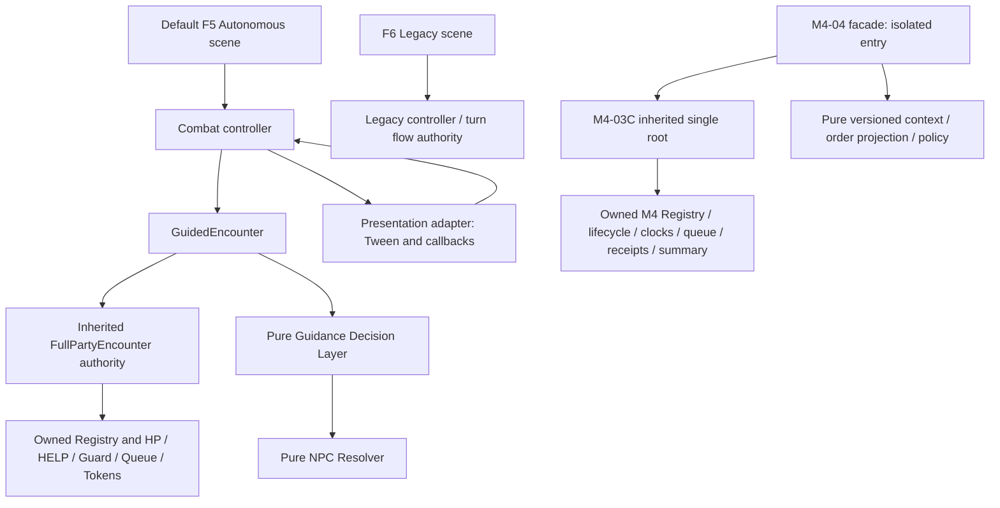
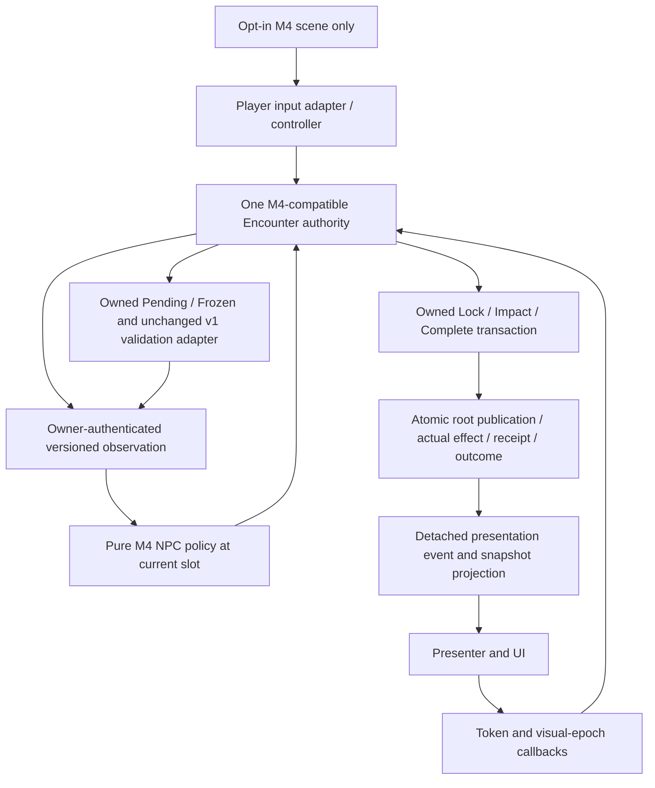

# M4-05A — Playable Integration Contract & Owner Decision Gate

**DESIGN ONLY — PROPOSED / PENDING OWNER APPROVAL.** Prepared 9 November 2026 (Asia/Bangkok). This task authorizes documentation and one Draft PR only. Every new integration rule, adapter, UI behavior, gate and scenario below is **PROPOSED**, including recommendations. No G05 decision is approved by this document; approval of design is separate from implementation authorization, visual acceptance and production cutover.

[Milestone authority](README.md#current-status-and-next-roadmap) remains the documentation index. [M4 architecture](M4_Down_Help_Death_Retreat_Architecture.md) and its historical A01–A39 matrix remain unchanged. [M4-04 §2.1](M4_04_Autonomous_Decision_Contract.md#21-owner-subdecision-approval--current-authority) retains approved isolated O1-A/O2-A/O3-A/O5-A; this proposal does not widen those approvals. Old Draft/NOT STARTED labels in historical records are not current milestone status.

## 1. Canonical preflight and evidence boundary

| Check | Observed result on 9 November 2026 |
|---|---|
| Repository / canonical | `shanwinder/wanderer` / `visual-combat-test-1` |
| Required, initial local, fetched, live canonical and merge-base | All `7ce51cd0695d844ca8e7c085ab592bd9108b1e01` |
| Prerequisite | [PR #55](https://github.com/shanwinder/wanderer/pull/55) MERGED; merge SHA exactly matches required canonical; merged 10:15:27 Asia/Bangkok; former delivery HEAD `4babe132b84e9412a27391d11a1d98ea4779962d` |
| Squash ancestry | Canonical commit has PR #54 canonical as its single parent; PR #55 metadata records seven feature commits and the one canonical merge commit |
| Cleanliness / duplicate check | Initial working tree clean; fetched branches and open PR search found no M4-05A work; unrelated #2/#17 remain open Drafts, untouched |
| Task branch | `codex/m4-05a-playable-integration-design`, created from exact required SHA |
| Commands / source | `git status --short --branch`, `git fetch origin`, `git rev-parse HEAD origin/visual-combat-test-1`, `git merge-base HEAD origin/visual-combat-test-1`, `git branch -a`, `git ls-remote origin refs/heads/visual-combat-test-1`; live GitHub PR metadata/open-PR search |
| Access retry | Initial sandbox fetch could not write Git metadata and initial live lookup lacked DNS; approved elevated retries succeeded before branch creation |

**Inherited verification, not a new M4-05A run:** [PR #55 post-rebase record](../tests/actors/evidence/m4-04/post-r54-rebase.json) names Godot `4.7.2.stable.official.ed1daf0bf`, executable `/Applications/Godot.app/Contents/MacOS/Godot`, tested source `abb0727a892127d4b43f880af5890d68859d7f86`, original focused source `6187a4ff6dea0a5a983c21171e92db53eff6cd63`, exact full verification commands, expected/actual, exits and archive references. Recorded expected and actual: canonical 88/88 and candidate 94/94 stages; focused 128 cases / 458 assertions; 0 unexpected errors/timeouts, five expected negative errors separately; Legacy 6 cases / 5,892 identical frames. These results are attributed to those tested sources, **not** a fresh execution on squash SHA or this design HEAD.

The 128-case record separates 121 pure-policy cases, five owned-transaction cases, one diagnostic and one blocked-dependency case. Real ATTACK/RESCUE/RETREAT examples are M404-124/125/126. M404-128 is a real serial Enemy second-hit SKIPPED case, not arbitrary external mutation during an action. See [coverage](../tests/actors/evidence/m4-04/coverage.json), [case index](../tests/actors/evidence/m4-04/case-index.json) and [post-rebase scenarios](../tests/actors/evidence/m4-04/post-r54/m4-04-scenarios.json). Partial/blocked design rows are not promoted to PASS. No Godot, import, parse, headless startup, gameplay, GUI, keyboard or visual acceptance was run for M4-05A.

## 2. Current architecture — inspected facts



Arrows to pure modules are computations, not additional mutable owners. M4-02 is the earlier standalone RESCUE/Clock proof; C integrates its approved semantics in C's own root and pure transition rules, **not** by wrapping a live M4-02 Encounter. Likewise M4-04 extends C directly, not production FullPartyEncounter.

| Domain / inspected sources | Implemented now | Playable integration gap |
|---|---|---|
| [Autonomous scene](../scenes/combat/combat_autonomous_optin.tscn), [Legacy scene](../scenes/combat/combat_prototype.tscn), [controller](../scripts/combat/combat_prototype.gd) | F5 inherited scene selects autonomous session; controller instantiates GuidedEncounter, owns UI drafts and visual views; Legacy uses its own original combat flow | Existing controller expects production dictionaries, token phases, command-ready and binary result UI; it is not an M4 adapter |
| [GuidedEncounter](../scripts/combat/guided_encounter.gd), [FullPartyEncounter](../scripts/combat/full_party_encounter.gd) | One inherited Registry, HP, HELP/Guard ledger, pending queue, action token, command, Pending/Frozen Guidance and fixed profiles; Guided override locks per-slot decision report | No M4 LifeState/episode/clock/terminal summary; underscore-field coupling prevents blind substitution |
| [Resolver](../scripts/npc/npc_decision_resolver.gd), [Layer](../scripts/npc/guidance_decision_layer.gd), [Guidance data](../scripts/npc/guidance_data_contract.gd) | Exact validated shapes; first still-valid declared self-hit Safety; living Player HELP≤30%; causal FOLLOWED/MATCHED_INDEPENDENTLY/REFUSED | Resolver returns PLAYER_DEFEATED at Player HP0; v1 has no RESCUE/RETREAT guidance type; cannot fake positive HP to reuse it |
| Production commands and actions | Player ATTACK/DEFEND; NPC independent decisions at their slots; Player→NPC1/2/3→Enemy order; fallback before Player ATTACK lock; resolve then complete exactly once | No Player RESCUE/RETREAT input contract; no player-less round admission; M4 queue API and token schemas differ |
| Production HELP/Guard/terminal | NPC HELP heals living Player up to +4/maxHP, consumes own one use only on positive heal; DEFEND reduces Enemy hit by 2, minimum1; Player Guard covers round, NPC Guard next hit; round-end clears guards. Player HP0→DEFEAT before checking no enemies; else no living Enemy→VICTORY | No DOWN continuation; cannot retain production terminal evaluation in an M4 authority |
| [M4-01 actor](../scripts/m4/isolated_actor_state.gd), [M4-02 owner](../scripts/m4/isolated_rescue_clock_encounter.gd) | Party ALIVE/DOWN/DEAD and PRESENT/RETREATED valid pairs; RESCUE HP1 with episode/resource binding; B2 entry grace, subsequent round-close ticks/death | Earlier standalone proof APIs are not production controller hooks; no UI or conscious consent |
| [M4-03C owner](../scripts/m4/m403_terminal_encounter.gd), [rules](../scripts/m4/m403_terminal_rules.gd), [queue](../scripts/m4/m403_queue_adapter.gd) | One root/publication; seed/journal replay validation; finite plan admission; ATTACK/RESCUE/RETREAT Lock/Impact/Complete, real receipts/dispositions; witnessed seal/close; atomic terminal freeze; Abort/Restart | Capability is fixture authority; not production input authorization. HELP/Guard absent; no dynamic unlimited round generator; Restart rejects SEALED |
| [M4-04 facade](../scripts/m4/m404_decision_facade.gd), [context](../scripts/m4/m404_decision_context.gd), [policy](../scripts/m4/m404_autonomous_decision_policy.gd), [episode projection](../scripts/m4/m404_episode_order_projection.gd) | Exact12/exact8 isolated context/output, owner-equality binding, generation-wide replay-derived episode ranking; O1/O2/O3 priorities; supported decisions delegate to C transactions | Live context publishes null HELP uses and null Frozen/Profile. Unknown HELP is not zero: relevant priority blocks. DEFEND/HELP effects blocked. Production D09 is absent |
| [Presenter](../scripts/combat/combat_presentation_adapter.gd) | Visual epoch; time/phase/identity checks; impact callback returns effect feedback; return-home before completion; no owned HP | Current generic HELP/SKIP branch does not define RESCUE/RETREAT/DOWN/DEAD visuals; outcome and lifecycle UI need reviewed mapping |

**Critical compatibility differences:** production damage Player/NPC/Enemy = **5/1/3**. M4-04 facade locks NPC ATTACK with **5**, and blocks target maxHP<5. C accepts fixture-bound attack amounts; it is not production damage policy. Preserve both existing implementations; G05-01 must select a versioned playable damage provider (recommended 5/1/3 to preserve accepted playable balance) before B. Do not silently change M4-04's isolated tests/constants or claim identical balance. C also declares each Enemy's target as first active Party at admission; production can supply scenario declarations. Target fallback/declaration mapping, finite-plan exhaustion and full-history replay cost require bounded review.

## 3. Proposed playable architecture and single authority



**PROPOSED invariant:** an opt-in session has exactly one mutable combat authority. HP, LifeState, participation, episodes, resources, Guard, queue, declarations, tokens, receipts, clock and terminal summary belong to that authority. Guidance and command admission live within its validated lifecycle domain. Pure replay scratch data, UI text caches and snapshots do not become writers. No live FullPartyEncounter inside an M4 Encounter, no two Registries synchronized by signals, no mirrored queue in the controller. Default F5 and Legacy sessions remain separate existing paths, never concurrent owners of the opt-in battle.

Preferred implementation shape: an M4-compatible authority extension with reviewed versioned rules and adapters, preserving isolated modules/tests. Whether a subclass can satisfy new ledger/journal schema without compromising replay is a **dependency**, not a promise. B must demonstrate a single publication seam and full reconstruction of new operations. If this requires changes to core C validators, provide a reviewed versioned extension rather than bypassing them or passing new fields to old exact validators.

**PROPOSED flow:** Player selects own ATTACK/DEFEND and independent Guidance draft → input adapter validates identity/readiness → Encounter accepts Guidance and admits actual Player command at proper boundary → owner advances queue → current NPC observes one revision → pure policy returns candidate/reasons → owner revalidates and locks supported choice → presenter shows locked intent → impact callback requests actual transaction → owner publishes effect/outcome atomically → view maps actual result → return animation → completion requests one owned receipt → owner advances or closes. For Player DOWN, admission uses an explicitly approved autonomous continuation operation, not a proxy command. Animation timing never authorizes an otherwise invalid effect.

**PROPOSED single-owner / no-fake-receipt proof plan:** inspect the opt-in object graph and instrument its publication seam: one active root/Registry owns each battle; controller/presenter retain no writable HP/queue/ledger. Mutating detached nested snapshots must leave the complete owner root unchanged. For ATTACK/RESCUE/RETREAT and approved HELP/DEFEND, record pre-lock, post-lock, post-impact and post-completion roots, authorization identity, journal operation and receipt set. Policy/read/lock alone produces no receipt; impact changes only the authorized effect/resources; accepted completion adds exactly one authentic receipt and one disposition. Rejection must preserve the entire root; cancel/Restart must not fabricate progress. Inject failure before publication to prove atomicity, and prove summary/receipt imports are rejected. These are B proof requirements, not results from inspecting this design.

## 4. Proposed versioned input/output adapter contract

Names below are design names, not implemented APIs or approved wire schemas. Exact recursive schemas, rejection precedence and replay journal additions must be reviewed before B implementation. Use a separate `M4PlayableAdapter v1` namespace; do not widen Guidance v1 or pretend that `owner_kind=M403_ISOLATED` authenticates a production owner.

| Boundary | Proposed inputs / provenance | Output / rejection contract |
|---|---|---|
| Session/bootstrap | Validated bounded fixture, stable retained IDs, separately held authority capability; explicit selected mode/version | One session/generation and owner-issued read view; malformed fixture leaves whole old session unchanged |
| Player command | Version, current session/generation/round/queue/expected state revision, request ID, actual Player ID, ATTACK/DEFEND and target | Admission status and accepted Player command identity; reject NPC actor IDs, unavailable Player, stale/duplicate request, busy/terminal state; no writes on rejection |
| Guidance | Unchanged exact8 v1 request via separate adapter; issuer bound to owner Player and command-ready state | Existing accepted/rejected semantics and Guidance revision; accept alone remains Pending if command admission fails; no M4 fields injected |
| NPC observation/decision | Single owned revision, real eligible slot/opportunity, episode order from authenticated history, HELP/RESCUE ledgers, immutable owner-bound Frozen/profile | Versioned candidate, exclusions and causal relation; recompute/equality validate before lock. No caller-selected NPC action or injected resource/binding |
| Transaction | Owner-built lock request; complete unmodified owned token for impact/complete/cancel; no caller result/amount override | Actual APPLIED/SKIPPED/rejected state and authoritative effect data; receipt only from accepted completion; token schema distinct from Main's token |
| Presentation view | Version, session/generation/round, state revision, action identity/phase, actor/target IDs, locked decision/relation, actual effect, lifecycle/resource snapshot, frozen outcome identity | Detached data; UI may display intent before effect but positive feedback only after APPLIED. Rejected callbacks produce no hit/heal/guard/receipt |
| Round/terminal | Owner admission, dispositions, genuine completed receipts, witness/event identities; immutable outcome ID | Natural close once or terminal/administrative stop; retained Party lifecycle and separate Enemy availability summary; not a controller-derived win/loss |

Request IDs are deduplication identities, not capabilities. UI is not allowed to invoke fixture mutations, import receipts/witnesses, alter state snapshots, choose an NPC target, or set command-ready. Proposed private adapter bookkeeping may retain token/visual correlation only; it cannot manufacture gameplay authorization. Legacy APIs remain unchanged. Test malformed versions/types/extra keys/mixed identities/caller-modified snapshots before accepting any new adapter.

## 5. Proposed lifecycle, token ownership and round admission

| Phase | Owner responsibility | Controller/presenter responsibility |
|---|---|---|
| Before lock | Validate real slot, actor/target eligibility, current revision, capability and policy; fallback only at approved pre-lock selection point | Display available commands/draft; never pop a second queue |
| Locked | Issue immutable token with session/G/R/Q/slot/action/actor/target/episode/authorization and lock revision; reserve one active action | Retain exact token and visual epoch; show intent/reason without claiming effect |
| Impact | Revalidate live actor/target/episode/use and exact token; atomic effect + resource + outcome if required; otherwise actual SKIPPED, or protocol rejection with no mutation | Forward token; show real delta and LifeState; preserve original decision reason separately |
| Completion | Only APPLIED/SKIPPED action completes; exactly one receipt/disposition/cursor handoff; causal terminal token alone may settle frozen outcome | Return to saved home; forward completion once; do not write a receipt or advance independently |
| Cancel / abort | Pre-impact cancel and its disposition are not effect/receipt; administrative abort uses genuine owned authority and freezes without tick | Kill corresponding visual callbacks; no success animation or invented completion |
| Natural close | DRAINED, no outstanding work, real progress, active sides, authenticated seal witness; close batch once, then admit a reviewed next round | UI timer/animation-end cannot tick clocks; display close results from owner |

**PROPOSED finite playable boundary:** retain a finite reviewed round plan for the first proof, with initial/next-round command admission distinct from preparation. If plan exhausts or no real progress prevents seal, display the owner's diagnostic as a bounded-proof stop; do not call it victory/defeat, invent a receipt, spin or synthesize rounds. Review exact proof duration, continuation admission and controlled recovery under G05-01/G05-03. An unbounded production scheduler is deferred. No disposed Player/NPC slot is reinserted after RESCUE; an actor may use an existing not-yet-disposed slot only under its legitimate command/policy rules.

## 6. G05-02 — proposed HELP / DEFEND effect bridge (O6)

**Option A recommended for a complete playable proof, still unapproved.** Extend the single authority with the smallest replay-validated HELP ledger and Guard ledger; do not execute these through FullPartyEncounter as a second engine. Bootstrap grants one HELP use per eligible NPC identity for the encounter and records provenance in the owner seed. Reads, copies, candidates and UI badges grant nothing; caller-provided `help_uses` rejects. HELP and RESCUE have separate ledgers and transaction kinds.

| Contract point | Proposed owner-controlled behavior |
|---|---|
| HELP selection / lock | Existing rule: NPC helps **living ALIVE/PRESENT Player** at HP≤30%, own use1; no NPC-to-NPC ordinary HELP or Player HELP command added. +4 capped at maxHP; never heal DOWN/DEAD or RETREATED actor |
| HELP impact | Validate same eligible helper, living/present Player, retained target and available use. Preserve production locked-effect rule: threshold chooses the action at slot; impact checks target availability/non-full HP and use, not a new threshold-based cancellation. Atomic positive HP delta + use1→0 + journal effect; no use on rejection/SKIPPED |
| RESCUE separation | Existing distinct DOWN episode, eligible Party helper/use and HP1 effect; HELP cannot retire a DOWN episode, spend rescue use or be relabelled RESCUE |
| DEFEND lock / impact | Self-target Player or NPC only through its rightful command/decision slot. Atomic owned Guard grant; zero HP delta is valid **Guard effect**, not fake damage/heal. No consumable HELP/RESCUE charge |
| Guard damage | Enemy damage reduction2/min1. Player Guard persists for Enemy hits that round; NPC Guard consumed by next qualifying Enemy hit. Normal round end clears Guard; repeated grants do not stack. Damage + guard consumption + DOWN/terminal consequences publish together |
| New lifecycle cleanup requiring approval | PROPOSED clear an actor's Guard when DOWN/DEAD/RETREATED, and clear remaining Guard on terminal/Restart; RESCUE does not restore a removed Guard. This is an M4 extension, not a claim that isolated C already owns Guard |
| Completion / rollback | Impact commits effect once; accepted Complete creates real receipt. Duplicate completion adds none. Pre-impact cancellation uses real disposition and spends nothing. Failure before atomic publish leaves HP/ledgers/journal/revision unchanged; never refund an already committed effect merely because animation is cancelled. Restart resets a new generation, not historical rollback |

Required O6 dependencies: versioned root/seed/journal/replay validation for both ledgers, lock/token/impact/complete operations, actual effect projection, Guard expiry/consumption and failure-injection proof. A token or pure `selected=HELP/DEFEND` is not an effect receipt. Any unsupported transition must remain blocked, not bypass replay validation.

**Option B — limited proof:** keep O6 blocked and demonstrate only supported ATTACK/RESCUE/RETREAT in explicitly labelled fixtures. Safety can select DEFEND and stop on missing effect bridge; unknown live HELP can block before nonurgent RESCUE. Never set HELP uses to zero to force fallback or silently turn DEFEND into ATTACK. Show “blocked dependency” and allow approved stop/Restart. Such a delivery cannot claim complete D08 priority execution or full playable acceptance; paired pure-policy examples remain separate. Owner must accept this reduced scope explicitly.

## 7. G05-03 — proposed Player DOWN and terminal migration

All rules in this section apply only to the proposed opt-in path after approval. Default Main retains Player HP0→DEFEAT. Preserve M4 Party valid pairs and Enemy HP-only availability.

- Player HP0 becomes DOWN/PRESENT, creates the authentic episode, loses command/Guidance eligibility; NPC/Enemy queue continues while outcome ACTIVE. DOWN does not itself mean DEFEAT if another ALIVE/PRESENT Party actor remains.
- NPC RESCUE Player or another NPC commits HP1/ALIVE, retires the exact episode, consumes helper rescue use once. DEAD and RETREATED cannot act or receive RESCUE; re-DOWN is a new episode/order. DOWN has no conscious active consent/refusal in this scope.
- RESCUE restores eligibility, not a consumed opportunity or old Player command. Player input resumes only at next valid command-ready boundary with new round/generation identity and fresh accepted input. Running-round Player slot without a legitimate accepted command must not be auto-filled; its disposition/admission rule is a G05-04 dependency.
- Natural round-close clock uses B2 entry-round grace; next valid close B1; following close B0→DEAD. No animation-time ticks, terminal ticks, Abort ticks or duplicate-close ticks. Strict seal requires active sides; clock-caused terminal is unreachable in the current strict model and remains a consistency check, not a required fabricated demonstration.

Carry forward [C classifier](../scripts/m4/m403_outcome_classifier.gd) precedence for opt-in review, without changing it silently. P = ALIVE/PRESENT Party count, E = HP-positive Enemy count, R = ALIVE/RETREATED Party count; N = initial Party size:

| Condition, in precedence order | Outcome / display |
|---|---|
| P>0, E>0 | ACTIVE; continue legal slots |
| P>0, E=0 | VICTORY; may include DOWN Party members in summary |
| P=0, R=N | PARTY_RETREAT |
| P=0, 0<R<N | MIXED_WITHDRAWAL; display those left DOWN/DEAD separately |
| P=0, R=0, E=0 | DEFEAT / MUTUAL_INCAPACITATION |
| P=0, R=0, E>0 | DEFEAT / NO_ACTIVE_PARTY |

Last-Party exit and last-Enemy hit freeze actual outcome plus summary atomically at effect; terminal causal token may finish once, later slots stop, no natural close is fabricated. No active helper means no post-terminal rescue window. Summary lists each initial Party ID exactly once with LifeState/participation/final episode relation, and each Enemy once with HP/availability; Enemy HP0 is not labelled DEAD. No permanent save/aftercare fate is inferred. Administrative ABORTED and plan-exhaustion diagnostics stay distinct from combat outcome.

## 8. G05-04 — proposed Guidance and Player command integration (D09)

Preserve Guidance v1 exact8: `schema_version`, `guidance_type`, `issuer_player_id`, `preferred_target_id`, `encounter_id`, `generation`, `round_id`, `expected_guidance_revision`. Types stay NONE/ATTACK/DEFEND/HELP/FOCUS_TARGET. FOCUS names an Enemy preference; HELP does not mean RESCUE. No NPC command input, fake Player HP, proxy Player, new Compassion effect or trait weighting.

Preserve [R1 Option A](../tests/npc/README.md#r1-option-a--current-m3a-04-contract): accepted submit (including identical content)+1; successful existing preferred-Enemy removal invalidating Pending FOCUS+1; reads/rejects/HP0/unrelated removal/freeze/round completion/terminal do not increment; Restart new generation/revision0. Retained DEAD/RETREATED IDs are not unregister events. State revision and Guidance revision remain distinct. No new lifecycle revision counter is smuggled into v1.

**PROPOSED production integration adapter:** owner binds session↔encounter identity explicitly, obtains Frozen/profile from its own store at a coherent current state revision, and supplies a separate versioned M4 observation. Existing exact isolated context validators cannot accept a new owner kind without a separately reviewed version. Delegate to unchanged v1 Layer only for genuinely compatible state (including supported roster, eligible Party and known authoritative HELP uses); otherwise use the reviewed M4 policy/relation mapping. Frozen data is an advisory historical record, never an execution grant. FOLLOWED requires a changed baseline/selected decision caused by compatible Guidance; identical independent choice is MATCHED_INDEPENDENTLY; priority refusal is distinct from request rejection or effect skip. Unsupported Guidance must be honestly NOT_APPLICABLE, never treated as consent.

| Player lifecycle / timing | Proposed command / Pending / Frozen behavior | Approval dependency |
|---|---|---|
| ALIVE/PRESENT before round | Fresh v1 submit accepted → Pending; actual successful admission alone freezes it. Failed command leaves accepted Pending visible; no pretend round start | G05-04 normal adapter/API mapping |
| Already DOWN at bootstrap or next boundary | No Player command or new Guidance; explicit autonomous admission with NONE for that round; still real NPC/Enemy opportunities | G05-03 continuation and G05-04 mapping of round preparation to admission |
| DOWN during running round after freeze | Disable commands; preserve Frozen and locked reason history for that round. NPC decides at own slot from real current state; DOWN alone no Guidance revision bump | G05-04 Frozen provenance and unsupported-state relation mapping |
| Rescued during running round | No command-ready reopening, Pending re-arm or reinsertion; preserve legitimate history, wait for next boundary | G05-04 disposition for any uncommanded Player slot; no proxy SKIP receipt |
| Next natural boundary, Player alive | Clear prior Active; new round identity and Pending NONE, then fresh request using current identity/revision | G05-04 exact round increment location: Main increments on finish; C advances on next open. Must increment once, not twice |
| Accepted Pending then external DOWN before begin | Recommended strict boundary: reject that producer atomically before life/Pending change; no same-identity invalidation. Forced diagnostic fixture stays outside command-ready flow even after HP1 | G05-04 exception gate; only valid new-generation Restart recovery for initial isolated exception, no fake round advance |
| DEAD or RETREATED Player | No new command/Guidance; other eligible actors may continue; no automatic return/revival | G05-03/G05-04; voluntary Player retreat UI remains deferred |
| Terminal / Restart | Clear Pending/Active under lifecycle contract; retain detached frozen summary until valid Restart; new G invalidates callbacks and input | G05-03/G05-06 Restart boundary review |

**Exceptional decisions still required:** legal pre-round external life producer; same-identity Pending invalidation/recovery (not approved, and any R1 extension needs its own task); accepted Player command losing eligibility before lock; Player rescued before a previously uncommanded undisposed slot; round admission when Player absent; exact compatibility/relation rules for non-v1 Party states; owner-bound Frozen/profile schema; FOCUS invalidation for future actual roster removal. Recommended bounded scope rejects unsupported producers and retains IDs. If Owner wants same-round re-entry or new Guidance types, defer them to a separately reviewed extension instead of implementing full D09 here.

## 9. G05-05 — proposed visual / user experience contract

Presentation is a data-only consumer of actual owner events. Visual choreography may anticipate **intent**, but success, HP changes, LifeState changes and resource use appear only from accepted effects. Never route RESCUE/RETREAT through an unknown-action generic branch and call it accepted animation.

| Owned state/event | Proposed visible feedback | Forbidden inference |
|---|---|---|
| ALIVE/PRESENT | Current HP, eligible state, selected/locked target cues; normal pose | HP-positive alone must not override participation/input gates |
| DOWN/PRESENT | Distinct down pose + text DOWN + actual budget/episode indicator; commands disabled for Player | Do not show DEAD, hide retained identity, or run a local countdown |
| DEAD/PRESENT | Distinct inactive/death presentation and DEAD text; no selectable rescue target | No ordinary heal/revival feedback or implied save-level permadeath implementation |
| ALIVE/RETREATED | Exit/retreat feedback then retained roster badge; absent from active target choices | Do not unregister, lose summary row or play death feedback |
| RESCUE locked / APPLIED | Intent names helper and DOWN recipient; success restores HP1/standing only on actual event, shows spent rescue use | No “+4 HELP” label or success before impact |
| RESCUE unavailable / rejected / SKIPPED | Explicit unavailable reason before lock; request rejection distinct from actual post-lock SKIPPED. Show original intent beside actual result | No fake heal, hit, resource debit or recipient-refusal wording |
| NPC RETREAT | Self-preservation reason and self action; exit only after actual effect; retained summary | No UI command forcing companion exit |
| NPC reasons / Guidance | Short Thai reason, baseline vs selected and FOLLOWED/MATCHED_INDEPENDENTLY/REFUSED/NOT_APPLICABLE from actual report; detail via keyboard-accessible log | Matching action is not proof of causal compliance; safety choice is not unconscious recipient refusal |
| HELP / Guard | Real heal amount or Guard grant/consumption/expiry; distinguish Guard effect from HP0 delta | A zero delta is not fabricated damage or a receipt |
| Terminal | Exact outcome + Party lifecycle and Enemy availability panels; causal action may finish, inputs stay locked | Do not collapse MIXED_WITHDRAWAL into victory or DOWN into DEAD |
| Restart | Clear old logs/intents/tokens/selection/summary as appropriate, reset transforms/labels from new owner snapshot, restore keyboard focus | No late old-generation visual/effect callback touching new state |

Preserve speed **0.70**, lunge **44px**, Compact Formation: NPC1 `(320,480)`, NPC2 `(405,435)`, NPC3 `(475,509)`, Player `(570,465)`, Enemy A `(970,506)`, B `(1100,424)`; actions return to saved home transforms. Any deliberate RETREAT hide/exit presentation must not shift the baseline homes. Timing/poses for new states require visual approval, not new gameplay timers. At 1280×720 provide visible keyboard focus, Tab/Shift-Tab navigation, normal activation keys, readable short Thai labels and keyboard-accessible full reasons; tooltips alone are insufficient. DOWN and terminal screens must leave Restart reachable.

## 10. G05-06 — proposed O7 interleaving and Restart safety

| Situation | Current legal basis / proposed boundary | Proof obligation |
|---|---|---|
| Mutation before Lock | Prior completed serial actions can change later slot state. Rebuild observation at slot, reject stale observed revision | Real sequence, compare selected target/episode and exact root; no cached round-start policy |
| After Lock, before Impact | C is serial; arbitrary external damage/heal/retreat producer is **unsupported**, not authorized by an animation delay | Reject unsupported producer/no mutation. If later approved, specify issuer/capability, journal/replay accounting, phase legality, impact revalidation and tests separately |
| Actual SKIPPED | Real serial first Enemy hit can make declared target unavailable before second Enemy action; C can lock that second declared hit and settle SKIPPED | Real token→SKIPPED→Complete receipt; do not describe it as external mid-action mutation |
| Pre-impact cancel | Owned cancel disposes opportunity; no impact/receipt | No resource/HP delta, no close based on fake progress |
| Callback cancelled by Restart | Valid owner reset advances generation; visual epoch changes and Tween/callables are cancelled | Inject old callback at windup/impact/return; no new-session mutation or feedback |
| Stale-generation callback | Token identity is rejected regardless of reused action number or visual state | Whole-root equality, no receipt/cursor/tick/UI effect |
| Duplicate impact/completion | Exact token phase/consumption permits once only | Two calls cannot double effect/use/receipt/advance |
| Frozen outcome | Only actual causal settled token may complete once; other work rejected/stopped; summary immutable | Terminal during effect plus late callbacks; no extra round close/tick or rewrite of summary |

**Restart nuance — PROPOSED:** validate reset before replacing the owner; after successful reset invalidate presentation epoch and render the new snapshot synchronously before any subsequent callback. Invalid reset preserves old state; do not cancel a real committed effect and invent its rollback. Current C rejects Restart in SEALED. Recommended B has synchronous owner-controlled seal→close with no await/UI callback between them; Restart requests are serviced after a legal close boundary. If that cannot be guaranteed, Owner must approve a genuine pre-issued Abort route or a separately reviewed reset extension. Do not bypass C's phase check, fabricate Abort authority or silently open a SEALED reset loophole. Test valid LOCKED/APPLIED/terminal reset and invalid SEALED reset separately; an always-responsive GUI promise remains unverified until B/C.

O7 closure requires a named **legal producer** and real history, not direct test writes to `_root`, a mocked receipt or pure altered snapshot. Pure diagnostics remain useful but cannot close a playable acceptance row. Unsupported producers remain dependency X7 below.

## 11. Owner decision register — all pending

| ID | Choices and recommendation | Compatibility / scope / risk / required decision | Status |
|---|---|---|---|
| G05-01 Single authority | **A recommended:** opt-in M4-compatible authority + reviewed Controller/Presenter/Guidance adapters. B: refactor/replace production Encounter directly | A isolates failure/rollback and preserves default; requires new APIs, schema/journal work and explicit damage/declaration/finite-round mapping. B may reuse current UI API but must migrate HP/queue/token/terminal and Guidance together, impacts all Main regression, and makes rollback broader. Neither permits synchronized HP owners. Choose A/B and resolve X1/X2 before B | PROPOSED / PENDING |
| G05-02 HELP/DEFEND O6 | **A recommended for complete proof:** minimum owner ledger/transaction bridge (§6). B: blocked limited ATTACK/RESCUE/RETREAT proof | A executes D08 priorities but adds effect/replay/Guard lifecycle risk. B smaller but cannot prove full priority flow; no fake entitlement or fallback. Choose scope and approve Guard cleanup/HELP impact semantics explicitly | PROPOSED / PENDING |
| G05-03 DOWN/terminal | Recommended opt-in Party lifecycle, C outcome precedence, real continuation and summary; retain Main outside opt-in | Approve Player-unavailable admission, no slot resurrection, finite-plan stop, exact round-close and Restart boundary. Postcombat aftercare and permanent fate deferred | PROPOSED / PENDING |
| G05-04 Guidance/D09 | Recommended separate versioned adapter and strict exceptional boundary, preserving exact8/types/R1/Pending/Frozen | Approve owner provenance, round identity mapping, no stale command re-arm and exception exclusions. Same-identity exceptional re-entry/new revision rules require separate decision/task | PROPOSED / PENDING |
| G05-05 Visual/UX | Recommended event-driven state/intent/effect/summary mapping at accepted presentation baseline | Approve new state feedback and keyboard/readability criteria; actual Godot GUI acceptance is a later gate, no visual approval from docs | PROPOSED / PENDING |
| G05-06 Lifecycle/O7 | Recommended serial legal producers, real skip, exact tokens, frozen causal completion, safe reset boundary | Approve supported producer list and SEALED handling; arbitrary mid-action mutation remains X7. Diagnostic tests cannot substitute | PROPOSED / PENDING |

Approval record must name chosen option, exceptions and dependency resolutions. Blank/“recommended” is not approval; merge of this design PR alone is not B authorization.

## 12. Dependencies, risks and rollback design

| Dependency | Unresolved work / risk | Proposed resolution boundary |
|---|---|---|
| X1 API / authority | C's fixture capability, strict seed/journal schemas and full replay are not reviewed production APIs; performance under GUI unknown | G05-01: versioned single-root extension and bounded performance evidence; no live wrapped Encounter |
| X2 balance / scheduling | NPC5 vs Main1, declared-target semantics, finite plan and Main-finish vs C-open round identity differ | G05-01/03/04: explicit playable provider recommendation5/1/3; preserve isolated5; stable order/pre-lock fallback and fixed per-round declarations; approve finite stop and admission. Dynamic scheduler deferred |
| X3 O6 | HELP provenance, Guard effect/consumption/expiry absent in C; new operations must pass replay | G05-02 A plus reviewed schema/transactions, or explicitly reduced B proof |
| X4 production D09 | Frozen/Profile live binding and command/Guidance APIs absent; exceptions could resurrect stale input | G05-04 adapter and strict exception rejection, no changed v1/R1 |
| X5 visuals | Current controller couples Legacy/Guided; generic presenter lacks explicit M4 choreography | G05-05 opt-in adapters/views and GUI/keyboard evidence |
| X6 Restart / round close | SEALED reset restriction; delayed callbacks; zero-progress/exhaustion cannot be forced through close | G05-03/06 legal synchronous close boundary or separately approved Abort/reset route |
| X7 O7 | No arbitrary mid-action external mutation producer in current serial model | Defer producer extension; prove supported serial/restart/duplicate cases honestly |
| X8 O4 / scope | Conscious consent/recipient refusal, new Player RESCUE/RETREAT commands, new traits, inventory/persistence/aftercare are absent | Separate decisions/tasks; do not expose disabled fictional functionality as completed |

**PROPOSED rollback:** opt-in selection is explicit and never changes `project.godot` default F5. On failed acceptance, stop opt-in rollout and retain existing Main/Legacy entry; do not migrate a live M4 state into FullPartyEncounter. A user chooses a fresh session through existing entry, no cross-owner HP/queue import. Keep new files isolated where possible and record any unavoidable shared diffs/tests; revert only the authorized integration change if later instructed. No automatic branch deletion, merge or promotion. Technical risk triggers HOLD: second authority, fabricated receipt, inability to authenticate resources/Frozen, changed baseline traces, unsupported mutation, unavailable reason/keyboard feedback, or unknown engine errors.

## 13. Proposed M4-05B implementation boundaries

B may begin only with recorded relevant G05 approvals, resolved blocking dependencies, reviewed exact API/task/file scope and **separate explicit implementation authorization**. This document is not that authorization.

Recommended bounded delivery: opt-in scene/path, one M4-compatible authority, player-only ATTACK/DEFEND command adapter (DEFEND only if O6 approved), independent NPC policy, actual supported transactions, explicit finite-round continuation, real state/reason/summary views and Restart safety. If O6 option B is selected, remove unsupported command/effect promises and label demo limitations; no “complete playable M4” claim. Keep current Main/Legacy, Guidance v1/R1, isolated proof modules/tests, combat baseline and all historical evidence unchanged unless a later reviewed scope explicitly permits a change. No full NPC AI, new traits, consciousness model, world lore, Speed Order/final Turn System, Player rescue/retreat UI, persistence, loot, management or Resonance.

Review in small steps: schemas/owner invariants → command and slot admission → supported decision/transaction adapters → real effect projection → lifecycle/terminal/reset → headless regressions → separate GUI acceptance. B evidence must name actual engine, tested commit, full command, expected/actual per scenario, exit/error classification, logs/results and source manifest. Run existing suite with fresh unique output:

```sh
python3 tests/combat/verify.py --godot /path/to/godot --output /tmp/wanderer-queue-check-unique
```

Use the applicable existing proof flags in [combat guide](../tests/combat/README.md) and [actor guide](../tests/actors/README.md), plus approved focused adapter coverage. Verify actual executable version 4.7.2; preserve import/parse/startup/gameplay/negative logs and results.json. Unexpected errors fail even exit0; expected five negative errors are separately accounted. Preserve A-first/B-first, dead-Enemy skips, living counters, one round completion, locks, target fallback, ATTACK/DEFEND/NPC2 Guard, terminal and Restart coverage. Never change tests/constants just to pass. Stop B at its requested review gate; no automatic C or cutover.

## 14. Proposed M4-05C acceptance matrix — all NOT RUN

C requires separately authorized **actual Godot 4.7.2 GUI inspection at 1280×720** and Owner review of the verified B candidate. Headless startup, this design, inherited isolated results and screenshots alone cannot establish pacing or owner comprehension. Record executable version, exact commit, command/entry, input sequence, expected/actual, logs and screenshot/video timestamps where useful. C gate includes baseline comparison, keyboard, animation and readable reasons. Production cutover requires a further explicit decision after B/C completion; **no automatic default F5 change**.

Every row is **PROPOSED / NOT RUN** for the future playable integration. “Current coverage” states inherited slices only; M404 numbers there refer to executed case IDs, while design-row coverage is in the linked coverage map. Required authority means runtime writer; Owner Gate column means approval needed. B = separately authorized implementation; C = visual/Owner acceptance; D = later production cutover.

| Scenario ID | Preconditions | Expected behavior (PROPOSED) | Required authority | Proof method | Current coverage | Dependencies | Owner Gate | Execution status |
|---|---|---|---|---|---|---|---|---|
| P05-01 Player DOWN continuation | Player receives legal lethal impact; NPC remains active; enemies active | DOWN, input off; real NPC/Enemy slots continue, no immediate Main-style defeat | M4 effect/queue owner | Legal headless trace + GUI state | C isolated lifecycle/queue only | X1/X2/X4/X5 | G05-01/03/04, B/C | PROPOSED / NOT RUN |
| P05-02 Rescue Player | Player DOWN B1 previous round, helper safe/use1, eligible NPC slot | NPC RESCUE before close→HP1, episode retired/use0, no reinserted command | Policy + owner rescue transaction | Real lock/impact/complete + GUI | O1 pure and M404-125 real rescue slice | X1/X2/X4/X5 | G05-01/03/04/05, B/C | PROPOSED / NOT RUN |
| P05-03 Rescue NPC | NPC DOWN, helper safe/use1; Player or other ally active | Ranked legal NPC target rescued without Player favoritism | Policy + owner episode/resource | Paired roster histories + GUI | O2 pure ranking; isolated rescue slices | X1/X2/X5 | G05-01/03/05, B/C | PROPOSED / NOT RUN |
| P05-04 Urgent vs nonurgent | Compare B1 previous, B2 previous/current; no safety | Valid B1 prior entry urgent; B2 nonurgent/grace; invalid B1 current rejected | Context/order/policy owner | Paired pure + actual transactions | O1-A/O2-A isolated coverage | X1/X2 | G05-01/03, B | PROPOSED / NOT RUN |
| P05-05 Safety first | First valid declared self-hit lethal/lowHP; rescuable ally | DEFEND before RESCUE; reason helper priority; real Guard if A, blocked if B | Policy + Guard owner | Paired decisions and actual hit consumption + GUI | Pure policy only; O6 blocked | X3/X5 | G05-02/05, B/C | PROPOSED / NOT RUN |
| P05-06 HELP before nonurgent | Living Player≤30%, NPC use1, nonurgent DOWN ally, no safety/urgent rescue | HELP selected over nonurgent RESCUE; no invented resource | Policy + HELP ledger owner | Paired priorities + real effect | Pure fixtures only; live HELP unknown blocks | X3 | G05-02, B | PROPOSED / NOT RUN |
| P05-07 NPC RETREAT | NPC≤30%, no higher priority, active Enemy | Actual self RETREAT; retained row and reason | Policy + C-compatible transaction | Real trace + GUI exit | O3 pure and M404-126 owned slice | X1/X2/X5 | G05-01/03/05, B/C | PROPOSED / NOT RUN |
| P05-08 Last Party / Enemy | Legal last-active retreat/down or last-Enemy hit; separate seed cases for ties | Exact precedence, atomic frozen summary; causal completion once | Terminal/summary owner | Legal sequences + pure tie classifier + GUI | C terminal proof; no simultaneous-hit claim | X1/X2/X5 | G05-03/05/06, B/C | PROPOSED / NOT RUN |
| P05-09 Actual HELP | O6-A approved; helper use1; living low Player | +4 capped, positive heal spends once; rejected/skipped spends none | HELP transaction owner | Boundary values, duplicate/fault injection + GUI | Production HELP exists, no M4 bridge | X3/X5 | G05-02/05, B/C | PROPOSED / NOT RUN |
| P05-10 Actual DEFEND | O6-A; Player and NPC Guard cases, repeated Enemy hits | Reduction2/min1; Player round vs NPC next hit; life/reset clears as approved | Guard/damage owner | Real grant/consumption/expiry + GUI | Production Guard exists, no M4 bridge | X3/X5 | G05-02/05, B/C | PROPOSED / NOT RUN |
| P05-11 Frozen before DOWN | Guidance accepted/frozen, Player later DOWN | Immutable Frozen/reason history, no revision bump; real M4 decisions | Guidance + lifecycle owner | Paired guidance/no-guidance trace + GUI | Pure bindings; no production D09 bridge | X4/X5 | G05-04/05, B/C | PROPOSED / NOT RUN |
| P05-12 Rescue and stale Pending | Old accepted Pending; normal next-round or isolated pre-round exception | No old Pending/Player command re-arm; exception producer rejected; fresh boundary required | Command/Guidance owner | Old request replay and root equality | Isolated diagnostic/unchanged R1 only | X4 | G05-04, B | PROPOSED / NOT RUN |
| P05-13 R1 revision safety | Submit same content, FOCUS removal, reads/rejects, DOWN/RESCUE, round/reset | Exact existing increment rules, no lifecycle revision trick; stale request rejects | Guidance owner | Existing suite plus adapter boundary cases | Existing Guidance regression only | X4 | G05-04, B | PROPOSED / NOT RUN |
| P05-14 Restart during action | WINDUP, post-impact RETURN, terminal causal lane; separate SEALED case | Legal reset new G; old callbacks inert; SEALED follows approved boundary, not bypass | Owner reset + visual epoch | Inject delayed callbacks + GUI repeat | Isolated reset and Main callbacks separately | X5/X6 | G05-03/05/06, B/C | PROPOSED / NOT RUN |
| P05-15 Stale/duplicate tokens | Old G/round/Q/action or edited token; duplicate complete | No delta/receipt/advance/tick; legitimate complete exactly once | Transaction owner | Token mutation/replay + full-root comparisons | C token tests only | X1/X3/X4 | G05-01/02/04/06, B | PROPOSED / NOT RUN |
| P05-16 Impact vs receipt | Accepted locked action, impact then completion | Effect at impact; actual receipt at completion; return animation does not reapply | Single transaction owner | Before/after roots, journal and receipt set + GUI | C and M404-124/125/126 slices | X1/X3/X5 | G05-01/02/05/06, B/C | PROPOSED / NOT RUN |
| P05-17 No fake feedback | Rejected lock; real second-hit SKIPPED; unavailable rescue | Intent may show; no hit/heal/Guard success, phantom HP or fabricated receipt | Effect owner → view projection | Actual serial skip + callback rejection + video | M404-128 serial skip; no M4 UI | X5/X7 | G05-05/06, B/C | PROPOSED / NOT RUN |
| P05-18 F5 baseline | Default project entry, baseline canonical fixtures | Guided Autonomous unchanged, damage/HELP/Guard/terminal/controls and presentation retained | Existing Main authority | Full baseline regression + F5 GUI comparison | Inherited PR #55 regressions only | X1/X5 | G05-01/05, B/C | PROPOSED / NOT RUN |
| P05-19 F6 Legacy baseline | Direct Legacy scene F6; both kill orders | Scripted ATK/GUARD and saved homes/pacing/Restart unchanged | Existing Legacy authority | Exact traces + F6 GUI comparison | Inherited 6 cases /5,892 frames only | X1/X5 | G05-01/05, B/C | PROPOSED / NOT RUN |
| P05-20 Full opt-in flow | Approved O6-A/D09/admission; bounded fixture reaches lifecycle and outcome | Real player command→NPC decisions→effects→close→terminal summary→Restart, single owner | M4-compatible owner | End-to-end automated trace + Owner play/video | Not covered by isolated proof | X1–X6 | G05-01–06, B/C; D later | PROPOSED / NOT RUN |
| P05-21 Keyboard/readability | 1280×720, normal/DOWN/terminal states, long Thai reasons | Focus visible, full reasons keyboard-readable, Restart reachable; no clipped critical state | UI reading owner views | Actual Tab/Shift-Tab/activation and comprehension check | No M4 GUI coverage | X5 | G05-05, C | PROPOSED / NOT RUN |
| P05-22 Clock/round boundary | Real progressed round with DOWN B2 entry, then later B1/B0 closes | Exactly one grace/tick/death batch; no tick on abort/terminal; distinct round admission | Clock/queue owner | Real multi-round trace + UI budget | C/M402 slices; strict seal limits retained | X2/X6 | G05-03/06, B/C | PROPOSED / NOT RUN |
| P05-23 Interleaving producer | Prior completed action vs attempted external mutation after lock | Refresh before lock; unsupported producer rejected; arbitrary interleaving stays deferred | Owner request/phase gate | Legal serial trace + rejected producer; diagnostic labelled | O7 diagnostic/deferred, serial128 only | X7 | G05-06, B | PROPOSED / NOT RUN |
| P05-24 Honest bounded stop | All opportunities cancelled or finite plan exhausted | No fake progress/receipt/tick/victory; explicit diagnostic and approved recovery | Queue/admission owner | Real no-progress/exhaustion trace + GUI | C42/C43 isolated limits | X2/X6 | G05-01/03/05/06, B/C | PROPOSED / NOT RUN |
| P05-25 Lifecycle target validity | DOWN, DEAD, RETREATED targets; repeated DOWN episode | Only current DOWN/PRESENT rescue target; new episode order; no dead/retreated action or rescue | Lifecycle/resource/queue owner | Target/episode replays + GUI target lists | M401/M402/C isolated subsets | X1/X3/X5 | G05-01/02/03/05, B/C | PROPOSED / NOT RUN |
| P05-26 Guidance causal relation | Same state with NONE vs compatible Guidance; priority conflict and unsupported state | FOLLOWED only causal change; independent match/refusal/not-applicable correctly explained | Pure policy + authenticated binding | Paired actual adapter contexts + Owner explanation | Pure M404/Layer slices only | X4/X5 | G05-04/05, B/C | PROPOSED / NOT RUN |

O6-B explicitly leaves P05-05/06/09/10/20 incomplete; blocked controls and honest diagnostic feedback can be reviewed but are not those effects passing. O7 producer expansion is not required to invent a success case; unsupported row portions remain deferred with owner-visible limits.

## 15. Proposed sequence and stop gates

| Gate | Required evidence / authorization | Does not authorize |
|---|---|---|
| M4-05A design review | Independent contract review; Owner decisions G05-01–06 and dependency resolutions recorded explicitly | Runtime implementation, visual acceptance, cutover or merge by the agent |
| M4-05B bounded implementation | Separate task/file scope and implementation instruction after relevant approvals; actual integration tests and evidence | C acceptance by implication, production cutover or default F5 change |
| M4-05C visual / Owner acceptance | Separate GUI task; exact B commit, Godot4.7.2/1280×720, F5/F6 Autonomous/F6 Legacy and opt-in, controls/reasons/animations reviewed | Production promotion by implication |
| Production cutover | New explicit Owner decision after completed playable verification and reviewed rollback | Automatic merge, branch cleanup or any broader production extension |

## 16. Documentation audit and learning notes

M4-05A changes only this new contract, [index](README.md) and [root README](../README.md). No runtime, scene, test, asset, animation, configuration, Gameplay Constant, Guidance v1/R1 or historical evidence edit. A01–A39 and O1-A/O2-A/O3-A/O5-A approval text remain unchanged. Validate relative Markdown targets/anchors, table columns, both Mermaid diagram structures, scenario IDs/required columns/status, scope and `git diff --check` before Draft delivery. Diagram review is structural/source inspection, not rendered GUI verification; external URLs are not exhaustively HTTP-tested. Actual documentation audit: **3 files, 135 local links including 54 fragments, 0 broken targets/anchors; 18 consistent tables; 26 unique sequential scenarios with required status; two Mermaid source diagrams structurally inspected (not rendered)**. `git diff --check` passed. Architecture/A01–A39 and the complete M4-04 approval contract were compared byte-for-byte against canonical and are unchanged. Scope check found only the three allowed Markdown files; no runtime/test/evidence diff. The first temporary audit script incorrectly expected the scenario ID cell to contain no title; its regex was corrected and the audit rerun successfully without changing scenarios. External references (44) were not exhaustively fetched; relevant PR state was checked live.

เรียนรู้ตาม v0.4: **Goal** อ่านผล playable ที่จะพิสูจน์ → **Concept** แยกผู้ตัดสินใจ/ผู้อนุมัติผล/ผู้แสดงภาพ → **Do** เดินตัวอย่าง Player DOWN บนกระดาษ → **Observe** ตรวจ token, HP1, resource และ receipt คนละจังหวะ → **Explain** ทำไม NPC อาจป้องกันตนเองก่อนช่วย → **Adjust** เลือก G05 และข้อยกเว้น → **Commit** เอกสารเท่านั้น. คำว่า “เลือกช่วย” ไม่ได้แปลว่า “ช่วยสำเร็จ”; คำว่า “merge isolated proof” ไม่ได้แปลว่า “เล่นและตรวจภาพแล้ว”.

**Mandatory stop:** deliver one Draft PR for Independent Design & Contract Review. DO NOT MERGE, enable auto-merge, delete branch, implement B/C, modify production/default F5 or Guidance v1/R1. O4 consent, O6 effects, O7 new interleaving producers and production extensions remain subject to their explicit gates.
