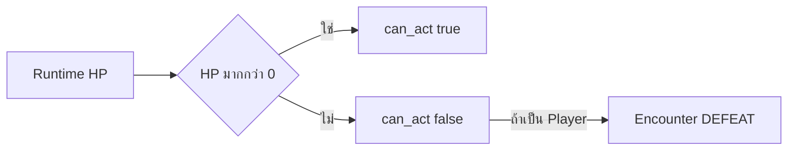
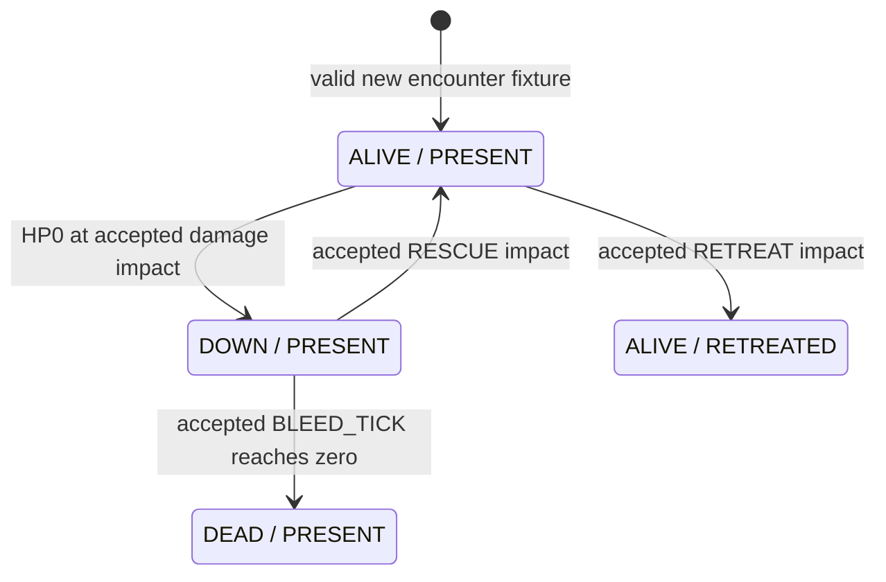

# M4 — Down / Help / Death / Retreat: Architecture & Acceptance Design

**M4 Architecture — Proposed / Awaiting Owner Review**

วันที่ 5 พฤศจิกายน 2026 (Asia/Bangkok) • **Design Only** • ทุกกฎใหม่ด้านล่าง **PENDING OWNER APPROVAL**

## 1. Executive Summary

งานนี้ได้รับอนุญาตให้ทำ **Option A: ออกแบบ M4** จากคำขอ “M4 Architecture & Acceptance Design” หลังปิด M3A-05; ไม่ใช่การอนุมัติกฎเกมหรือ implementation. [ดัชนีเอกสาร](README.md#current-status-and-next-roadmap) ยังคงเป็น Milestone Authority; ฉบับนี้เป็น specification เฉพาะ M4 ไม่ใช่ roadmap ชุดใหม่. การ merge เอกสารไม่อนุมัติ gameplay rules โดยปริยาย และต้องมีคำสั่ง merge ใหม่เสมอ.

เป้าหมายคือให้การล้ม การช่วย การเสียชีวิตใน encounter และการหนี มีผลต่อทางเลือกของ NPC และสรุปผู้รอดชีวิตได้ โดยรักษา **Player controls only themselves; NPC companions decide independently; Guidance is a suggestion, never direct control.** ผู้เล่นอาจถูกช่วย ถูกปฏิเสธ หรือถูกทิ้งไว้ แต่ต้องอ่านเหตุผลและผลที่เกิดจริงแยกกันได้.

**ข้อเสนอแนะนำ:** แยก `LifeState(ALIVE/DOWN/DEAD)` กับ `Participation(PRESENT/RETREATED)`; Encounter สั่ง transaction เดียวผ่าน Registry-owned RuntimeState; HELP คง heal เดิม และ RESCUE เป็น action ใหม่ที่ต้องอนุมัติแยก; นับ bleed-out ด้วย event `ROUND_CLOSED` หลังคิวจบครบครั้งเดียว; Retreat ใช้ slot ของแต่ละ actor และ NPC เลือกเอง. เริ่มพิสูจน์ data/state แบบแยกจาก Main ก่อนนโยบาย NPC, UI และภาพ. ตัวเลข RESCUE/bleed-out และ outcome ยังไม่ใช่ balance ที่อนุมัติ.

### ฐานที่ตรวจจริง

| รายการ | Fact ณ เริ่มงาน |
|---|---|
| Repository / canonical | `shanwinder/wanderer` / `visual-combat-test-1` |
| Actual base | `9cb5e8dced6aa6e1719b4c86c04c23c00c46ef60` ตรง expected baseline; ไม่มี HEAD ใหม่กว่า |
| Git | initial working tree สะอาด; fetch สำเร็จหลังใช้สิทธิ์เขียน Git metadata; local HEAD, remote-tracking HEAD, live `git ls-remote` HEAD และ merge-base ตรง actual base |
| PR #43 | [merged](https://github.com/shanwinder/wanderer/pull/43) ที่ `a84c8d4deaa759f0f0937e6ff58c3f4ba4612a34`: M3A-04 Implemented / Merged / Owner Accepted |
| PR #44 | [GitHub ยืนยัน merged](https://github.com/shanwinder/wanderer/pull/44) ที่ actual base: M3A-05 COMPLETED / Owner-Reported Acceptance PASS; ไม่มี independent evidence ราย scenario เพิ่ม |
| Duplicate check | GitHub open PR search พบ #2/#17; branch search M4 และ local/live remote heads ไม่พบงาน M4 ซ้ำก่อนสร้าง branch |
| Branch นี้ | `codex/m4-architecture-acceptance-design` สร้างจาก canonical actual base; ไม่รวม #2/#17 |

อ่าน [v0.1 §22–23](01_Wanderer_Game_Development_Plan_v0.1.md#22-ขอบเขต-prototype-แรก), §14, [v0.4](04_Wanderer_Learning_Development_Workflow_v0.4.md), [combat guide](../tests/combat/README.md) และ [NPC guide](../tests/npc/README.md) เทียบ source จริง. v0.1 เป็น intent เรื่อง Down/Death/Retreat; v0.3 เป็น presentation intent; v0.5 เป็น lore/proposed Resonance. ไม่แก้ historical snapshots, lore หรือ OPEN Turn System. PR #2/#17 เป็นงาน unmerged คนละขอบเขต ไม่ merge/cherry-pick.

## 2. Existing Architecture — Facts from Actual Base

ตารางนี้อ้างสิ่งที่โค้ดทำ ไม่ใช่การอ้างว่ารันทดสอบใหม่. ชื่อ method เป็นจุดตรวจ contract บน actual base; ทุก M4 impact ในคอลัมน์สุดท้ายเป็นข้อเสนอ.

| ระบบ / source | Responsibility / data ownership | Current behavior / interface | Dependency / limitation / จุดกระทบ M4 |
|---|---|---|---|
| [ActorDefinition](../scripts/actors/actor_definition.gd) | baseline identity/display/role/base_max_hp; detached read-only backing data | `create()` ตรวจ exact 4 fields; `snapshot()` copy | ไม่ถือ current HP/scene/life state; ไม่ควรยัด encounter state เข้า definition |
| [ActorRuntimeState](../scripts/actors/actor_runtime_state.gd) | mutable actor_id/current/max HP ของ instance ที่ Registry ถือ | `take_damage()` clamp ถึง 0; `heal()` clamp ถึง max **รวมเพิ่มจาก HP0 ได้**; `can_act()` คือ HP>0 | ไม่มี Down/Dead/Retreat/bleed-out; M4 ต้องกั้น heal ผ่าน lifecycle transaction ไม่ใช้ HP เป็น life authority เพียงตัวเดียว |
| [Actor Registry](../scripts/actors/actor_registry.gd) | ถือสำเนา runtime/definition/membership และ retired-ID ledger | register copy-in; `actor_snapshot()` copy-out; `fixture_damage/heal`; unregister ลบ actor และห้าม reuse ID | คัด runtime กลับด้วย HP จึงจะทำ state ใหม่หายถ้าไม่ออกแบบ copy contract; unregister ไม่ใช่ death/retreat และทำ survivor data หาย |
| [FullPartyEncounter](../scripts/combat/full_party_encounter.gd) | Registry, party/enemy order, command/queue, HELP/Guard, tokens, result, Guidance/session profiles | `restart`, `begin_round`, `begin_next_action`, `resolve_action`, `complete_action`, snapshots | sole orchestrator; fixture APIs ไม่ใช่ gameplay bypass; M4 ต้องมี eligibility/transition authority ที่นี่ |
| [GuidedEncounter](../scripts/combat/guided_encounter.gd) | production subclass ใช้ inherited authority; `_slot_report` metadata | สร้าง fresh envelope ใน `_npc_decision_for_slot`; lock report ข้าง decision; unavailable slot ยังอธิบายได้ | พึ่ง underscore fields ของ base; ไม่มี life policy; เปลี่ยน schema โดยเติม field ตรง ๆ จะไม่ผ่าน strict validators |
| [NPC Resolver](../scripts/npc/npc_decision_resolver.gd) | pure decision ไม่มี mutable HP/ledger | `decide_for_actor()` exact context/actor snapshot; Player HP0 → `PLAYER_DEFEATED`; ไม่มี enemy → SKIP; NPC unavailable → SKIP; safety→urgent HELP→ATTACK | actor ต้อง `can_act == (hp>0)`; HELP เฉพาะ Player; first still-valid declared self hit ไม่ใช่ผลรวม. M4 Player Down/NPC ally rescue ต้องใช้ reviewed extension |
| [Guidance Decision Layer](../scripts/npc/guidance_decision_layer.gd) | pure wrapper ของ baseline, causal response/profile predicates | `decide_with_guidance()` strict envelope v1; NONE เท่ากับ baseline; safety/urgent HELP มาก่อน; FOCUS/DEFEND ตาม approved predicates | capabilities exact ATTACK/DEFEND/HELP/FOCUS_TARGET; ไม่มี RESCUE/RETREAT; Compassion ไม่มีผลใหม่ |
| [Guidance data](../scripts/npc/guidance_data_contract.gd) + Encounter | exact request/profile validation; Encounter ถือ pending/frozen/revision | v1 eight required fields, types NONE/ATTACK/DEFEND/HELP/FOCUS_TARGET; submit เมื่อ command-ready; freeze หลัง begin สำเร็จ | ไม่ใช่ permission ให้ NPC ทำตาม. fixed Trust/Discipline/Courage/Compassion เป็น encounter fixtures ไม่ใช่ progression |
| Player Command: Encounter + [controller](../scripts/combat/combat_prototype.gd) `_autonomous_command()` | controller ถือ draft/selected target; Encounter ถือ accepted Player command | Player มี ATTACK/DEFEND; submit Guidance ก่อน begin_round; accept Guidance แต่ command reject ยังเป็น Pending | ไม่มี Player HELP/RESCUE/RETREAT; UI command-ready ผูกกับ Player ยังมีชีวิต; Down flow ต้องออกแบบก่อนเชื่อม |
| Combat Queue: FullPartyEncounter | `_pending` เป็น stable IDs; ไม่ precompute NPC decisions | Player→party order→enemy order; decide เมื่อถึง slot; unavailable actor มี SKIP token; Player fallback ก่อน lock; enemy declarations ล็อกต่อรอบ | ไม่มี initiative; ไม่ reinsert actor ที่ฟื้น; M4 ต้องบอก skip/eligible target ตาม action โดยคงลำดับ |
| Action Tokens / Impact / Completion: FullPartyEncounter | `_locked` เป็น authority; caller token เป็น copy | identity encounter/generation/round/action/actor; LOCKED→RESOLVED หรือ SKIPPED→COMPLETED; effect ที่ resolve; complete ปลด slot/จบรอบ | `_valid_token` ตรวจ identity ไม่ใช่เชื่อ decision จาก caller; controller ตรวจ metadata เพิ่ม. หลัง lock เป้าหมายใช้ไม่ได้ → SKIP ไม่มี retarget |
| Restart / Generation: Encounter + controller/presenter | valid candidate roster ก่อน replace; generation+1, IDs/ledgers/Guidance reset | invalid restart atomic; old token reject; presentation cancel/epoch/phase checks และคืน saved homes | ต้อง reset life/bleed/rescue ledger/summary ใหม่ด้วย; อย่าใช้ action_id อย่างเดียว |
| Victory / Defeat: FullPartyEncounter `_update_terminal()` | `_result`, command lock, pending/active Guidance | **Player unavailable ชนะลำดับตรวจ → DEFEAT**; มิฉะนั้น no available enemies→VICTORY; terminal ล้าง pending ไม่เพิ่มรอบ | ไม่สนใจ NPC ยังช่วยได้; ไม่มี survivor summary. จุดขัด intent v0.1 ต้องได้รับอนุมัติ migration ไม่เปลี่ยนเงียบ |
| Existing HELP: Resolver + Encounter | `_help_uses[npc_id]=1`; runtime HP หนึ่งชุด | Player ยัง HP>0 และ ≤30%; HELP+4 clamp; ใช้หนึ่ง slot; consume เมื่อ delta>0; ตรวจ actor/target/need/use ที่ impact | HP0 target ถูก reject ก่อน heal ด้วย reason เดิม `TARGET_DEAD_BEFORE_RESOLVE` ซึ่งชื่อ **ไม่พิสูจน์ว่า DEAD state มีอยู่** |
| Existing Guard: Encounter | `_guards[id]`; expires round end | DEFEND self ลด 2/min1; Player ทุก valid enemy hit ในรอบ; NPC next valid hit เท่านั้น | Legacy NPC2 Guard Player ลด 1/min1 เป็นคนละ rule; M4 ต้องไม่เปลี่ยนทั้งสองโดยปริยาย |
| Combat Controller / [Presentation Adapter](../scripts/combat/combat_presentation_adapter.gd) | controller ถือ views/draft/busy/local token; adapter ถือ Tween/visual_epoch/phase | `play_action()`→callback impact→actual feedback→return→complete; HP อ่าน Encounter; SKIP ไม่มี fake hit; `_autonomous_current()` เทียบ owned lock/report | ไม่มี life authority; result UI แปลงเป็น bool victory ปัจจุบันไม่รองรับ mixed outcome. HELP/อื่น ๆ branch ใน presenter ไม่ใช่ RESCUE implementation |
| [Autonomous scene](../scenes/combat/combat_autonomous_optin.tscn) / [Legacy scene](../scenes/combat/combat_prototype.tscn) / [Legacy flow](../scripts/combat/combat_turn_flow.gd) / [targets](../scripts/combat/combat_targets.gd) | Autonomous สืบ scene/controller เดิม session_mode1; Legacy state/queue/targets อีกชุด | Main Guided; F6 Legacy กฎ ATK/GUARD scripted เดิม; target alive flag ของ Legacy ไม่ใช่ M4 lifecycle | M4 ภายหลังต้อง opt-in proof ก่อน; ห้ามดึง shared state ใหม่ไปแทน Legacy โดยไม่ได้ review |

## 3. Current vs Proposed Behavior และขอบเขต

| ประเด็น | Existing runtime | Proposed M4 — PENDING OWNER APPROVAL |
|---|---|---|
| HP0 | unavailable; Player จบ DEFEAT | party HP0 → DOWN/PRESENT; NPC ยังตัดสินใจได้ถ้ามีผู้พร้อม |
| Help | heal living Player เท่านั้น | คง HELP; RESCUE สำหรับ DOWN แยก effect/resource |
| Death | ไม่มี state/timer/persistence | DOWN→DEAD ใน encounter จาก clock ที่เลือก; ไม่มี save deletion |
| Retreat | ไม่มี action/guidance/outcome | actor action; ออกจาก participation ไม่ลบ identity |
| Target | ทุก effect ต้อง target.can_act | eligibility ตาม action: ATTACK=ALIVE/PRESENT; RESCUE=DOWN/PRESENT |
| Terminal | Player unavailable ก่อน victory | พิจารณาทั้งสองฝ่าย/ผู้ยังทำงานได้ และเก็บราย actor |
| NPC | policy ที่อนุมัติเดิม | extension ที่แยก version/contract ก่อนเปิดใช้; ไม่ขยาย v1 ตรง ๆ |

**Preservation boundary:** speed0.70; short lunge44px; Compact Formation homes NPC1(320,480), NPC2(405,435), NPC3(475,509), Player(570,465), A(970,506), B(1100,424); ทุก action คืน saved home. Player/NPC/Enemy ATTACK5/1/3; HELP≤30%/+4/หนึ่งครั้งต่อ NPC ต่อ encounter; Guard ลด 2/min1 ใน Autonomous และ Legacy NPC2 ลด 1 เดิม; deterministic order/command locking; R1 Option A/schema v1; Restart generation และ Legacy differential คงเดิมทั้งหมดในงานนี้.

ไม่มี gameplay scripts/actions/policies/scene/UI/config/test assertions ใหม่; ไม่ implement inventory/equipment, Trust progression, Compassion effect, personality AI, injury system, permadeath, Speed Initiative, Final Turn System, Starstone/Resonance. ทางเลือก M4 ที่เปลี่ยน HP0/terminal/targets เป็น **proposed isolated future behavior** ไม่ใช่การเปลี่ยน baseline วันนี้.

## 4. Actor Lifecycle State Machine

### ทางเลือกโครงสร้าง

| ทางเลือก | ข้อดี | ข้อเสีย |
|---|---|---|
| A: enum เดียว ALIVE/DOWN/DEAD/RETREATED | เรียนรู้ง่าย, switch สั้น, ปิดคู่ state ผิดได้ง่าย | RETREATED บอกไม่ได้ว่าหนีทั้งที่บาดเจ็บ/Down; ข้อมูลชีวิตหายหรือซ่อนอยู่ที่อื่น; เพิ่ม rescue/carry ยาก |
| B: LifeState + Participation แยก (**แนะนำ**, D02) | สรุปชีวิตกับที่อยู่แยกกัน; ไม่สับสน death กับ unregister; รองรับ future evacuation โดยไม่ทำเป็น resurrection | ต้องตรวจคู่ state ทุก transaction; contract/copy/validator ซับซ้อนขึ้น |

**Proposed valid pairs ใน proof แรก:** ALIVE/PRESENT, DOWN/PRESENT, DEAD/PRESENT, ALIVE/RETREATED เท่านั้น. DOWN/RETREATED และ DEAD/RETREATED reject; เก็บการแบกผู้บาดเจ็บ/ศพเป็น later decision ไม่ใช่บังคับให้ลุกก่อนแบกในเกมเต็ม. หากอนุมัติ evacuation ภายหลัง ค่อยขยาย valid pairs/version; ห้าม loss of life state เพื่อแสดงว่าออกสนามแล้ว.

- `HP=0` เป็นค่าตัวเลข; สำหรับ lifecycle model ใหม่ DOWN/DEAD ต้อง HP0, ALIVE ต้อง HP>0. ไม่อ่าน HP0 ว่า DEAD โดยอัตโนมัติ.
- `Unavailable` เป็นผลของ eligibility รวม life/participation/terminal ไม่ใช่ life state.
- `Down` ยังมีโอกาสช่วย; `Dead` ปิดการช่วยใน encounter; `Retreated` ออกสนามแต่ยังอยู่ใน summary.
- `Removed from encounter` คือ roster operation อีกเรื่อง; existing unregister ลบข้อมูลและ retire ID. ไม่ใช้แทน down/death/retreat; future active encounter ไม่ควรลบ actor ที่ต้องสรุป.
- `Terminal encounter` เป็น encounter state หยุดรับ effects/slots/clock ไม่ได้แปลงทุก actor เป็น DEAD หรือ RETREATED.

### Existing runtime — ไม่มี state machine ชีวิต

ภาพนี้แสดงเพียงความสัมพันธ์ที่มีในโค้ด; `heal()` ระดับข้อมูลเพิ่มจาก 0 ได้แต่ gameplay HELP ปัจจุบันกั้นไว้. ไม่มี DOWN/DEAD/RETREATED ใน runtime นี้.

### Proposed transitions — ทั้งภาพยังรอ Owner Approval

ไม่มีลูกศร DP→AR, XP→AP หรือ AR→AP เพราะแนะนำให้ reject ใน encounter เดียว. Restart สร้าง generation/initial state ใหม่ ไม่ใช่ transition ชุบชีวิตใน encounter เก่า. enemy HP0 semantics อยู่ D14; proof แรกใช้ party actor เท่านั้น ไม่อ้างว่า enemy ได้กฎ Down อัตโนมัติ.

### Transition contract

ทุกแถว owner คือ **Encounter ตรวจและ commit ผ่าน Registry-owned RuntimeState**; validation ต้องเสร็จก่อนเขียน. `T`=owned action token identity+phase; `E`=Encounter event key `(encounter_id,generation,round_id,event_kind)` ที่ consume ครั้งเดียว. Rejected/SKIP ไม่มี HP/state/resource/clock delta. รหัส M4_* ทั้งหมดเป็น proposed reason namespace ไม่ใช่ existing API.

| Transition / trigger | Preconditions / allowed-rejected | Timing / safety | Reason / UI feedback | Future tests |
|---|---|---|---|---|
| ALIVE→DOWN จาก damage ถึง 0 | PRESENT, HP ก่อน>0, validated ATTACK; อื่น ๆ reject | Impact atomic damage+state+down-entry round+budget; T ป้องกันซ้ำ | `M4_HP_ZERO_DOWN`; “ล้ม ยังช่วยได้” แยก HP− | A01,A18,A19 |
| DOWN→ALIVE จาก RESCUE | PRESENT, valid rescuer ALIVE/PRESENT, resource>0, target ยัง DOWN | Impact atomic HP ฟื้น+life+ล้าง clock+ใช้ resource; T; completion ไม่มี heal | `M4_RESCUED`; “ช่วยให้ฟื้น” HP+ตามค่าที่อนุมัติ | A02–A04,A16 |
| DOWN→DEAD จาก bleed-out | PRESENT, clock eligible, budget ลดถึง 0; ALIVE/RETREATED ไม่ tick | `ROUND_CLOSED` E เพียงครั้งเดียว; generation ต้องตรง; ไม่รอ animation | `M4_BLED_OUT`; “เสียชีวิตในการต่อสู้นี้” ไม่เขียน save | A03,A15,A17,A23 |
| ALIVE→RETREATED จาก Retreat | PRESENT, owned self action, success predicate ผ่าน | Impact; T; ออกจาก eligibility ทันที; completion drain token ได้ | `M4_RETREAT_SUCCEEDED`; “หนีสำเร็จ” ไม่ใช่หายจาก summary | A08,A12,A20 |
| DOWN→RETREATED | reject ใน first proof; future carried evacuation เปิดตัดสินต่างหาก | ไม่มี delta แม้มี token ถูกต้อง | `M4_EVACUATION_UNSUPPORTED`; “ยังอพยพผู้ล้มไม่ได้ใน proof นี้” | A21 |
| DEAD→ALIVE จาก heal/rescue | reject ทุก HP operation ที่ไม่ใช่ valid new-session fixture | ตรวจก่อน mutate; T/E ซ้ำไม่เปลี่ยนเหตุผลชีวิต | `M4_DEAD_NOT_RESCUABLE`; ไม่มี HP+/revive visual | A03,A19 |
| RETREATED→ALIVE/PRESENT | reject re-entry encounter เดิม แม้ HP>0; ชีวิตยัง ALIVE อยู่แล้ว | ไม่มี queue insertion; old token ใช้ไม่ได้ | `M4_REENTRY_FORBIDDEN`; “ออกจากการต่อสู้แล้ว” | A20,A21 |
| ALIVE→DEAD โดยตรง / DOWN ถูกโจมตีซ้ำ | reject ใน proof แรก; v0.1 intent ให้โจมตีผู้ล้มได้ยังเป็น gap | ไม่มี bypass clock; ต้อง D14/D17 แยกก่อน full M4 | `M4_TRANSITION_UNSUPPORTED` | A22 |

## 5. State Ownership

| ข้อมูล / authority ที่เสนอ | เหตุผลและขอบเขต |
|---|---|
| ActorDefinition: immutable identity/base stats เดิม | life ไม่ใช่ข้อมูลตั้งต้นร่วม; ไม่แก้ definition เมื่อใครล้ม |
| Registry-owned ActorRuntimeState: HP + LifeState + Participation | state หนึ่งชุดต่อ ID; guarded atomic mutation/copy-in/out ต้อง preserve ทุก field; public raw heal ห้าม bypass lifecycle |
| Encounter: transition authorization, clock/entry/episode ledger, rescue/help budgets, queue, guards, terminal summary | รู้ action/token/generation/roster; RuntimeState ไม่ตัดสิน round หรือ NPC policy. clock ledger อ้าง actor ID ไม่สร้าง life state สำรองอีกชุด |
| Resolver/Layer extension: snapshots→decision/response | เสนอแผน ไม่ mutate state; ห้าม decision สร้าง death/rescue/retreat effect เอง |
| Controller: command draft, visual views, local token copy | ไม่ถือ authoritative life/HP/survivors; labels อ่าน snapshot เดียวกัน |
| Presenter: Tween/epoch/phase/feedback | completion ไม่เป็นเจ้าของเวลาตาย; visual node ที่ถูกซ่อนไม่ทำให้ actor ตาย |
| Future persistence service | นอกงาน; DEAD ใน encounter ไม่ใช่คำสั่งลบตัวละคร/ไฟล์เซฟ |

Proposed lifecycle snapshot แยก accessor/version: actor_id, HP, life_state, participation, derived can_act, down_episode_id และ clock view. down_episode_id เพิ่มเมื่อเข้า DOWN ใหม่ ป้องกัน rescue token เก่าจับการล้มครั้งถัดไป; ไม่ใช้ snapshot_revision เท่ากันเป๊ะที่ impact เพราะ damage อื่นที่ชอบด้วยกฎอาจเปลี่ยน revision. Exact field names/schema ต้อง review ใน data proof ก่อนเขียน; **ห้ามเติมลง original eight-field actor snapshot ของ Resolver v1 ตรง ๆ**.

## 6. Help / Rescue Contract

| ทางเลือก | Semantics / resource | Trade-off |
|---|---|---|
| A: HELP เลือก heal หรือ rescue ตาม target life | แชร์หนึ่ง use เดิม/encounter; threshold ของ ALIVE คงเดิม แต่ DOWN ต้อง branch ใหม่ | ปุ่มน้อย แต่ชื่อ/action เดิมแปลสองอย่าง; เสี่ยงแก้ HELP ที่รับรองและใช้ use หมดจน rescue ไม่ได้; ต้อง approval เปลี่ยน HELP โดยตรง |
| B: HELP เดิม + RESCUE ใหม่ (**แนะนำ**, D03–D04) | HELP living Player≤30%/+4/once เดิม; RESCUE target DOWN/PRESENT; หนึ่ง slot, separate budget | อธิบายและทดสอบแยกได้; เพิ่ม action/capability/UI และต้องตัดสิน resource/ค่า HP ก่อน implement |

**Recommended candidate สำหรับ later proof เท่านั้น:** RESCUE คืน 1 HP, budget 1 ต่อ helper ต่อ encounter แยกจาก HELP; ใช้ budget เมื่อ transition สำเร็จเท่านั้น. ใช้ actor slot เสมอแม้ effect SKIP; ไม่มี inventory/MP/currency. ค่าหนึ่งเหล่านี้เป็นตัวเลือกใน D03/D04 **PENDING OWNER APPROVAL**, ไม่ใช่เพิ่ม balance ใหม่แล้ว. การฟื้นไม่ให้ slot พิเศษและไม่คืน HELP/RESCUE ที่ใช้แล้ว.

ข้อกำหนดที่เสนอ:

1. ผู้ช่วยต้อง ALIVE/PRESENT และไม่ terminal ทั้งตอน lock และ impact; NPC ช่วยเมื่อถึง slot ของตน ไม่มีปุ่มสั่ง NPC. Player RESCUE เป็น future self-command ที่ต้อง review เพิ่ม ไม่อยู่ใน v1 ATTACK/DEFEND.
2. Healing ALIVE = เพิ่ม HP ไม่เปลี่ยน life; Rescue DOWN = เปลี่ยน life+HP+clock transaction เดียว; Death prevention = rescue สำเร็จก่อน tick ถึง 0 ไม่ใช่ hidden immortality/stabilization state. การ stabilise แต่ยัง DOWN เป็นทางเลือก later (D17).
3. ผลเกิดที่ **Impact**; Completion รับผิดชอบ return/handoff เท่านั้น. lock target_id และ down_episode_id; ไม่ reserve/use resource ล่วงหน้าใน serialized queue.
4. Duplicate token → reject `INVALID_TOKEN_OR_STATE` ตามกลไกเดิม; future equivalent gate ต้องคงอยู่. คนที่สองถึง slot หลังเป้าหมายฟื้น ประเมินใหม่; ถ้าล็อกแล้วแต่ target ฟื้นก่อน impact → SKIP `M4_TARGET_NOT_DOWN`, resource ไม่ลด. ห้ามทำ damage/heal/rescue ซ้ำ.
5. target DEAD ก่อน impact → SKIP `M4_DEAD_NOT_RESCUABLE`; RETREATED→`M4_TARGET_NOT_PRESENT`; down episode เปลี่ยน→`M4_DOWN_EPISODE_CHANGED`; ไม่มี fallback/resurrection. กรณีเหล่านี้ใช้ authorized fixture event ใน test; queue ปัจจุบัน serialized ไม่ได้มี simultaneous impacts.
6. helper DOWN ก่อน slot→SKIP unavailable; ล้มหลัง lock ก่อน impact→SKIP `M4_ACTOR_UNAVAILABLE`; target ยัง DOWN ตามเดิม. helper RETREATED/DEAD เช่นกัน. Completion ยังระบาย token ที่ SKIP ครั้งเดียว.
7. **NPC ปฏิเสธจะช่วย**: เป็น decision ของ helper เช่น safety ก่อน rescue, budget หมด หรือ risk สูง; log เหตุผลไม่ใช่ request error. **NPC ปฏิเสธรับความช่วยเหลือ**: ALIVE ที่รู้สึกตัวอาจมี consent policy ภายหลัง (D16); existing HELP ไม่เพิ่ม refusal ตอนนี้. DOWN ใน proof แทน incapacitated/ไม่รู้สึกตัว จึงไม่อ้างว่าผู้หมดสติเลือกปฏิเสธ; proposed rescue ไม่ต้อง consent แต่ยังรอ approval. ถ้าต้องมี conscious Down ให้แยก consent/capacity contract ก่อน ไม่เพิ่ม full injury/consciousness AI.

## 7. Bleed-out / Death Contract

### Clock alternatives

| Clock | Determinism | Queue interaction / timing ambiguity | Restart / target validity | Complexity / testing |
|---|---|---|---|---|
| ทุก Round ที่จบ | deterministic เมื่อระบุ boundary; จำนวน actor ไม่เปลี่ยน rate | ต้องแยก natural close กับ terminal abort; ล้มท้ายรอบอาจเสียเวลาทันทีถ้าไม่มีกฎ grace | generation+round key; revalidate target หลัง tick | ต่ำ–กลาง; test down ต้น/ท้ายรอบ, duplicate close, abort |
| ทุก N completed Action Slots | deterministic เมื่อ N/skip นิยามชัด | actor count/skip/retreat เปลี่ยน rate; การนับก่อน/หลัง completion สร้างความต่าง rescue | slot/event ledger; NPC อาจตายก่อน slot ช่วยได้; Restart ต้องล้าง counter | กลาง–สูง; ทดสอบทุก queue position และจำนวนสมาชิก |
| Encounter Events | deterministic หาก event whitelist+ordering ชัด | นับเฉพาะ event ที่กำหนด ไม่ใช่ทุก damage/UI event; ถ้า trigger recursive ต้อง serialize | event identity+generation+episode; target ตรวจหลัง event | กลาง; เหมาะต่อการย้าย turn model แต่ต้องพิสูจน์ no duplicate/reentrancy |

**Recommendation D05:** ใช้ Encounter event transport โดยมี clock source เดียวคือ `ROUND_CLOSED` หลัง natural exhaustion ของรอบ. นี่คือ round-count policy ที่แยกจาก UI/completion animation; ไม่ใช่เอาทุก event มานับ และไม่ผูก Final Turn System. หากอนาคตเปลี่ยน turn model ต้อง approve clock adapter ใหม่ ไม่ถือว่า Speed Initiative ได้รับอนุมัติ. ไม่มี real-time timer.

**Proposed precise ordering:** action impact commit → terminal evaluation → completion ครั้งเดียว → ถ้า pending ว่างและยัง nonterminal: emit `ROUND_CLOSED` → eligible Down actors tick ใน transaction เดียว (อ่านชุดก่อน tick) → deaths ทั้งหมด commit → terminal evaluation → ถ้ายัง nonterminal จึงเพิ่มรอบ/สร้าง NONE. Terminal จาก last enemy impact/last active departure ทำให้ abort ไม่ใช่ natural close จึงไม่ tick/เพิ่ม round completion. Terminal result ต้อง finalize หลัง effect และก่อนรับ effect ถัดไป แต่ผลหน้าจอรอ visual token settle ได้.

**Candidate budget D05/D06:** B=2 eligible closes สำหรับทุก party actor ใน isolated fixture เพื่อให้เทียบง่าย; Player ไม่มี extra time โดยปริยาย. ไม่ tick ในรอบที่เข้า DOWN (`down_enter_round == closing_round`); เริ่มที่รอบถัดไป. ตัวอย่าง NPC ล้มรอบ 3 → ปิดรอบ 3 ยัง B2 → ปิดรอบ 4 เหลือ 1 → ปิดรอบ 5 เป็น DEAD. Rescue impact ในรอบ 5 ก่อน close ทัน; หลัง tick เป็น DEAD ช่วยไม่ได้. ตัวเลข 2 และ grace เป็นข้อเสนอรออนุมัติ; v0.1 ที่ Player อาจมีเวลามากกว่ายัง OPEN.

Guardrails: tick เฉพาะ DOWN/PRESENT ใน generation นี้; E consume ครั้งเดียวต่อ round; clock ไม่ติดลบ; duplicate close/replayed tick ไม่มี delta; rescue ล้าง clock ของ episode เดิม; down ใหม่ได้ budget ใหม่ตามนโยบายที่อนุมัติแต่ resource ไม่คืน. หากไม่มี active party เลย เสนอ terminal ทันทีพร้อม Down ค้าง ไม่วนรอบเปล่าเพื่อฆ่าทั้งทีม. เมื่อ terminal หยุด clock และเก็บ Down เป็น Down; aftercare/death หลัง combat เป็น D17 ไม่ auto heal/auto kill.

Death ในที่นี้คือ encounter-local irreversible state ที่ปฏิเสธ heal/rescue; ไม่ใช่ permadeath implementation, permanent character deletion หรือข้อสรุปเรื่องคืนชีพของโลก. v0.1 lore intent ยังเดิม; วิธี persistence, corpse/carry, attack Down และ death reason อื่นยัง deferred.

## 8. Retreat Contract และ Terminal Outcome

| ผู้กระทำ | Proposed model / agency |
|---|---|
| Player | เลือก RETREAT เฉพาะตัวเองที่ command-ready; เป็นหนึ่ง action slot. ไม่ถอน NPC อัตโนมัติ |
| NPC | เลือก RETREAT เมื่อ slot ตนเองจาก state ปัจจุบัน; หนีได้โดยไม่รอ Player อนุมัติ/หนีตาม; explain เหตุผล |
| Enemy | **Open Decision D14**; แนะนำอย่าเพิ่มใน first proof; ถ้าจะเพิ่มต้องกำหนด victory/escape ผลใหม่ |
| Whole Party | outcome ที่เกิดเมื่อแต่ละคนออกสนามเอง ไม่ใช่ปุ่ม puppet ทีม. Future encounter-level withdrawal request อาจเป็นคำแนะนำเท่านั้น; ไม่เพิ่ม RETREAT ใน Guidance v1 |

**Action vs encounter request:** action ให้คิว/token/cost ชัด แต่คนท้ายคิวหนีช้ากว่า; encounter-level request สื่อเจตนาทีมง่ายแต่เสี่ยง bypass slots/agency และยกเลิก actions พร้อมกัน. แนะนำ action ใน prototype; team request รอ version ใหม่/owner review แยก.

**Success options D07:** A deterministic succeed เมื่อ ALIVE/PRESENT และ valid token (แนะนำสำหรับ bounded proof); B deterministic contest จาก declared threat/escape condition ที่ยังต้องออกแบบ. ไม่เพิ่ม random, Speed stat, movement distance หรือ chance โดยพลการ. Failure ของ B ต้องผลชัด: stay PRESENT, consume slot, no HP delta, `M4_RETREAT_FAILED`; rejection ก่อนเริ่มใช้ไม่ได้ไม่กิน slot. A ยังมี SKIP ถ้า actor ใช้ไม่ได้ก่อน impact.

**Timing / pending tokens:** successful impact เปลี่ยน participation ทันที, clear guard actor, prohibit new targets/actions; เก็บ roster/snapshot สำหรับ summary. มี token เดียวที่ active จึงปกติไม่มี action อื่นค้างพร้อมกัน; own RETREAT token ยัง complete ได้แม้ owner เพิ่ง RETREATED (completion ตรวจ phase ไม่บังคับ can_act). pending IDs ไม่ต้อง splice/reorder; ตรวจ eligibility แล้ว SKIP เมื่อถึง slot. Old ATTACK/HELP/RESCUE token ที่ปลอม/ล่าช้า effect ไม่ได้; terminal อาจล้าง pending เหมือนเดิม. ถ้าอนาคตใช้ external evacuation ระหว่าง windup ต้อง define cancel→SKIP→complete ก่อนปล่อย next slot ห้ามแค่ซ่อน node แล้วคิวค้าง.

### Proposed outcome algorithm — D10/D11

คำนวณหลัง atomic transition/tick batch; ยังไม่เรียกใช้งานใน Main. `active_party = ALIVE/PRESENT`; `active_enemy` ใช้ approved enemy availability (enemy M4 semantics ยังรอ D14). Down ยังไม่ตายแต่ทำ action ไม่ได้.

| ลำดับ | เงื่อนไข | Proposed outcome / reason |
|---|---|---|
| 1 | ไม่มี active enemy และมี active party | VICTORY / `M4_ENEMIES_UNAVAILABLE`; Down/Dead ของเพื่อนยังรายงานตามจริง |
| 2 | ไม่มี active party; ไม่มี Down/Dead party และทุก party RETREATED | PARTY_RETREAT / `M4_ALL_PARTY_RETREATED` |
| 3 | ไม่มี active party; มีคน RETREATED ร่วมกับ Down/Dead ที่ทิ้งไว้ | MIXED_WITHDRAWAL / `M4_ESCAPED_WITH_LEFT_BEHIND`; ไม่อ้างว่าหนีครบหรือช่วยทุกคน |
| 4 | ไม่มี active party และไม่มีคน RETREATED | DEFEAT / `M4_NO_ACTIVE_PARTY`; Down ไม่แปลงเป็น Dead |
| 5 | ทั้งสองฝ่ายหมด active โดยไม่มี retreat ใน atomic batch เดียว | ใช้ DEFEAT พร้อม `M4_MUTUAL_INCAPACITATION` แทน VICTORY; ต้อง owner review precedence |
| ต่อ | ยังมี active ทั้งสองฝ่าย | nonterminal แม้ Player Down/Dead/Retreated; NPCs ยังทำงานได้ |

แถว 5 เป็น specific reason ของแถว 4 ไม่ใช่ check ที่ตามมาแล้วไปไม่ถึง. simultaneous case เป็น proposed batch/fixture case ไม่ใช่บอกว่าปัจจุบันมี damage พร้อมกัน. Future Enemy retreat อาจต้อง ENEMY_WITHDRAWAL/OTHER จึงห้าม reuse bool victory ใน controller เพื่อแสดงทุก outcome เป็นแพ้.

**Player unavailable scheduling D15:** ถ้าล้ม/ตาย/หนีและยังมี active NPC ให้คิวปัจจุบันเดินต่อ; รอบถัดไปใช้ Encounter-owned autonomous continuation ไม่สร้าง fake Player DEFEND และไม่รอปุ่ม Player. Player slot SKIP; NPC เลือกเอง; enemy declarations สำหรับ future proof ให้เลือก first ALIVE/PRESENT party ตาม stable order เมื่อเปิดรอบ (ไม่มี retarget หลัง lock). Rescue ให้ Player ฟื้นหลังผ่าน slot ตนไปแล้วไม่ให้ act ซ้ำ; รับ command อีกครั้งตอน next command-ready boundary ถ้ายัง ALIVE/PRESENT. ไม่ส่ง Guidance ใหม่จาก Player ที่ Down/Dead/Retreated; last frozen round record อาจอยู่เป็น historical metadata จนจบรอบ ไม่ใช่คำสั่งจากผู้เล่นใหม่. ทั้งหมดต้อง review envelope/scheduler ไม่แก้ Resolver v1 ให้ Player HP0 ผ่านเฉย ๆ.

**Survivor summary:** Encounter freeze หนึ่ง immutable result พร้อม encounter/generation/outcome/reason/round และ row ต่อ initial roster ID: role, HP, LifeState, Participation, down/death/retreat เหตุผล, last accepted transition. มี sets disjoint ของ ALIVE/PRESENT, DOWN/PRESENT, DEAD/PRESENT, ALIVE/RETREATED; union ตรง initial roster (future unregistered ต้องมี archive row). `living_total` รวม Down และ retreated living; `escaped` นับเฉพาะ retreated; ห้ามใช้คำว่า“รอดปลอดภัย”แทน Down/left behind. UI แสดงรายชื่อและความไม่แน่นอนหลัง combat; ไม่ทำ save/world consequences. Duplicate finalize ไม่เปลี่ยน summary; Restart สร้างใหม่ generation ใหม่.

## 9. NPC Decision Priority Matrix

### Existing approved policy — ไม่เปลี่ยนในงานนี้

Current Resolver ตรวจ Player HP0/no enemy/unavailable ก่อน; self preservation เมื่อ first valid declared self hit และ(HP≤30%หรือ hit≥HP)→DEFEND; urgent HELP ให้ living Player≤30%เมื่อ use เหลือ; มิฉะนั้น ATTACK first available enemy. Layer รักษา safety/urgent HELP; HELP หมดตอน Player low ยัง baseline ATTACK; FOCUS cooperation iff Discipline=PLAN_ORIENTED **หรือ** Trust=ESTABLISHED; discretionary DEFEND ต้อง Courage=CAUTIOUS และ cooperation และ valid self hit. Compassion ไม่มี gameplay effect. FOLLOWED ต้อง action/target เปลี่ยนเพราะ Guidance; independent match ไม่ใช่ FOLLOWED.

### Proposed extension — D08, D16; ไม่มีการแก้ Resolver/Layer เดิม

| Priority | Condition | Proposed independent decision / reason | Guidance conflict / rationale |
|---|---|---|---|
| 0 | terminal / self DOWN,DEAD,RETREATED | SKIP / terminal หรือ `M4_ACTOR_UNAVAILABLE` | NOT_APPLICABLE; ห้าม dead actor กลับคิว |
| 1 | existing first-valid-hit safety predicate | DEFEND เดิม / existing reason | รักษา self-first; อาจปฏิเสธช่วย Player แม้ใกล้ death. ไม่เพิ่ม combined forecast |
| 2 | self low HP≤30%, CAUTIOUS, rescue ไม่มีทางทำก่อน eligible death หรือไม่มี valid rescue target | candidate RETREAT / `M4_SELF_PRESERVATION_RETREAT` | เพิ่มเงื่อนไขใหม่ต้อง review; ถ้าช่วยทัน priority 3 มาก่อน candidate นี้; ไม่ทำให้ low HP อย่างเดียวเปลี่ยน policy เดิมโดยไม่ได้อนุมัติ |
| 3 | DOWN ally มี budget 1, helper/resource พร้อม และไม่มี priority 1; priority 2 ใช้ไม่ได้เมื่อช่วยทัน | RESCUE / `M4_URGENT_RESCUE` | มี ATTACK suggestion ก็ปฏิเสธเพื่อช่วย; exact response ต่อ RESCUE ยังต้อง version design ไม่เรียก HELP follow โดยอัตโนมัติ |
| 4 | living Player≤30%, HELP พร้อม | HELP เดิม / `PLAYER_LOW_HP_HELP` | urgent HELP เดิมคง; competing rescue ที่ไม่ urgent อยู่ priority 5 |
| 5 | nonurgent DOWN ally; helper พร้อม | RESCUE / `M4_ALLY_DOWN_RESCUE` | ใหม่; recommendation เริ่ม shared situation rule ไม่ใช้ Compassion |
| 6 | ไม่มี rescue/help ที่ทำได้ และมี candidate RETREAT ตาม approved predicate | RETREAT / `M4_SELF_PRESERVATION_RETREAT` | refusal/survival อธิบาย state/resource; ห้ามสุ่ม personal refusal |
| 7 | ไม่มีเหตุฉุกเฉิน | approved ATTACK/FOCUS/discretionary DEFEND ตามเดิม | ใช้ existing causality เมื่ออยู่ v1 supported behavior |

Priority2 เป็น conditional preemption สำหรับกรณีช่วยไม่ทันหรือทำไม่ได้เท่านั้น; ไม่ให้ NPC เลือกสอง action. หาก priority 3/5 candidate ใช้ไม่ได้ ให้ reason_details บอก no resource/invalid target แล้วประเมินต่อ; ไม่คืน RESCUE ปลอมที่ทำไม่ได้. **Multiple Down ranking:** budget ต่ำสุดก่อน → down-enter sequence เก่าก่อน → stable party order เป็น tie-break; Player ไม่สำคัญกว่า NPC โดยอัตโนมัติ. เลือก target ใหม่ทุก slot; คนแรกช่วยแล้วคนถัดไปเห็น state ใหม่. Ties/targe tranking เป็น D08 รอ approval.

**Refusal distinctions:** helper เลือก DEFEND/RETREAT แทนช่วย = independent choice พร้อมเหตุผล; recipient declines conscious aid = D16 อีก contract; request rejected = schema lifecycle error; effect SKIP = target/resource เปลี่ยนหลัง lock. ไม่รวมทั้งสี่แบบเป็น“NPC ไม่เชื่อฟัง”. Player Guidance ไม่แทน policy; แยก baseline action, selected action, guidance_response, actual effect ไว้เหมือนแนวคิดเดิม.

**Traits:** Trust/Discipline/Courage ใช้เพียง approved predicates เดิมใน v1; Courage RETREAT เป็นข้อเสนอใหม่ข้างบน. Compassion HIGH อาจเลือกช่วยเสี่ยงกว่าเป็น Option B ใน D08 แต่ **ไม่มีผลใหม่ที่อนุมัติ**; ไม่เพิ่ม threshold, trust delta, persistent relationship, utility AI หรือ personality tree. Recommendation คือพิสูจน์ situation priority ก่อน trait delta และให้ owner อธิบาย paired case ได้.

## 10. Token / Queue / Lifecycle Safety

| ความเสี่ยง | Proposed contract / authority | Test |
|---|---|---|
| duplicate damage/heal/rescue | Encounter-owned LOCKED token resolve ได้ครั้งเดียว; state+HP+resource ใน transaction เดียว; เปลี่ยน phase ก่อน external feedback/reentrancy | A04,A18 |
| unauthorized resurrection | Runtime guard ทุก heal/rescue ต้อง life eligible; DEAD→ALIVE reject; Registry copy ต้อง preserve LifeState; fixture gate ไม่เป็น public gameplay bypass | A03,A19 |
| actor กลับเข้าคิวหลัง death | queue เก็บ IDs เดิม; slot revalidate; ไม่ insert เพิ่มเมื่อ rescue; RETREATED/DEAD ไม่ actor-eligible | A05,A20 |
| dead/retreated target | action-specific predicates ทั้ง lock/impact; target lock ไม่ retarget; RESCUE ดู episode ด้วย | A03,A04,A20,A22 |
| old callback หลัง Restart | encounter+generation+round+action+actor+owned phase; UI epoch/metadata ยังตรวจเพิ่ม; event key มี generation | A14–A18 |
| completion ติดเพราะ owner retreated/target dead | completion ตรวจ valid owned token และ RESOLVED/SKIPPED ไม่ใช้ can_act เป็น gate; ไม่มี effect ใหม่ที่ completion | A08,A15,A20 |
| guard ค้างข้าม Down/Retreat | recommend clear own Guard ใน accepted transition และ round end; ไม่ consume guard จาก invalid hit | A18,A22 |
| double death/clock | E/idempotency ledger, down_episode, batch eligible views ก่อน tick; ไม่ tick terminal abort | A03,A17,A23 |
| queue unlock เร็ว/round ซ้ำ | no edit ระหว่าง round รวม handoff; final close once หลัง all slots; terminal drain ไม่ increment | A11,A17,A23 |
| guidance ค้างกับ actor ออกสนาม | frozen metadata ไม่ grant eligibility; active profile/actor อ่านตาม ID; pending expiry ตาม issuer/round/lifecycle ที่ review; ไม่ unregister retreated เพื่อล้าง data | A09,A20,A24 |
| summary ขัด state | Encounter freeze หลัง atomic terminal evaluation; initial roster partition ครบ; UI อ่าน summary ไม่ recompute จาก sprite/HP | A10–A13,A23 |

**Order of validation at proposed impact:** authenticate owned token/phase → encounter generation/terminal → actor life+participation → action-specific target+episode → resource/preconditions → atomic commit/phase update/revision → terminal evaluation → snapshot feedback. Invalid caller payload ต้องไม่ replace owned decision/response. State changes ที่เกิดจาก valid unrelated event ไม่อนุญาต caller retarget. Stale event/callback ต้องหยุดก่อน HP/resource/Guidance revision.

**Restart transaction:** validate candidate ทั้ง roster/lifecycle/clock ก่อน replace; failure ไม่ cancel หรือเขียนส่วนใดใน Encounter. เมื่อ success generation+1 แล้ว reset life,clock,episode,resources,queue,guard,summary,pending/frozen,Guidance rev0; controller cancel Tween/epoch/clear views อย่าง coherent. อย่า reset global persistent character โดยใช้ fixture Restart.

## 11. Guidance Integration Boundaries

**v1 คงเดิมครบ 8 fields:** schema_version, guidance_type, issuer_player_id, preferred_target_id, encounter_id, generation, round_id, expected_guidance_revision. Types NONE/ATTACK/DEFEND/HELP/FOCUS_TARGET เท่านั้น. preferred_target เป็น enemy ID สำหรับ FOCUS ไม่ใช่ ally rescue target. HELP ไม่แปลว่า RESCUE โดยปริยาย; ไม่เพิ่ม RETREAT/RESCUE ลง schema/capabilities หรือเปลี่ยน meaning ในงานนี้.

**R1 Option A คงเดิม:** accepted submission รวมเนื้อหาเดิม+1; existing command-ready unregister preferred Enemy ล้าง Pending FOCUS+1 ก่อนเขียน NONE; reads/rejects/HP0/unrelated removal ไม่เพิ่ม; freeze/completion/terminal ไม่เพิ่ม; Restart generation ใหม่/rev0. [Exact current contract](../tests/npc/README.md#r1-option-a--current-m3a-04-contract).

**Proposed compatibility path D09:** retained roster ของ DEAD/RETREATED ไม่ใช่ unregister; v1 known-enemy preference ยังเป็น data ที่รับได้ แต่ห้ามเลือกเป็น effect target เมื่อ ineligible. FOCUS unavailable ที่ slot→NOT_APPLICABLE; หลัง lock effect→SKIP; frozen report ยังคงคำตัดสินเดิม. ไม่มี Guidance revision bump จาก life/participation. Future NPC extension ต้องแยก versioned life context/capabilities adapter ที่ไม่ส่ง unknown fields เข้า Resolver/Layer เดิม. Full M4 integration อาจต้อง Guidance version ใหม่;ต้อง review และ approval ก่อน ไม่สัญญาว่า wrapper เดิมรองรับ RESCUE แล้ว.

Player issuer ออกจาก active participation: recommendation expire Pending ด้วย lifecycle lock โดยไม่เพิ่ม revision (Down ก็ไม่รับ submit ใหม่); Frozen ของรอบเดิมเป็น record อ่านอย่างเดียวจน close/terminal. ห้ามใช้ expiry เพื่อรับ request เก่าใน round เดิม: eligibility ตรวจ issuer ก่อนและ command lock อยู่; ฟื้นแล้วรับใหม่เฉพาะ next boundary/round identity ใหม่. กฎ expiry ใหม่นี้ยังเป็น D09/D15 ไม่ใช่แก้ R1 code วันนี้. NPC retreat ไม่ต้องล้าง team Guidance ทั้งชุดหรือ profile archive ของคนอื่น; filters กันเฉพาะ actor นั้น. Enemy retreat ยังไม่ implement; หากเลือกให้ล้าง preferred content แบบใหม่ต้อง approval revision contract แยก.

## 12. UI / Feedback Design — Proposed Only

ใช้ logical 1280×720 และ accepted formation/pacing เดิม. ไม่สร้าง node/layout/animation ในงานนี้. แนวทาง future UI:

- Actor row แยก “HP”, “สถานะชีวิต”, “อยู่ในสนาม/หนีแล้ว” เพื่อ HP0 ไม่ดูเหมือนตายแน่นอน; Down แสดง “เหลือ N รอบที่นับได้” และ grace ชัดเจน ไม่แสดงวินาที.
- Intent “ช่วยให้ฟื้น→NPC2” ต่างจาก “รักษา→Player”; ที่ impact แสดง actual transition/HP delta/resource หรือ “ช่วยไม่ทัน: เสียชีวิตก่อนเกิดผล”. SKIP ไม่มี heal flash/ลุก/hit ปลอม.
- Reason อ่านว่า “ป้องกันตัวก่อน เพราะรับการโจมตีถัดไปไม่ไหว” / “เลือกช่วย Player ก่อนโจมตี” / “เลือกหนีเพื่อเอาตัวรอด”; ปฏิเสธรับ aid แยก helper refusal. ไม่สื่อว่า Player สั่ง NPC สำเร็จ.
- Player Down/Dead/Retreated: controls ตัวเอง/Guidance ปิด; แสดง NPC กำลังตัดสินใจต่อ; Restart ยังมี. Rescue Player แล้วไม่เปิดปุ่มกลางคิว.
- หนีสำเร็จมี status และ log ก่อน fade/hide; death ไม่มี automatic delete. UI result แสดง outcome หลายแบบและ rows ทุก actor; Down left behind ยังเป็น Down.
- Short Thai ข้อความหลัก; detail/reason code ใน tooltip/log; keyboard focus ต้องทดสอบจริง; ไม่ใช้สีอย่างเดียวแยก state. visual transition ใช้ authoritative snapshot ไม่ timer เขียน state.

Future manual gate ต้อง record engine/commit/command(entry)/expected-actual และ screenshots/video ที่ 1280×720; ตรวจ 0.70pacing,44px lunge,saved homes,intent/target,down/rescue/death/retreat readability,keyboard/Thai text. Headless PASS ไม่ใช่ visual acceptance.

## 13. Acceptance Matrix — Future Scenarios, NOT RUN

ทุกแถวเป็น **Proposed expected result** ภายใต้ recommended options; ถ้า owner เลือกต่างให้แก้ design matrix ก่อน implement ไม่แก้ tests เพื่อให้ PASS. ใช้ fixture ที่กำหนด life/HP/budget/declared hits/token อย่างชัด. “No policy”หมายถึง data/effect proof ไม่เรียก Resolver. Codes M4_*ยัง proposed. Existing protocol rejection คงใช้ reason เดิมเมื่อเหมาะสม.

| ID / scenario | Preconditions | Action / Event | Expected State | Expected Decision | Expected Effect | Expected Reason | Regression Risk |
|---|---|---|---|---|---|---|---|
| A01 HP0→Down | party ALIVE/PRESENT HP 3 | valid enemy impact 3 | HP0 DOWN/PRESENT, B2, entry round ปัจจุบัน | locked ATTACK เดิม | damage ครั้งเดียว+Down; ไม่ DEFEAT ถ้ามี NPC พร้อม | M4_HP_ZERO_DOWN | HP0/terminal |
| A02 Rescue ทัน | Player DOWN B1; NPC พร้อม/use 1; ไม่มี safety | NPC slot แล้ว impact ก่อน close | Player ALIVE HP 1, clock clear | RESCUE Player แทน ATTACK | rescue use 1→0; HELP เดิมไม่ลด | M4_URGENT_RESCUE/M4_RESCUED | Player HP0 resolver gate |
| A03 ช่วยช้า | target DOWN B1 รอบก่อน; authorized close event ถึง 0 | fixture lock ก่อน death แล้ว late impact | DEAD HP0 | locked RESCUE ไม่เขียนใหม่ | SKIP, use ไม่ลด, ไม่มี revive | M4_BLED_OUT; M4_DEAD_NOT_RESCUABLE | clock/token race |
| A04 duplicate/rescue episode | valid RESCUE impact เคยสำเร็จ | replay token; อีก helper ล็อก old Down; new Down episode | ฟื้นแค่ครั้งเดียว; new Down ไม่ถูก old token ช่วย | later helper fresh slot เลือกใหม่ | replay reject; old target SKIP/use ไม่ลด | INVALID_TOKEN_OR_STATE / M4_TARGET_NOT_DOWN / M4_DOWN_EPISODE_CHANGED | duplicate effect |
| A05 helper ตาย/ล้มก่อน slot | NPC มี pending ID; fixture transition DOWN/DEAD ก่อน slot | begin_next_action | target ยัง DOWN; helper ใช้ไม่ได้ | SKIP | HP/resource 0 delta; queue เดิน | M4_ACTOR_UNAVAILABLE | dead actor queue |
| A06 NPC เลือกช่วย Player | Player DOWN B1; NPC healthy; suggested ATTACK | NPC slot | Player ฟื้นเมื่อ impact | RESCUE อิสระ; conflict metadata จาก reviewed extension | use ลดครั้งเดียว; attack ไม่เกิด | M4_URGENT_RESCUE | agency/Guidance causality |
| A07 NPC ปฏิเสธจะช่วย | self HP 3/10 valid self hit 3; Player DOWN B1 | NPC slot | Player ยัง DOWN, NPC guard | DEFEND self | guard เดิมลด 2/min1; rescue use ไม่ลด | SELF_LOW_HP_THREAT + rescue blocked by safety | self-first/first hit |
| A08 NPC หนีอิสระ | NPC≤30% CAUTIOUS, no rescuable ally/no existing threat; predicate อนุมัติ | own RETREAT slot impact | ALIVE/RETREATED HP เดิม | RETREAT แม้ Player ยังอยู่ | ไม่ถอน Player/NPC อื่น; own complete ได้ | M4_SELF_PRESERVATION_RETREAT/M4_RETREAT_SUCCEEDED | NPC agency/token completion |
| A09 หลายคน Down | ally X/Y B1, entry sequence ต่าง; helpers 2 | helper 1 แล้ว helper 2 slots | X ฟื้นก่อน, Y ถูกประเมินใหม่ | rank budget→entry→stable order | ไม่ช่วยคนเดิมซ้ำ; separate budgets | M4_URGENT_RESCUE | precomputed decisions |
| A10 last enemy defeated | active party 1, Down ally 1; last enemy HP≤attack | accepted impact | VICTORY; ally ยัง DOWN | locked ATTACK | enemy HP0; clock ไม่ tick จาก terminal abort | M4_ENEMIES_UNAVAILABLE | kill order/clock |
| A11 both kill orders | M4 off/base fixture และ Legacy | A-first/B-first หลายรอบ | existing expected HP/round/result | baseline เดิมทุก slot | dead skips/living counters/once close | existing reasons | damage/fallback/queue |
| A12 party-wide Retreat | party ทุกคน ALIVE; NPC เลือกหนีเองตาม fixture policy | self RETREAT ทีละ slot | ทุกคน ALIVE/RETREATED; PARTY_RETREAT | คนละ independent decision | no forced team effect; pending drain | M4_ALL_PARTY_RETREATED | false whole party control |
| A13 retreat ทิ้งเพื่อน | Down 1/Dead 1; last active party RETREAT | valid impact | MIXED_WITHDRAWAL; Down ไม่ตายเพิ่ม | self RETREAT | summary escaped/left behind ตรง roster | M4_ESCAPED_WITH_LEFT_BEHIND | summary partition |
| A14 Restart ระหว่าง Rescue | helper LOCKED windup / post impact / return | valid Restart แล้ว delayed callbacks | exact new fixture/gen+1, resources reset | ไม่มี old decision ใน new session | old impact/complete ไม่ mutate HP/state | INVALID_TOKEN_OR_STATE | reset/visual cleanup |
| A15 Restart ระหว่าง death | DOWN B1; close event queued / death committed ก่อน UI | Restart และ old tick/visual completion | new fixture ALIVE; no old death/summary | no old slot | generation reject; no char/save deletion | proposed stale event / token reject | event generation |
| A16 helper ล้มหลัง lock | RESCUE LOCKED; authorized fixture makes helper DOWN | impact แล้ว complete | helper DOWN; target DOWN | immutable RESCUE แต่ effect SKIP | no resource/HP delta; completion ครั้งเดียว | M4_ACTOR_UNAVAILABLE | token stuck |
| A17 stale/duplicate close | DOWN B2 eligible; saved E/gen | close ซ้ำ; old round event; Restart old E | ลดหนึ่งครั้งใน eligible current close | No policy | round/clock/death ไม่ซ้ำ | proposed duplicate/stale event | round completion |
| A18 duplicate combat/guard | existing ATTACK/HELP/DEFEND; target changes life | duplicate impact/invalid hit | HP/guard/resource สอดคล้อง | locked decision เดิม | accepted impact ครั้งเดียว; invalid hit ไม่ consume Guard | existing token/target reason | damage 5/1/3 HELP4 Guard |
| A19 unauthorized heal | DEAD, DOWN และ ALIVE targets; copies retained | heal/rescue wrong state; mutate copies/register copy | DEAD ไม่ฟื้น; DOWN ต้อง RESCUE; copies ไม่ write authority | No policy | reject atomic; lifecycle ไม่หายตอน copy | M4_DEAD_NOT_RESCUABLE / proposed invalid heal | raw heal HP0/copy |
| A20 target Retreated | ATTACK/RESCUE ล็อกแล้ว fixture authorized exit / own RETREAT resolved | impact หรือ late callback/next slot | retreated ไม่ target/act, own completion สำเร็จ | immutable decision หรือ SKIP slot | no hit/no heal/no queue insertion | M4_TARGET_NOT_PRESENT / M4_REENTRY_FORBIDDEN | target fallback หลัง lock |
| A21 invalid transitions | DOWN/DEAD/RETREATED และ correct generation | Down→retreated / dead→alive / reentry | unchanged | No policy | rejection ไม่มี partial HP/resource | M4_EVACUATION_UNSUPPORTED / M4_DEAD_NOT_RESCUABLE / M4_REENTRY_FORBIDDEN | lifecycle invariant |
| A22 Down ถูกเล็ง | ALIVE target ล้มหลัง ATTACK lock; no Down attack approval | impact และ next target selection | DOWN ไม่ถูกโจมตีซ้ำใน proof | locked ATTACK SKIP; future lock เลือก eligible | no HP delta/Guard consumption | proposed target ineligible | v0.1 gap/target validity |
| A23 defeat/mutual/batch | last active party ล้ม; หรือ batch both sides unavailable | atomic commit/close batch | DEFEAT; Down ยัง Down; mutual reason เมื่อเข้าเงื่อนไข | no future actions | one frozen result, no empty round ticks | M4_NO_ACTIVE_PARTY / M4_MUTUAL_INCAPACITATION | terminal precedence |
| A24 Guidance compatibility | v1 request/FOCUS known HP0 หรือ retained unavailable ID; removed ID; frozen round | submit/reads/removal/Restart และ actor slots | R1 revision เดิม; lifecycle filter blocks effect | v1 unchanged; extension แยก | no Guidance type new/no effect on retired actor | STALE_GUIDANCE_REVISION / TARGET_UNAVAILABLE / UNKNOWN_GUIDANCE_TARGET | R1/eight fields |
| A25 Legacy differential | unchanged PR39 reference+new future proof branch | full runner and traces | original Legacy HP/queue/visual states | scripted ATK/NPC2 GUARD | 6 cases/5,892 frames เทียบ baseline; inherited checks ไม่ลด | existing exact trace contract | shared controller/adapter |
| A26 Player Down continuation | Player DOWN และ NPC ALIVE; round จบ nonterminal | auto next boundary; NPC rescues Player ภายหลัง | ไม่รอ Player button; หลังฟื้นรับ input next boundary | Player SKIP; NPC independent | no fake DEFEND/no extra turn; new declaration valid | M4_ACTOR_UNAVAILABLE / M4_RESCUED | scheduler deadlock |
| A27 consent/refusal meaning | helper healthy; target ALIVE conscious หรือ DOWN incapacitated | proposed aid decision/impact | ALIVE consent ตาม option; DOWN ไม่มี fabricated refusal | helper refusal แยก recipient refusal | ไม่แปลง request reject เป็น NPC refusal | D16 reason contract ต้อง review | consent/UX ambiguity |
| A28 retreat failure alternative | ถ้า owner เลือก contest Option B; actor ALIVE | RETREAT fails at impact | ยัง PRESENT HP เดิม | locked RETREAT | consume slot เท่านั้น, no hidden attack | M4_RETREAT_FAILED | unreviewed success rule |

ทุก scenario ต้องมี actual expected comparison/token/event trace เมื่อ implement ไม่ใช้ PASS จากตารางนี้. Existing regression ยังต้องทั้ง enemy kill orders, dead skips/living counters, command locking, fallback ก่อน lock, ATTACK/DEFEND/Legacy NPC2 Guard, victory/defeat/Restart และ five expected negative errors. Future visual acceptance แยกจาก data/headless proof.

## 14. Open Decision Register

ทุกแถวสถานะ **PENDING OWNER APPROVAL** รวม Recommendation และค่าตัวเลข; owner อนุญาตเพียง design task. Dependencies เป็นเงื่อนไขออก implementation task ไม่ใช่อนุมัติงานต่ออัตโนมัติ.

| Decision ID | Question | Existing Behavior | Option A | Option B | Recommendation | Trade-offs | Dependencies | Owner Approval Status |
|---|---|---|---|---|---|---|---|---|
| D01 | HP0 คืออะไร | unavailable; Player DEFEAT | HP0→DOWN ก่อน | HP0→DEAD/inactive ทันที | A สำหรับ party M4 | เปิด rescue แต่เปลี่ยน terminal | D02,D06,D10 | PENDING OWNER APPROVAL |
| D02 | Down ownership/model | Runtime HP only | combined enum | split Life/Participation ใน owned runtime, Encounter authorize | B | คู่ state/copy validation เพิ่มแต่ summary ชัด | Registry copy/version | PENDING OWNER APPROVAL |
| D03 | Rescue semantics/HP | HELP+4 living Player | overloaded HELP | separate RESCUE, candidate 1 HP | B | action/schema ใหม่; ไม่เปลี่ยน HELP เดิม | D01,D04,D09 | PENDING OWNER APPROVAL |
| D04 | Help/Rescue limits | HELP 1/NPC/encounter | share HELP budget | separate RESCUE 1/helper/encounter, consume on success | B เป็น candidate | เพิ่ม resource state/loop risk; ไม่ใช่ inventory | D03,episode guard | PENDING OWNER APPROVAL |
| D05 | Bleed-out clock | ไม่มี | round close event, candidate B2+entry round grace | every N slots หรือ whitelisted non-round events | A | cadence ผูก prototype แต่ adapter ย้ายได้ | D06,D10,D15 | PENDING OWNER APPROVAL |
| D06 | Death transition | ไม่มี | budget 0→encounter DEAD, no heal | Down คงอยู่/เสถียรจน post combat | A เฉพาะ isolated proof หลัง approve | consequence จริงแต่ไม่ perm delete; ต้อง grace/threshold | D05,D17 | PENDING OWNER APPROVAL |
| D07 | Retreat success | ไม่มี | self action deterministic valid→success | threat/escape contest | A สำหรับ proof | ง่ายแต่ไม่ final challenge/balance | D10,D15 | PENDING OWNER APPROVAL |
| D08 | NPC rescue/retreat priority | safety→HELP→ATTACK | situation matrix/tie-break §9 | trait weighted risk/Compassion | A | เรียนรู้ง่าย; personality ยัง deferred; Courage Retreat ต้อง approve | D03,D05,D07,D09 | PENDING OWNER APPROVAL |
| D09 | Target/queue/Guidance invalidation | can_act only; strict v1/R1 | retained roster+action eligibility+versioned extension | unregister exit actors+rewrite v1 schema | A | ต้อง archive/compatibility work แต่ไม่เสีย summary | D02,D10,D15 | PENDING OWNER APPROVAL |
| D10 | Terminal outcome | Player unavailable→DEFEAT first | active party/enemy+mixed outcome §8 | preserve Player immediate defeat | A สำหรับ M4 isolated | จำเป็นต่อ NPC ช่วย Player Down; migration ใหญ่ | D01,D07,D09,D15 | PENDING OWNER APPROVAL |
| D11 | Survivor summary | Player/enemy HP result UI | frozen all actor partition พร้อม Down/left behind | summarize alive count only | A | ข้อมูลมากแต่ไม่หลอกว่า Down รอดปลอดภัย | D02,D10 | PENDING OWNER APPROVAL |
| D12 | First implementation scope | ไม่มี M4 runtime | isolated data/state/atomic proof ก่อน | full Main/UI/NPC พร้อมกัน | A | feedback ภาพช้ากว่าแต่ review ความเสี่ยงทีละชั้น | D01,D02 และ explicit new task | PENDING OWNER APPROVAL |
| D13 | Down→Retreated | ไม่มี carry/evacuation | reject first proof | carried evacuation แยก action/consent/resource | A ชั่วคราว | ไม่ครอบคลุม lore intent การแบก; ไม่ลืมชีวิตผู้หนี | D02,D07,D17 | PENDING OWNER APPROVAL |
| D14 | Enemy Down/death/retreat | enemy HP0 unavailable | preserve enemy HP0; no enemy Retreat ใน first proof | lifecycle ทั้งสองฝ่าย+enemy escape | A สำหรับ first proof; full M4 ต้อง review B | asymmetric prototype แต่ไม่เพิ่ม enemy AI เอง | D01,D10,enemy behavior approval | PENDING OWNER APPROVAL |
| D15 | Player unavailable/clock advance | immediate DEFEAT; input starts round | automatic NPC continuation/no Player command | stop/suspend ที่ Player Down | A เมื่ออนุมัติ M4 queue proof | scheduler/Guidance expiry/declared targets ใหม่ | D08,D09,D10 | PENDING OWNER APPROVAL |
| D16 | Refusal/consent | HELP ไม่มี recipient refusal | helper agency; Down incapacitated no active consent | conscious Down/recipient consent policy | A สำหรับ first proof | ไม่จำลอง refuse aid ทั้งหมด; full requirement ยัง open | D03,D08,capacity definition | PENDING OWNER APPROVAL |
| D17 | Down attack/stabilize/aftercare | ไม่มี | defer; terminal freezes Down as Down | attack Down/partial stabilize/post combat consequence | A สำหรับ first proof | ยังไม่ครบ v0.1§14; ไม่ auto heal/auto kill | D05,D06,D10,D13 | PENDING OWNER APPROVAL |

## 15. Recommended First Proof และ Implementation Breakdown

**Proposed เท่านั้น:** ลำดับนี้แตกงานภายใต้ M4 design ไม่ใช่ roadmap คู่ขนาน; authority สถานะยังอยู่ index. ไม่มี task ใด Implemented/Approved และห้ามเริ่มใน PR นี้.

| Proposed task | Reviewable scope / prerequisite | Acceptance / stop gate |
|---|---|---|
| Proposed M4-01 — Data / State Proof | หลัง owner เลือก D01/D02/D12 และออก implementation task; RefCounted isolated model, lifecycle pairs, HP invariants, copy isolation, encounter authorization; ใช้ fixture-authorized transitions ไม่ add production actions | A01,A19,A21; Main/Legacy/Resolver/Layer/scene/UI ไม่เปลี่ยน; owner อธิบาย HP0 vs Down vs Dead vs Retreated ได้; stop Draft review |
| Proposed M4-02 — Atomic Effect / Clock Proof | ต้อง D03–D06,D09,D13,D17; isolated rescue effect/episode/resource, round event clock/death, token/generation/restart; fixture event ไม่ใช่ player button | A02–A05,A14–A19,A22; no resurrection/duplicates; no UI; tests/evidence ครบ; stop review |
| Proposed M4-03 — Queue / Retreat / Outcome Proof | ต้อง D07,D10,D11,D14,D15; isolated stable queue, unavailable Player continuation, actor exit และ summary | A08–A13,A20,A23,A26,A28 ตาม option; no Guidance types ใหม่; stop review |
| Proposed M4-04 — Autonomous Decision Extension Proof | ต้อง D08/D09/D16 และ versioned input/response contract; pure paired cases: rescue/refusal/retreat/conflict | A06,A07,A09,A24,A27; ไม่แก้ v1/Compassion เอง; causal reason ชัด; stop review |
| Proposed M4-05 — Playable Integration / UI / Visual Acceptance | owner สั่งแยกหลัง proof ก่อนหน้าผ่าน; controller/presenter/Guidance adapter contracts reviewed; production cutover ไม่ implicit | A14–A26 และ existing full regression; actual engine/commit/logs/exit/results/source hashes; F5/F6 Autonomous/F6 Legacy 1280×720 และ owner comprehension; stop Draft และ owner acceptance |

แนะนำให้ออกงาน **Proposed M4-01** เท่านั้นเป็นก้าวแรกหลัง review ไม่รวม bleed-out, RESCUE action, NPC policy หรือ visual เข้า data foundation เพื่อให้ดู“เล่นได้”ทันที. หาก implementation ต้องใช้ test-only model/fixtures ต้องระบุใน task ใหม่ ไม่สร้าง script หรือ test ใน design PR นี้. Decisions ส่วนที่ยังไม่ใช้เลื่อน review ได้ แต่ห้าม hard code pending rule แล้วเรียกว่า approved.

## 16. Risks / Dependencies / Verification Record

**Known risks:** HP0 เดิมกับ Player DEFEAT ขัด rescue window; raw heal/copy สูญ life ทำ resurrection; strict schema ทำ unknown fields พัง; inherited underscore coupling; controller รวม Legacy/Guided/UI และ result bool; clock grace/terminal precedence ทำ down มีเวลาต่างกัน; no active party clock freeze ยังไม่ใช่ post combat fate; separate budgets/repeated Down อาจทำ survival loop; declared hit เดิมเป็น first hit ไม่ใช่ forecast; consent/attack Down/carry/enemy exit ยังไม่ครบ full vision. เหล่านี้เป็น design risks จาก inspection ไม่ใช่ test failures ที่ค้นพบใหม่.

**Dependencies:** Owner เลือก critical decisions และออก task implementation แยก; versioned context/capability plan ก่อน NPC integration; approved enemy/Player unavailable scheduler ก่อน terminal cutover; Godot actual version และ fresh regression evidence ก่อน runtime PR; owner play/keyboard/visual acceptance ก่อน merge presentation. ไม่ต้องรอ Final Turn System เพื่อ review data แต่ไม่ถือว่า prototype clock settles ระบบนั้น.

**Inherited Evidence — ไม่ใช่ผลรัน M4:** [PR #43](https://github.com/shanwinder/wanderer/pull/43) ทดสอบ source `5e54b6f5bcc5ada73cbd07c4dbdeca99256d2378` ด้วย engine `4.7.2.stable.official.ed1daf0bf`; executable และ exact commands อยู่ใน [run-record](../tests/combat/evidence/m3a-04/run-record.json) และ [reproduction guide](../tests/combat/README.md#verification-and-durable-evidence). Expected เดิมคือทุก stage ผ่าน ไม่มี unexpected errors และ Legacy ตรง baseline; recorded actual คือ **64/64 stages PASS, 34 focused Main cases / 507,851 checks**, zero unexpected errors/timeouts, negative suite มี five expected errors แยกต่างหาก, Legacy **6 cases / 5,892 frames identical**, **97/97 source hashes matching** ใน record เดิม. Per-frame checks ไม่ใช่ independent cases. [Results](../tests/combat/evidence/m3a-04/final-results.json), [logs/exits](../tests/combat/evidence/m3a-04/logs.zip), [trace comparison](../tests/combat/evidence/m3a-04/trace-comparison.json). ไม่อ้างว่ารันทดสอบ merge commit หรือ M4 แล้ว.

**Current documentation verification:** ตรวจ git diff/scope, local Markdown links/anchors, cross references/state invariants/transition timing, current milestone status และ approval boundaries, inherited source SHA-256 manifest และ `git diff --check`; **ผลตรวจเอกสาร:** Markdown 14 ไฟล์, local links 285 รายการ (fragment links 63), broken links 0, table-width errors 0; decisions 17 / future scenarios 28 / Mermaid 2 ภาพครบ; source hashes ตรง manifest เดิม 97/97; `git diff --check` ผ่าน. ตัวเลข source hashes เป็น integrity check ไม่ใช่ผลรัน engine ใหม่. เปลี่ยนเฉพาะ root README/docs index/spec นี้. ไม่มี gameplay/scene/config/assets/test assertion/balance/evidence JSON-ZIP diff. **Godot/import/parse/runtime/full regression/F5/F6/keyboard/visual acceptance: NOT RUN ในงานนี้** เพราะ documentation only. Matrix§13 เป็น future test design ทั้งหมด; source integrity check ไม่ใช่ runtime verification. Owner overall M3A-05 PASS คง attribution/ข้อจำกัดเดิม.

## 17. Learning Notes

ใช้วงจร [v0.4](04_Wanderer_Learning_Development_Workflow_v0.4.md): **Goal** ให้เจ้าของอ่านสถานะแล้วทำนายผลได้ → **Concept** แยกค่าข้อมูล/ผู้มีสิทธิ์เปลี่ยน/เวลาที่ผลเกิด → **Do** ใน design นี้เดินตัวอย่างบนกระดาษ ไม่เขียน Godot → **Observe** เทียบตาราง/คิว → **Explain** อธิบาย reason/decision/effect แยก → **Adjust** เลือก Open Decisions → **Commit** เฉพาะเอกสาร; implementation แต่ละ proof ค่อยทำวงจรใหม่หลังได้รับงาน.

1. **HP ไม่ใช่ชีวิต:** เลข 0 บอกปริมาณที่เหลือ แต่ Down กับ Dead ให้สิทธิ์ rescue ต่างกัน. ลองถามว่า HP0 สองคนทำไมคนหนึ่งช่วยได้อีกคนช่วยไม่ได้.
2. **Owner ไม่ใช่ observer:** Label เห็นว่าล้มไม่ได้แปลว่า Label เขียน state ได้; Encounter รู้ token/คิวจึงอนุญาต, Runtime เก็บผล, Presenter แสดงผล.
3. **Decision ไม่ใช่ Effect:** NPC เลือกช่วยตอน slot ได้ แต่ target ตายก่อน impact ทำให้ SKIP; เหตุผลเดิมยังจริงตามข้อมูลตอนตัดสินใจ ไม่ควร rewrite ให้เหมือนไม่เคยอยากช่วย.
4. **Impact ไม่ใช่ Completion:** ช่วยสำเร็จที่ impact; การเดินกลับ/animation จบไม่ heal อีกครั้ง. ให้เจ้าของวาดเวลา lock→impact→return→complete และแทรก Restart ทีละจุด.
5. **Generation คือขอบเขต session:** action_id1 ในเกมเก่ากับเกมใหม่ไม่ใช่ action เดียวกัน; event clock ก็ต้องมี generation เหมือน callback.
6. **Life กับ Participation เป็นสองคำถาม:** “ยังมีชีวิตไหม” และ “ยังอยู่สู้ไหม”; NPC หนีแล้วยังมีชีวิตและต้องอยู่ summary ไม่ใช่ unregister จนข้อมูลหาย.
7. **Autonomy ต้องทดสอบคู่กรณี:** healthy NPC ช่วย Player Down เทียบ NPC ที่กำลังรับ lethal hit ป้องกันตนเอง; Player ส่งคำแนะนำเหมือนกันได้ผลต่างพร้อมเหตุผล. อย่าเรียกทุก match ว่า FOLLOWED.
8. **Clock ต้องมี boundary:** ล้มท้ายรอบ 3 ตาม candidate grace ยัง B2; ลองนับรอบ 4/5 และใส่ rescue ก่อน close 5. หากนับไม่ตรงกันแสดงว่า contract ยังต้องปรับก่อน coding.
9. **Design ไม่ใช่ Approval/Verification:** Mermaid กับ expected table ช่วยคิด ไม่ทำให้ transition ได้รับอนุมัติหรือ tests ผ่าน. Owner ต้องเลือก Dxx; future task ต้องเก็บ actual results และข้อจำกัดเอง.

**Mandatory Stop:** ส่ง Draft PR สำหรับ owner review แล้วหยุด. **M4 Architecture — Proposed / Awaiting Owner Review.** ไม่ merge/auto-merge ไม่เริ่ม M4 Runtime/Scene/UI/NPC Policy หรือ milestone อื่น.
